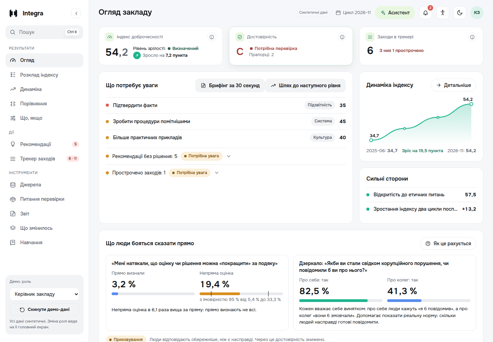
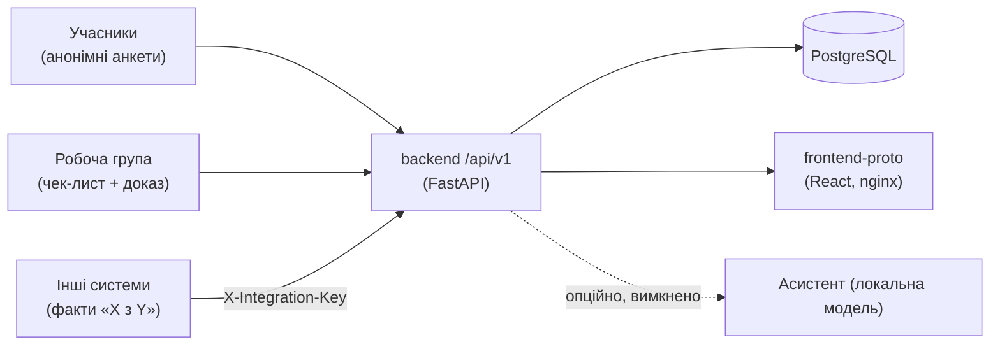

# Integra: цифрова система оцінювання доброчесності

**Команда White Hedgehogs · Завдання 3. Оцінювання стану доброчесності**

Інформаційно-аналітична панель, яка показує керівникові стан доброчесності й підказує, що вдосконалювати першим.



Екрани: [розклад індексу](docs/img/dashboard-explain.png), [самооцінка проти фактів](docs/img/dashboard-compare.png), [рекомендації](docs/img/dashboard-recs.png), [трекер заходів](docs/img/dashboard-tracker.png).

## Проблема і користувач

Оцінювання стану доброчесності в органах сектору безпеки й оборони зараз проходить кількома кроками, і на кожному є слабке місце:

1. **Респонденти** (особовий склад, експерти, курсанти) заповнюють опитування. Вони не певні, що відповіді анонімні, тому часто
   обирають ті, за які їх не можна притягнути до відповідальності.
2. **Робоча група** збирає відповіді й матеріали з підрозділів. Дані переносять вручну, і вони можуть загубитися чи змінитися.
3. **Уповноважена особа** зводить усе в Excel і пише звіт. Це займає тижні, тому повторні оцінювання й порівняння в динаміці
   роблять рідко.
4. **Керівник** отримує звіт, але не завжди розуміє, що з ним робити й з чого починати.

Цифрового рішення, яке охоплює весь цей ланцюг, практично немає.

## Що робить рішення

Integra пропонує п'ять ідей, на яких тримається оцінювання.

### Індекс доброчесності

Інтегральний показник (Integrity Index, далі просто індекс) показує стан системи доброчесності за шкалою від 0 до 100 і п'ятьма
рівнями зрілості за Моделлю НАЗК. Він складається з трьох компонентів:

| Компонент | З чого складається (приклади показників) |
|---|---|
| Культура | відкритість до обговорення етичних питань, особистий приклад керівників, готовність повідомляти про проблеми без страху |
| Система | зрозумілість процедур, доступність каналів звернень, захищеність тих, хто повідомляє, якість внутрішніх документів |
| Підзвітність | прозорість рішень керівництва, оприлюднення результатів перевірок, відповідальність за виконання заходів |

Бал компонента збирається з чотирьох джерел: анкети особового складу (вага 35 %), робочої групи (25 %), зовнішніх експертів (20 %)
і контрольного чек-листа (20 %). Індекс це середнє трьох компонентів, але рівень не може перевищувати рівень найслабшого компонента
більш ніж на один. Кожне число на екрані показує правило, за яким його пораховано, тож уповноважена особа бачить усі критерії
й загальний висновок.

### Хвилі оцінювання

Оцінювання проходить хвилями. Хвиля має початок, строк і склад учасників, а після закриття її результат фіксується незмінним
знімком. Так хвилі можна порівнювати між собою й перевіряти, чи заходи за минулою хвилею дали ефект. У нормативних документах
такого терміну немає, тож «хвиля» це наша пропозиція.

### Самооцінювання з перевіркою фактами

Пропонуємо збирати самооцінку від різних груп і звіряти її з показниками, які можна перевірити в інших системах: скільки проведено
навчань, скільки декларацій подано вчасно, скільки перевірок завершено. Якщо самооцінка вища за факти більш ніж на один рівень
зрілості (це 25 балів зі 100), індекс обмежується фактами, а достовірність результату знижується (A, B або C).

### Як ми захищаємо дані й результати

**Анонімність**
- Відповідь зберігається окремо від факту участі, зв'язку між ними немає.
- До закриття хвилі відповіді лежать зашифрованими (AES-GCM, ключ поза базою даних), тож їх не прочитає й адміністратор БД.
- Групи менш ніж з 5 відповідей не показуються, а малу групу не можна вирахувати різницею з більшої.
- Пройти опитування можна без облікового запису: за одноразовим посиланням або QR-кодом. У базі лишається лише хеш токена,
  а самі запити не потрапляють у журнали.

**Захист від підміни результатів**
- Склад учасників фіксується з моменту створення хвилі, підрозділ і категорію не змінити до її закриття.
- Результат закритої хвилі зберігається незмінним знімком разом із версією методики.
- Пункти чек-листа й статус «виконано» підтверджуються лише файлом-доказом із контрольною сумою.
- Журнал дій має ланцюжок хешів, який можна перевірити, а мітку журналу можна винести назовні.
- Привілейовані дії, як-от нові облікові записи чи відкриття хвилі, підтверджують двоє (принцип двох осіб).

**Безпека**
- Паролі встановлюються лише за одноразовим запрошенням, є ліміт спроб входу, а при виході токен відкликається.
- Права розділені за ролями: керівник бачить лише агрегати груп, технічний адміністратор не бачить результатів оцінювання.
- Профіль `production` вмикає всі запобіжники разом.

### Рекомендації й заходи

Дашборд не лише показує стан, а й пропонує перелік заходів за явними правилами. Рішення ухвалює посадова особа, кожен захід має
відповідального й строк, а наступна хвиля перевіряє, чи він дав ефект.

### Асистент

У системі є й ШІ, але лише як помічник: локальний асистент пояснює пораховані числа й терміни та допомагає з текстом. Висновків і
рекомендацій він не формує, а за замовчуванням вимкнений. Зовнішні адреси моделі заблоковані без явного дозволу.

### Що змінюється порівняно з ручним порядком

| Було | Стало |
|---|---|
| Анкети зводять вручну | Анонімна анкета за QR-кодом, зведення автоматичне |
| Рівні рахують в Excel | Індекс за явними правилами, кожне число показує своє правило |
| Відповідям важко довіряти | Звірка з фактами з інших систем, достовірність A / B / C |
| Звіт за Додатком Г готують тижнями | Звіт у Word, Excel або CSV одним кліком |
| Невідомо, хто що виконав | Захід має відповідального й строк, «виконано» лише з доказом |

## Демонстрація

- Відео (до 3 хвилин): **ПОСИЛАННЯ_НА_ВІДЕО**
- Покроковий сценарій для самостійної перевірки: [`docs/demo-scenario.md`](docs/demo-scenario.md)

## Як запустити

Потрібні Git і Docker з Docker Compose v2. Порти 8080 і 8000 мають бути вільні.

1. `git clone https://github.com/caaaaanek/hack-4-bitec.git && cd hack-4-bitec`
2. `cp .env.example .env`
3. У `.env` заповнити три значення: `POSTGRES_PASSWORD` (будь-який пароль), `JWT_SECRET` (від 32 символів, наприклад
   `python -c "import secrets; print(secrets.token_hex(32))"`), `DEMO_PASSWORD` (від 8 символів).
4. `docker compose up --build`. Перший запуск триває кілька хвилин.
5. Відкрити http://localhost:8080 і увійти як `leader` з паролем `DEMO_PASSWORD`. Інші ролі: `admin`, `coordinator`, `department`,
   `auditor`, `wg1`, `staff01`, `expert1`.

Запуск без Docker та інші режими: [`docs/run.md`](docs/run.md).

## Документація

Усе лежить у `docs/`:

| Файл | Про що |
|---|---|
| [`docs/demo-scenario.md`](docs/demo-scenario.md) | сценарій для самостійної перевірки |
| [`docs/integrity-index.md`](docs/integrity-index.md) | методика індексу: формули, пороги, приклад розрахунку |
| [`docs/dashboard.md`](docs/dashboard.md) | блоки дашборда керівника на демо-даних |
| [`docs/recommendations.md`](docs/recommendations.md) | приклади рекомендацій і заходів |
| [`docs/anonymity.md`](docs/anonymity.md) | як захищена анонімність, модель загроз |
| [`docs/cross-check.md`](docs/cross-check.md) | порівняння самооцінки з об'єктивними показниками |
| [`docs/time-savings.md`](docs/time-savings.md) | економія часу порівняно з ручним порядком |
| [`docs/integration-map.md`](docs/integration-map.md) | на яких наявних ІС рішення працює як модуль |
| [`docs/abuse-analysis.md`](docs/abuse-analysis.md) | можливі зловживання й запобіжники |
| [`docs/ecosystem.md`](docs/ecosystem.md) | зв'язок з іншими рішеннями у сфері доброчесності |
| [`docs/ai.md`](docs/ai.md) | як ми використали ШІ |

Додатково:

- [`docs/architecture.md`](docs/architecture.md): структура репозиторію і модулі.
- [`docs/role-workflows.md`](docs/role-workflows.md): що робить кожна роль у хвилі оцінювання.
- [`docs/features.md`](docs/features.md): додаткові модулі автоматизації.
- [`docs/backend.md`](docs/backend.md): ролі, модель даних, API.
- [`docs/run.md`](docs/run.md): усі способи запуску й демо-логіни.
- [`docs/api/`](docs/api): контракт API. [`docs/contracts/`](docs/contracts): контракти інтеграцій.
- [`docs/img/`](docs/img): скриншоти. [`docs/raw/`](docs/raw), [`docs/md/`](docs/md), [`docs/tools/`](docs/tools): джерела хакатону й скрипти конвертації.

## Як влаштовано



Структура репозиторію, модулі й розташування логіки: [`docs/architecture.md`](docs/architecture.md).

### Звідки беруться висновки

Бали, рівні, достовірність, рекомендації й статуси дають явні правила або підтверджує людина. Модель ШІ в розрахунках не бере участі,
тож той самий вхід завжди дає той самий результат. Основні правила:

```
Самооцінка компонента = 35 % особовий склад + 25 % робоча група + 20 % експерти + 20 % чек-лист
Рівень за фактами     = частка «X з Y» за порогами, від 1 до 5
Правило реальності    = самооцінка не вища за факти більш ніж на 25 балів
Індекс                = середнє трьох компонентів, але не вище за найслабший + один рівень
```

| Висновок | Як визначається |
|---|---|
| Група відповідей | враховується, якщо в ній не менше 5 людей; інакше випадає, а її вага ділиться між рештою |
| Достовірність | A: прапорців немає; B: один-два незначні; C: хоча б один серйозний або три незначні (низька участь, великий розрив між групами, «надто ідеальні» анкети) |
| Рекомендація | спрацьовує за явним правилом, має пріоритет і заходи з Додатку Д |
| Рішення й статус заходу | ухвалює посадова особа, «виконано» лише з файлом-доказом |
| Сигнали ризику | дають ознаку для перевірки, а не висновок про людину |

Повна методика: [`docs/integrity-index.md`](docs/integrity-index.md).

## Що використали

- **Код:** Python 3.13, FastAPI, SQLAlchemy 2, Alembic, PostgreSQL 16, PyJWT, python-docx, openpyxl (повний перелік у
  `backend/requirements*.txt`); React 18, Vite, шрифт Onest (SIL OFL); nginx, Docker Compose; pytest, GitHub Actions; діаграма Mermaid.
  Ліцензії відкриті.
- **Методика:** Рекомендації НУОУ (Додатки Б, В, Г, Д), Модель зрілості НАЗК, умова завдання 3. Опційно відкриті API Prozorro
  і реєстру декларацій НАЗК (`EXTERNAL_FETCH_ENABLED`).
- **Дані:** лише синтетичні, реальних персональних і службових даних немає.
- **ШІ в продукті:** Gemma (Google, відкриті ваги) локально через Ollama або шлюз із ключем. Інструменти розробки описано в
  [`docs/ai.md`](docs/ai.md).

## Ліцензія

[MIT](LICENSE)
