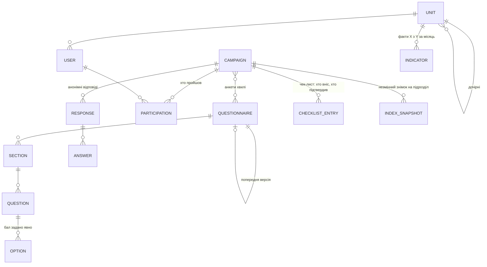
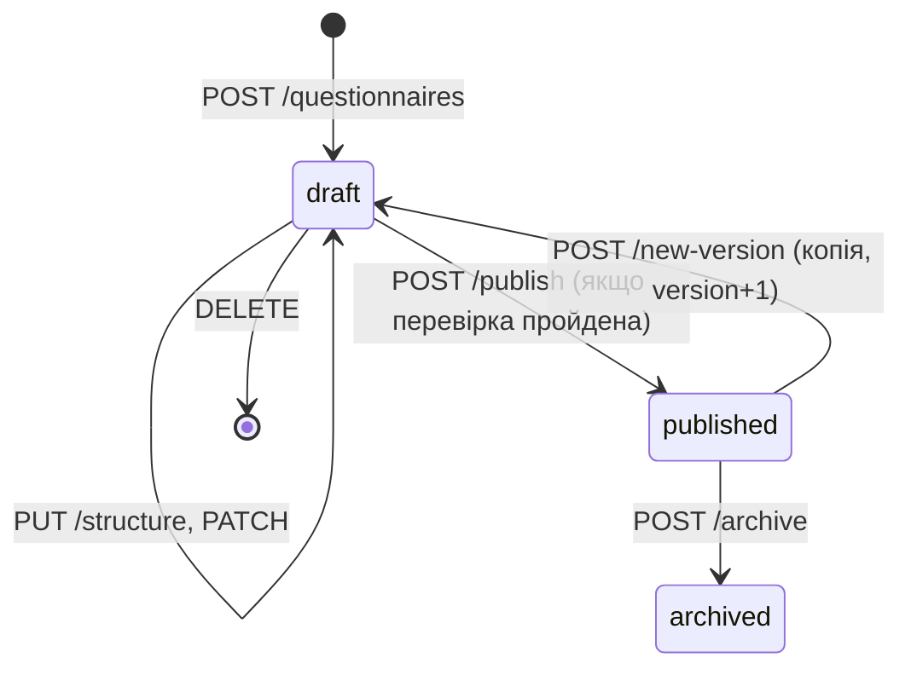

# Backend: опитувальники, конструктор анкет, ролі, Integrity Index

Стек: Python 3.13, FastAPI, SQLAlchemy 2, PostgreSQL 16, Alembic, JWT. Працює без зовнішніх хмарних сервісів і без ШІ.

## Ролі

| Роль | Хто це | Що може |
|---|---|---|
| `admin` | Адміністратор системи | Користувачі та їхні ролі, підрозділи, хвилі оцінювання, прогрес проходження, журнал дій. Анкети лише переглядає, і лише опубліковані (щоб обрати їх для хвилі) |
| `commissioner` | Розробник анкет | Створює й редагує чернетки анкет, публікує, створює нові версії, архівує. Підтверджує пункти чек-листа за доказами (вносить їх робоча група, тож вносить і підтверджує завжди різні люди). Не керує користувачами й хвилями |
| `respondent` | Учасник оцінювання | Бачить свої призначені анкети, проходить їх, бачить узагальнені результати. Член робочої групи ще й вносить чек-лист |

Категорія респондента (`category`) визначає, яку анкету він отримує:

| Категорія | Анкета | Джерело |
|---|---|---|
| `working_group` | Анкета 1 + вносить контрольний чек-лист | Додатки В і Б |
| `staff` | Анкета 2 | Додаток В |
| `expert` | Анкета 3 (ті самі питання, що в Анкеті 1) | Додаток В |

Права перевіряє залежність `require_roles(...)` у `app/security.py`. Кожен маршрут явно перелічує дозволені ролі.

**Розподіл обов'язків.** Хто складає анкети й бали (`commissioner`), той не запускає хвилі й не бачить прогресу. Хто запускає хвилі (`admin`), той не може змінити анкету під бажаний результат. Будь-яка зміна опублікованої анкети можлива лише як нова версія і потрапляє в журнал дій.

## Модель даних



- **Підрозділ** (`unit`) — лише `id`, `name`, `parent_id`. Типів немає, ієрархію будь-якої глибини задає адміністратор.

- **Анкета → розділ → питання → варіант.** Розділ має `component` (`culture`, `system`, `accountability`, `overall`, `checklist_1`…`checklist_6`). Це компонент системи доброчесності, за яким потім рахується індекс.
- **Код питання** (`code`, напр. `culture.values`) однаковий в анкетах різних категорій і різних версій. За ним порівнюються відповіді робочої групи й особового складу та різні хвилі.
- **Бал варіанта** (`score`) розробник задає явно. Для анкет зрілості бал дорівнює рівню 1–5, для чек-листа: 1 / 0,5 / 0.
- Типи питань: `single_choice`, `multiple_choice`, `scale`. Вільного тексту навмисно немає, бо він може розкрити особу.

## Життєвий цикл анкети



Опубліковану анкету змінити не можна. Інакше відповіді різних хвиль на «те саме» питання стали б непорівнянними. Зміни вносяться в нову версію.

Перед публікацією виконуються такі правила (`validate_for_publish`): є хоча б один розділ, у кожному розділі є питання, коди питань не повторюються, у питанні з вибором щонайменше 2 різні варіанти, у шкали `scale_min < scale_max`.

## Хвиля оцінювання і проходження

1. Адмін створює хвилю: підрозділ + опубліковані анкети + `min_group_size` (за замовчуванням 5).
2. `open`: респонденти бачать анкету в `GET /me/assignments`, якщо їхня категорія збігається з цільовою категорією анкети, а підрозділ входить у підрозділ хвилі (з дочірніми).
3. Респондент отримує форму **без балів** і надсилає відповіді. Сервер перевіряє повноту: на кожне обов'язкове питання є відповідь, варіанти належать саме цьому питанню, для single_choice обрано рівно один.
4. Адмін бачить прогрес: скільки людей мають пройти анкету і скільки пройшли. **Імен немає.** Для груп, менших за поріг, кількості приховано (`too_few_people: true`).
5. Член робочої групи вносить чек-лист (`PUT /campaigns/{id}/checklist/{question_id}`), commissioner підтверджує його за доказами.
6. `close`: прийом відповідей зупиняється, для підрозділу хвилі і кожного дочірнього зберігається незмінний знімок результатів.

## Як забезпечено анонімність на рівні зберігання

- `participations` знає, **хто** пройшов (user_id), але не знає відповідей.
- `responses` знає, **що** відповіли, але не має user_id, часу (лише дату) чи інших ознак особи. ID випадковий (UUID4).
- Між таблицями немає зовнішнього ключа чи спільного ідентифікатора.
- Подання відповіді **не пишеться** в журнал дій, бо запис «хто і коли» дозволив би зіставити людину з відповіддю.
- Респондент не бачить балів варіантів. Так менше спокуси обрати «правильну» відповідь (соціально бажані відповіді).
- Поріг `min_group_size` зберігається у хвилі. Модуль аналітики не показуватиме агрегати для груп, менших за поріг.

Обмеження MVP: обидві таблиці лежать в одній БД. У промисловій версії їх варто рознести в окремі схеми чи сервіси з різними правами доступу (див. концепт зі сліпим підписом токена).

## Журнал дій

`audit_log` фіксує дії адміністраторів і розробників анкет: створення та зміну користувачів, підрозділів, анкет, публікацію, версії, відкриття й закриття хвиль. Паролі не логуються (лише позначка `changed`). Перегляд: `GET /api/v1/admin/audit-log`.

## Демо-дані (seed)

Підрозділи: «Організація (демо)» → «Підрозділ А» (→ А-1, А-2), «Підрозділ Б» (→ Б-1), «Підрозділ В». Користувачі: `admin`, `commissioner`, `wg1`…`wg6`, `staff01`…`staff24` (по 4 на кожен некореневий підрозділ), `expert1`…`expert5`. Факти: синтетичні за останні 12 місяців для кожного некореневого підрозділу (`source: demo-mock`).

## Анкети з «Рекомендацій» (seed)

`app/seed/data/*.json` містять:

| Код | Що | Питань |
|---|---|---|
| `nazk-maturity-wg` | Анкета 1, робоча група | 11 |
| `nazk-maturity-staff` | Анкета 2, особовий склад | 10 |
| `nazk-maturity-expert` | Анкета 3, експерти (питання Анкети 1) | 11 |
| `nazk-checklist` | Контрольний чек-лист, 6 розділів | 36 |

Рішення щодо неточностей в оригінальних анкетах:
- В Анкеті 1 питання 4 і 5 розділу «Культура» однакові, тому залишено одне.
- У питанні «Робота з викривачами» 6 варіантів. Бали: 1, 2, 3, 4, 5, 5 (останні два описують постійне вдосконалення, тобто рівень «Оптимізуючий»). **Це рішення команди, його треба підтвердити.**
- В Анкеті 2 немає питання про роль керівника, тому для порівняння категорій беруться спільні коди питань.

## API для фронтенду

Базовий шлях: `/api/v1`. Повний контракт: [`docs/api/openapi.json`](api/openapi.json). Інтерактивна документація на запущеному сервері: `http://localhost:8000/docs`.

Авторизація: `POST /auth/login` (form-data `username`, `password`) повертає `access_token`. Далі заголовок `Authorization: Bearer <token>`.

| Метод і шлях | Роль | Призначення |
|---|---|---|
| `POST /auth/login`, `GET /auth/me` | усі | Вхід, поточний користувач |
| `GET/POST /admin/users`, `PATCH /admin/users/{id}` | admin | Користувачі й ролі |
| `GET/POST /admin/units` | admin | Підрозділи |
| `GET /admin/audit-log?entity=&limit=` | admin | Журнал дій |
| `GET /questionnaires?status=&kind=&target_category=` | commissioner; admin (лише опубліковані) | Список анкет |
| `POST /questionnaires` | commissioner | Нова чернетка (можна одразу зі структурою) |
| `GET /questionnaires/{id}` | commissioner; admin (лише опубліковані) | Анкета з розділами, питаннями, варіантами |
| `PATCH /questionnaires/{id}` | commissioner | Назва, опис, тип, категорія |
| `PUT /questionnaires/{id}/structure` | commissioner | Зберегти всю структуру конструктора |
| `GET /questionnaires/{id}/validate` | commissioner | Що заважає публікації |
| `POST /questionnaires/{id}/publish` · `/new-version` · `/archive` | commissioner | Життєвий цикл |
| `DELETE /questionnaires/{id}` | commissioner | Видалити чернетку |
| `GET/POST /campaigns`, `POST /campaigns/{id}/open` · `/close` | admin | Хвилі |
| `GET /campaigns/{id}/progress` | admin | % проходження без імен |
| `GET /me/assignments` | respondent | Мої анкети в відкритих хвилях |
| `GET /campaigns/{cid}/questionnaires/{qid}/form` | respondent | Форма без балів |
| `POST /campaigns/{cid}/questionnaires/{qid}/responses` | respondent | Подати відповіді |
| `GET /methodology` | усі, хто увійшов | Методика: ваги, пороги, рівні, правила |
| `GET /campaigns/{id}/results?unit_id=&recalculate=` | admin, commissioner | Знімок результатів закритої хвилі (див. `docs/integrity-index.md`) |
| `GET /units/{id}/history` | admin, commissioner | Усі хвилі підрозділу для графіка динаміки |
| `GET /units/{id}/compare?from_campaign=&to_campaign=` | admin, commissioner | Порівняння двох хвиль, радар «було / стало» |
| `GET /me/results` | respondent | Екран учасника: узагальнені результати хвилі і свого підрозділу |
| `GET /campaigns/{id}/checklist` | робоча група, admin, commissioner | Стан чек-листа: 36 пунктів, статус, доказ, підтвердження, бал |
| `PUT /campaigns/{id}/checklist/{question_id}` | робоча група | Внести статус (`full` / `partial` / `none`), доказ, коментар |
| `POST` / `DELETE /campaigns/{id}/checklist/{question_id}/confirm` | commissioner | Підтвердити (лише з доказом) або відкликати |
| `POST /indicators` | інша система (`X-Integration-Key`) або admin | Факт за місяць «X з Y» |
| `GET /units/{id}/indicators?months=3\|6\|12` | admin, commissioner | Факти у форматі «X з Y» |
| `GET /units/{id}/risk-signals?months=` | admin, commissioner | Сирі кількості знайденого і їх зміна |

Конструктор зберігає анкету **цілком** через `PUT /structure`. Порядок розділів, питань і варіантів задається порядком у масивах:

```json
{
  "sections": [
    {
      "title": "Культура",
      "component": "culture",
      "questions": [
        {
          "code": "culture.values",
          "text": "Яку цінність відіграє доброчесність?",
          "type": "single_choice",
          "required": true,
          "weight": 1,
          "options": [
            {"text": "Робота не ведеться", "score": 1},
            {"text": "Документ формальний", "score": 2}
          ]
        }
      ]
    }
  ]
}
```

Подання відповідей:

```json
{"answers": [{"question_id": "…", "option_ids": ["…"]}, {"question_id": "…", "value": 4}]}
```

Помилки валідації (422) приходять як список `{"path": "...", "message": "..."}` у полі `detail`.

## Результати й Integrity Index

Методика v2, приклад розрахунку, формати й правила: [`docs/integrity-index.md`](integrity-index.md). Код: `app/services/methodology.py` (усі ваги й пороги), `app/services/scoring.py` (розрахунок без БД, ядро `combine()`), `app/services/facts.py` (факти), `app/services/results.py` (знімки, історія, порівняння), `app/routers/results.py`, `app/routers/checklist.py`, `app/routers/indicators.py`.

Що варто знати фронту:
- Результати доступні лише для **закритої** хвилі, інакше буде 409. За замовчуванням віддається знімок (`source: "snapshot"`).
- `index.score` — з урахуванням фактів, `index.self_score` — лише самооцінка (для пунктирної лінії на графіку).
- Кожен компонент має `self_score` (S), `facts_score` (F), `score` (L), `sources` з ефективними вагами, `facts` у форматі «X з Y», `flags`, `reliability` і `rule`.
- `reliability`: `A` / `B` / `C` / `insufficient_data`. Причини лежать в `index.reliability_reasons`.
- `null` замість числа означає «недостатньо даних» або «замало людей для показу».
- Кожен перегляд результатів, історії й порівняння пишеться в журнал дій.

## Що далі (не реалізовано)

- Рекомендації за правилами, чат-бот (опційно), трекер заходів, інтеграція з темою 2. Поле `measures_done` в історії поки `null`.
- Експорт звітів.
