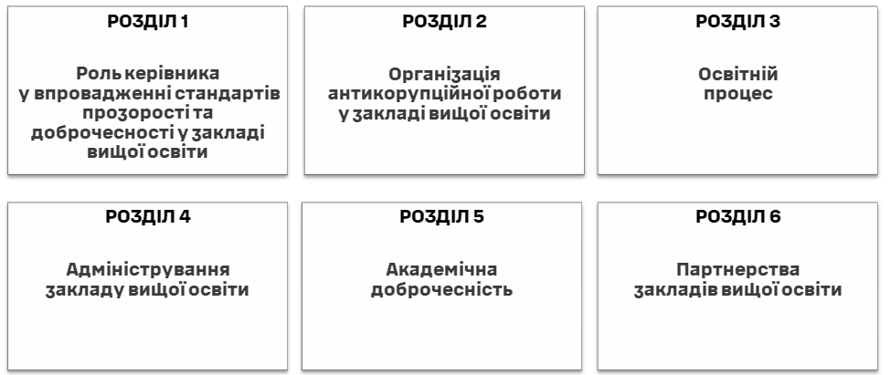
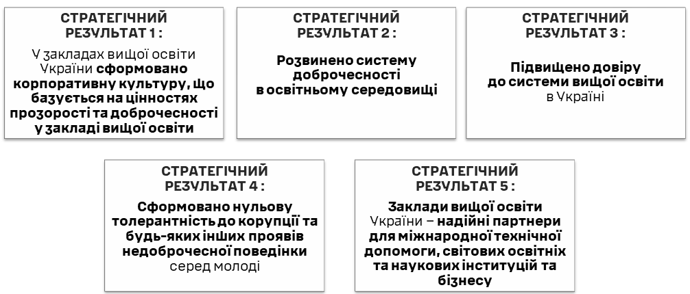
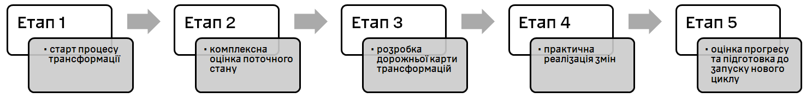
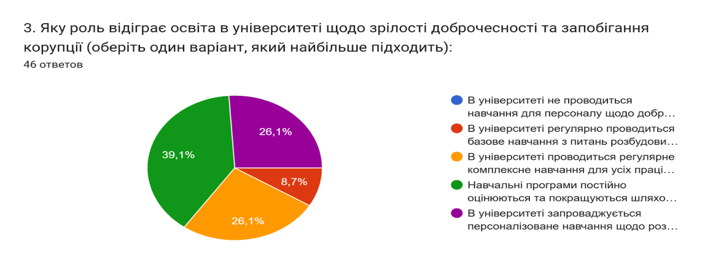

> Джерело: https://nuou.org.ua/assets/documents/recommendations_transform_dobrochesnist.pdf (конвертовано з PDF; оригінал — `recommendations_transform_dobrochesnist.pdf`)

# Рекомендації щодо трансформації функціонування вищих військових навчальних закладів (військових навчальних підрозділів закладів вищої освіти) на засадах доброчесності та нульової толерантності до корупції

**Міністерство оборони України**
Департамент з питань запобігання та виявлення корупції Міністерства оборони України
Національний університет оборони України

Київ – 2025

## ЗМІСТ

- Вступ — 3
- 1. Трансформація системи антикорупційної роботи у ВВНЗ (ВНП ЗВО) в послідовну та взаємопов’язану політику розбудови доброчесності за стандартами НАТО — 4
  - 1.1. Нормативне підґрунтя розвитку культури доброчесності та нульової толерантності до корупції у ВВНЗ (ВНП ЗВО) — 4
  - 1.2. Завдання трансформації функціонування ВВНЗ (ВНП ЗВО) на засадах прозорості та доброчесності — 6
- 2. Алгоритм трансформації функціонування ВВНЗ (ВНП ЗВО) на засадах доброчесності та нульової толерантності до корупції та його практичне застосування — 9
- Закінчення — 17
- Перелік посилань — 18
- Додатки — 20

## ВСТУП

Стратегічний курс України на європейську та євроатлантичну інтеграцію нерозривно пов’язаний із впровадженням фундаментальних принципів прозорості та підзвітності у діяльність сектору безпеки та оборони. Ключовим аспектом на цьому шляху є перехід від реактивної моделі “боротьби з корупцією” до проактивної, ціннісно-орієнтованої політики “розбудови доброчесності” (Building Integrity). Зазначена трансформація набуває особливого значення у системі військової освіти, оскільки саме у вищих військових навчальних закладах та військових навчальних підрозділах закладів вищої освіти (далі – ВВНЗ та ВНП ЗВО) формуються світогляд та етичні стандарти військових фахівців – лідерів всіх рівнів.

В межах реалізації мети Антикорупційної програми Міністерства оборони України на 2025-2026 роки та для впровадження Методичних рекомендацій НАЗК, затверджених наказом МОН України від 17.04.2025 № 576, розроблено “Рекомендації щодо трансформації функціонування вищих військових навчальних закладів (військових навчальних підрозділів закладів вищої освіти) на засадах доброчесності та нульової толерантності до корупції” (далі – Рекомендації).

Дані Рекомендації адаптовані до специфіки діяльності оборонного відомства та призначені для начальників (керівників) ВВНЗ (ВНП ЗВО) та їх структурних підрозділів, уповноважених з антикорупційної діяльності, членів робочих груп з оцінки корупційних ризиків, науково-педагогічних, наукових працівників та всіх учасників освітнього процесу.

Системне впровадження Рекомендацій у ВВНЗ (ВНП ЗВО) є практичним інструментом розвитку інституційних спроможностей закладів освіти з розбудови доброчесного середовища, що дозволить забезпечити єдині підходи в імплементації норм доброчесності, досягти синергії між національними антикорупційними реформами та передовими міжнародними практиками, а також забезпечити реальний, а не декларативний перехід до культури нульової толерантності до корупції.

## 1. Трансформація системи антикорупційної роботи у ВВНЗ (ВНП ЗВО) в послідовну та взаємопов’язану політику розбудови доброчесності за стандартами нато

### 1.1. Нормативне підґрунтя розвитку культури доброчесності та нульової толерантності до корупції у ВВНЗ (ВНП ЗВО)

Наявний міжнародний досвід, зокрема рекомендації ОЕСР [1] та інших провідних міжнародних організацій, а також Політика НАТО з розбудови доброчесності [2], наголошують, що заходи запобігання корупції та формування доброчесності слід розглядати як глибокі культурні та інституційні трансформації, що охоплюють різні сфери функціонування установ та організацій.

Інституціоналізація норм антикорупційної поведінки та принципів доброчесності в діяльність сектору безпеки та оборони не лише є однією з умов інтеграції в євроатлантичний та європейський простір [3], а й сприяє розбудові інституційної спроможності та людського капіталу сил оборони, необхідних для захисту територіальної цілісності й незалежності нашої держави та її повоєнної відбудови [4].

Формування нульової толерантності до корупції серед різних категорій є фокусом Антикорупційної стратегії держави та Державних антикорупційних програм на її виконання [5].

Стратегія розвитку вищої освіти в Україні на 2022-2032 роки визначає прозорість і відкритість, несприйняття корупції та академічну доброчесність ключовими пріоритетами розвитку та основою концептуальної перспективної моделі вищої освіти [6].

Державна антикорупційна політика спрямована на розв’язання проблем із запобігання корупції у пріоритетних сферах, зокрема в освітній. Такі проблеми пов’язані перш за все із корупційними ризиками під час прийому на навчання та під час реалізації освітнього процесу, застарілістю та недосконалістю нормативної бази, наявною ймовірністю конфлікту інтересів у сфері менеджменту вищої освіти [7, 8].

Запровадження військового лідерства, що ґрунтується на цінностях, де відсутня терпимість до корупції, а доброчесність є нормою визначено Концепцією трансформації системи військової освіти та є одним із основних завдань для формування професійної культури відповідно до принципів і стандартів НАТО [9]. При цьому доброчесність військового лідера є його ключовою чеснотою (моральною якістю), що відображається в поведінці та діяльності, визначає характер, етичні норми та способи взаємодії з підлеглими [10].

Зазначене повною мірою корелює з вимогами Кодексу доброчесної поведінки та професійної етики військових посадових осіб. Вимоги щодо етичних норм та норм антикорупційного законодавства спрямовані на формування військової корпоративної культури на засадах прозорості та доброчесності [11].

Антикорупційна програма МОУ закріплює загальну політику оборонного відомства, що полягає у створенні культури нульової толерантності до корупції, відкритості та відповідальності, демонстрації лідерської позиції та власного прикладу щодо повного несприйняття корупції, особистій участі в антикорупційних заходах [12]. Ключовим пріоритетом програми є розвиток інституційних спроможностей для подальшої трансформації системи антикорупційної роботи в послідовну та взаємопов’язану політику розбудови доброчесності за стандартами НАТО.

При цьому передбачено, що розвиток антикорупційної культури повинен здійснюватися шляхом набуття стійких навичок антикорупційної поведінки та розвитку особистісних компетенцій в системі освіти і підготовки, просвітницької діяльності.

Отже на рівні стратегічних та нормативних документів МОУ для закладів військової освіти визначено пріоритет нульової толерантності до корупції та розвитку практик доброчесної поведінки.

Міністерство освіти і науки України (далі – МОН України) також активно запроваджує інструменти розвитку загальної антикорупційної культури через систему освіти.

Важливим етапом цієї роботи стало видання наказу МОН України “Про внесення змін до деяких стандартів вищої освіти” від 13.06.2024 № 842, яким до стандартів вищої освіти першого (бакалаврського) рівня всіх спеціальностей включено загальну програмну компетентності “Здатність ухвалювати рішення та діяти, дотримуючись принципу неприпустимості корупції та будь-яких інших проявів недоброчесності” [13].

Чіткий механізм розбудови доброчесних закладів вищої освіти надано МОН України спільно з НАЗК у вигляді Методичних рекомендацій, затверджених наказом МОН України від 17.04.2025 № 576 [14] (далі – Методичні рекомендації НАЗК) та обов’язковими для їх впровадження в усіх закладах вищої освіти (далі – ЗВО) незалежно від сфери підпорядкування.

### 1.2. Завдання трансформації функціонування ВВНЗ (ВНП ЗВО) на засадах прозорості та доброчесності

Методичні рекомендації НАЗК [14] наголошують, що розбудова доброчесного освітнього середовища залежить від кожного / кожної учасника / учасниці освітнього процесу. Адже доброчесність – це спільна справа!

Трансформації підлягають основні сфери діяльності ВВНЗ (ВНП ЗВО) (рис. 1):

Рисунок 1 – Сфери трансформації ЗВО на засадах прозорості та доброчесності [14]

Основними **завданнями розбудови доброчесного закладу освіти** визначено:

**Сфера 1. Роль Керівництва** (“Tone at the Top” [15]) – керівник закладу є архітектором системи доброчесності, зобов’язаним забезпечити функціонування системи антикорупційної роботи. Його особистий приклад і проактивна позиція є фундаментом для створення етичного клімату в організації. Лідерство забезпечує політичну волю та ресурсну підтримку для всіх ініціатив у сфері доброчесності. Здійснюється дослідження організаційної культури ЗВО на підставі Методології НАЗК [16] для виявлення цінностей організації та рівня зрілості доброчесності.

**Сфера 2. Організація антикорупційної роботи** – створення (визначення) незалежного, підзвітного безпосередньо керівнику Уповноважений з антикорупційної діяльності (або уповноваженого підрозділу) (далі – антикорупційний уповноважений). Цей фахівець (підрозділ) відповідає за роботу за напрямом розробки політик, консультування особового складу, оцінки ризиків та захист викривачів.

Зазначається право ВВНЗ мати власну Антикорупційну програму як стратегічний документ закладу освіти з антикорупційної політики або акт, яким декларуються принципи дотримання нульової толерантності до корупції, запобігання конфлікту інтересів, підтримки викривачів, затверджено реєстр корупційних ризиків та визначено заходи щодо їх усунення.

**Сфера 3. Освітній процес** – забезпечення інтеграції етичних стандартів у навчальні програми та методики викладання через:

обов’язкове включення модулів з етики, доброчесності та антикорупційної стійкості до навчальних планів усіх освітніх програм;

встановлення чітких, стандартизованих та публічних критеріїв оцінювання, мінімізуючи простір для суб’єктивності та потенційних проявів корупції;

запровадження процедур для запобігання конфлікту інтересів у взаємовідносинах “викладач – здобувач освіти” (зокрема, під час приймання іспитів/заліків, захисту робіт чи наукового керівництва).

**Сфера 4. Адміністрування закладу освіти** – підвищення прозорості та ефективності управлінських процесів, не пов’язаних безпосередньо з навчальною та науковою діяльністю, що включає фінансову прозорість, управління персоналом, внутрішній контроль та аудит.

**Сфера 5. Академічна доброчесність** – забезпечення доброчесності у навчальній та науково-дослідній діяльності шляхом:

обов’язкового використання програмного забезпечення для перевірки на плагіат, фальсифікацію та фабрикацію даних у навчальних, кваліфікаційних та наукових роботах;

чіткої та послідовно застосовуваної політики санкцій за порушення академічної доброчесності для всіх учасників процесу (здобувачі, викладачі, науковці);

забезпечення прозорості джерел фінансування наукових досліджень та публікації їх результатів, особливо у контексті міжнародних партнерств та грантів (з урахуванням обмежень у сфері національної безпеки).

**Сфера 6. Партнерства закладів** – управління корупційними ризиками, пов’язаними з зовнішньою співпрацею, грантами та обмінами через:

розробку та застосування регламенту перевірки на доброчесність потенційних партнерів (особливо іноземних) для мінімізації ризику співпраці з недоброчесними або скомпрометованими суб’єктами;

включення антикорупційних положень та застережень про конфлікт інтересів у договори, меморандуми про співпрацю та грантові угоди;

встановлення посиленого контролю за обміном чутливими технологіями, знаннями та інформацією у рамках міжнародних проєктів.

Реалізація завдань з розбудови доброчесного ВВНЗ (ВНП ЗВО) дозволить досягти стратегічних результатів трансформації (рис. 2):

Рисунок 2 – Стратегічні результати трансформації ЗВО на засадах прозорості та доброчесності [14]

## 2. Алгоритм трансформації функціонування ВВНЗ (ВНП ЗВО) на засадах доброчесності та нульової толерантності до корупції та його практичне застосування

Для системної та послідовної трансформації функціонування ВВНЗ (ВНП ЗВО) на засадах прозорості та доброчесності розроблено практичний алгоритм дій, що базується на Методичних рекомендаціях НАЗК [14] та ураховує особливості організації антикорупційної роботи у системі МОУ [17, 18].

**Ключовими принципами трансформації мають стати: 1. Лідерство та відповідальність керівництва (“Tone at the Top”).**

Успіх трансформацій напряму залежить від політичної волі керівника ВВНЗ, який має стати головним амбасадором доброчесності. Головне завдання – публічно ініціювати роботу у даному напрямку, підтримувати зміни, демонструвати нульову толерантність до порушень та вимагати результатів від профільних заступників та керівників структурних підрозділів.

*Довідково: необхідним вбачається включення даних питань у порядок денний службових нарад, засідань структурних підрозділів, дорадчих органів, зокрема Вченої ради ВВНЗ (ВНП ЗВО).*

**2. Забезпеченість ресурсами та повноваженнями антикорупційного уповноваженого та робочої групи з трансформації.**

Антикорупційний уповноважений має виступати не лише координатором загального процесу трансформації, він має бути проактивним драйвером процесу, який ініціює заходи, надає фахову консультаційну підтримку, аналізувати перешкоди та пропонувати шляхи їх подолання.

Робоча група з трансформації ВВНЗ на засадах прозорості та доброчесності (далі – робоча група) є дієвим інструментом в роботі з розбудови доброчесності та нульової толерантності до корупції, що забезпечує виконання завдань трансформації та аналіз отриманих результатів. Критично важливо забезпечити як антикорупційного уповноваженого, так і робочу групу необхідними ресурсами та реальними повноваженнями для ефективного виконання визначених функцій.

*Довідково: з метою підсилення експертної підтримки процесу до роботи доцільно залучити науково-педагогічних та/або наукових працівників із відповідним рівнем професійної кваліфікації, що викладають дисципліни правового спрямування та питання виховання доброчесності.*

**3. Комплексний інформаційний супровід.**

Інформаційний супровід та активна просвітницька діяльність є наскрізним процесом на всіх етапах трансформації, що включає:

внутрішнє інформування – регулярне звітування керівництву ВВНЗ (ВНП ЗВО) про прогрес та виявлені проблеми під час засідань робочої групи;

роз’яснювальні кампанії – проактивне пояснення для особового складу суті змін, їх мети та очікуваних результатів, що є особливо важливим перед проведенням опитувань та впровадженням нових політик;

активну консультаційну підтримку – антикорупційний уповноважений та члени робочої групи мають бути доступними для надання консультацій та відповідей на запитання співробітників та здобувачів освіти;

загальна прозорість через оприлюднення ключових документів (наказів, звіту за результатами опитувань, плану трансформації) на офіційних ресурсах закладу.

*Довідково: доцільним є створення окремої інтернет-сторінки на веб-сайті закладу з метою розміщення необхідної інформації також можливо розміщення на існуючих ресурсах за напрямом запобігання корупції.*

**Алгоритм трансформації функціонування ВВНЗ (ВНП ЗВО) на засадах доброчесності та нульової толерантності до корупції** включає п’ять етапів (рис. 3):

Рисунок 3 – Схема алгоритму трансформації ВВНЗ (ВНП ЗВО) на засадах

доброчесності та нульової толерантності до корупції

Алгоритм побудований як безперервний цикл постійного вдосконалення, де кожен етап передбачає використання конкретних інструментів та отримання вимірюваних результатів (табл. 2).

Таблиця 2 – Опис алгоритму трансформації функціонування ВВНЗ (ВНП ЗВО) на засадах доброчесності та нульової толерантності до корупції.

| Зміст етапу | Заходи | Примітка |
|---|---|---|
| Етап 1. ІНІЦІАЦІЯ |  |  |
| Мета – офіційно розпочати процес трансформації, продемонструвати позицію керівництва (“Ton at the top” – “Тон згори”) та надати процесу легітимності та вагомості |  |  |
| Видання розпорядчого документу керівником ВВНЗ (ВНП ЗВО) (наказу, розпорядження) про початок трансформації й створення робочої групи, публічна заява керівництва | 1.1. Підготовка та видання наказу керівника ВВНЗ про організацію роботи з трансформації функціонування на засадах доброчесності. | Додаток А (шаблон наказу керівника ВВНЗ “Про організацію роботи з трансформації функціонування ВВНЗ на засадах прозорості та доброчесності”) |
|  | 1.2. Створення постійно діючої робочої групи з трансформації з представників ключових структурних підрозділів. |  |
|  | 1.3. Публічна заява керівника ВВНЗ (ВНП ЗВО) про початок процесів трансформації |  |
| Етап 2. ДІАГНОСТИКА |  |  |
| Мета – визначити об’єктивну “точку відліку”, виявити існуючі прогалини в системі антикорупційної роботи, зафіксувати поточний стан системи доброчесності ВВНЗ (ВНП ЗВО) |  |  |
| Проведення комплексної самооцінки стану антикорупційної роботи та визначення поточного рівня доброчесності ВВНЗ (ВНП ЗВО) за Методологією НАЗК | 2.1. Проведення робочою групою самооцінки щодо стану впровадження Методичних рекомендацій НАЗК | Додаток Б (Контрольний чек-лист застосування інструментів та механізмів для трансформації) |
|  | 2.2. Визначення поточного рівня доброчесності ВВНЗ за Методологією НАЗК шляхом опитувань визначених категорій особового складу | Додаток В (Анкети для визначення рівня доброчесності) |
|  | 2.3. Підготовка звіту з узагальненням результатів визначення рівня доброчесності | Додаток Г (шаблон Звіту за результатами визначення рівня доброчесності) |
| Етап 3. ПЛАНУВАННЯ |  |  |
| Мета – Перетворити результати діагностики на конкретний, вимірюваний та обмежений у часі план дій |  |  |
| Розробка та затвердження Плану трансформації | 3.1. Презентація ключових висновків та узгодження пріоритетів у трансформації ВВНЗ (ВНП ЗВО) | Додаток Д (типовий План заходів із |

| на основі результатів ІІ етапу з проведення діагностики | 3.2. Розробка проєкту Плану трансформації із визначенням заходів, відповідальних виконавців та співвиконавців, термінів та індикаторів виконання. | трансформації функціонування ВВНЗ (ВНП ЗВО) на засадах прозорості та доброчесності) |
|  | 3.3. Затвердження Плану керівником ВВНЗ та його доведення до виконавців та зацікавлених осіб. |  |
| Етап 4. ВПРОВАДЖЕННЯ |  |  |
| Мета – забезпечити фактичне виконання заходів, передбачених Планом трансформації |  |  |
| Реалізація запланованих заходів | 4.1. Реалізація заходів Плану трансформації відповідальними особами та підрозділами | рекомендовано звітування не менше 2 разів на рік проведення інформаційних заходів, висвітлення інформації на офіційних веб-ресурсах ВВНЗ (ВНП ЗВО) |
|  | 4.2. Моніторинг та контроль за своєчасністю та якістю виконання заходів через звіти виконавців та співвиконавців |  |
|  | 4.3. Періодичне інформування спільноти ВВНЗ про хід реалізації плану. |  |
| Етап 5. МОНІТОРИНГ ТА ВДОСКОНАЛЕННЯ |  |  |
| Мета – оцінити ефективність впроваджених заходів, забезпечити підзвітність та закласти основу для подальшого вдосконалення системи доброчесності в закладі |  |  |
| Запуск циклу щорічної оцінки й розробки плану заходів на наступний період | 5.1. Щорічна підсумкова оцінка. Наприкінці звітного періоду робоча група повторює Етап 2 “Діагностика” для об’єктивного вимірювання прогресу. | повторне заповнення Контрольного чек-листа та визначення рівня доброчесності Додатки Б, В |
|  | 5.2. Результати порівняльного аналізу (поточного та попереднього стану) є основою річного звіту про досягнення та виклики, що лишаються. | аналіз тенденцій та умов, що викликали зміни, порівняно із попередньою оцінкою, Додаток Г |
|  | 5.3. На основі звіту та оновленої діагностики приймається рішення про повернення до Етапу 3 для розробки оновленого Плану трансформації на наступний період. | розробка та затвердження оновленого Плану трансформації на наступний період, Додаток Д |

**Практичні рекомендації до застосування алгоритму трансформації ВВНЗ (ВНП ЗВО)** містять детальні покрокові інструкції для їх застосування на кожному етапі.

**Етап 1. Ініціація – старт процесу трансформації:**

На цьому етапі в першу чергу важливо провести загальне інформування особового складу ВВНЗ (на рівні керівників структурних підрозділів) щодо доведення загальних положень Методичних рекомендацій НАЗК, цілей та завдань трансформації. Після чого має бути проведена робота із видання наказу керівника ВВНЗ про організацію роботи з трансформації функціонування на засадах доброчесності та створення робочої групи за участю представників ключових структурних підрозділів (**Додаток А**).

Наступним важливим кроком має бути установче засідання робочої групи, для роз’яснення її членам мети, завдань та очікуваних результатів роботи. Інформаційне повідомлення про початок процесу трансформації та склад робочої групи має бути оприлюднене для всього особового складу ВВНЗ (ВНП ЗВО).

**Етап 2. Діагностика – комплексна оцінка поточного стану:**

Самооцінка щодо стану впровадження Методичних рекомендацій НАЗК з використанням Контрольного чек-листа (**Додаток Б**) має на меті визначити сильні та слабкі місця у визначених сферах, що буде основою для розробки плану трансформації на наступному етапі.

*Довідково: порівняння проводиться за кожним заходом з використання шкали “впроваджено повністю”, “впроваджено частково”, “потребує впровадження”.*

Визначення поточного рівня зрілості доброчесності ВВНЗ проводиться на основі стандарту ISO 31000 за розробленою НАЗК методикою [16] шляхом проходження особовим складом опитувань в дистанційному форматі за відповідними анкетами.

Анкети для проведення опитування з визначення рівня доброчесності (**Додаток В**) розроблені на підставі методології CMMI (Capability Maturity Model Integration), адаптованої для розбудови доброчесності і комплексної системи запобігання корупції в організаціях з урахуванням Рекомендацій Ради ОЕСР “Доброчесність на державному рівні” та рекомендацій стандарту ISO 31000 згідно з Моделлю зрілості доброчесності (запобігання корупції) в організаціях, розробленою НАЗК (https://antycorportal.nazk.gov.ua/indeks-zrilosti/).

Опитування включає в себе чотири розділи:

1. Культура – пропонується визначити яку роль відіграє керівник (начальник) у розбудові доброчесності, яку цінність відіграє доброчесність і корпоративна культура, яку роль відіграє освіта щодо зрілості доброчесності та запобігання корупції та який рівень відкритості щодо стану доброчесності.
2. Система – пропонується визначити як організована робота антикорупційного уповноваженого у ВВНЗ (ВНП ЗВО) та на якому рівні розвитку перебуває стратегія доброчесності ВВНЗ (ВНП ЗВО).
3. Підзвітність – пропонується визначити який рівень організації/керування корупційними ризиками, який рівень проведення аналізу проєктів актів, кандидатів на посади та контрагентів, рівень роботи з викривачами та рівень аудиту (внутрішнього контролю) ефективності системи доброчесності.
4. Рівень зрілості доброчесності у ВВННЗ (ВНП ЗВО) – пропонується дати особисту оцінку щодо власного рівня зрілості доброчесності або підрозділу (підрозділів), якими здійснюється управління (координація).

Для збору первинної інформації застосовується метод кількісного дослідження – онлайн-опитування (Computer Assisted Web Interviewing – CAWI). Збір даних здійснюється за допомогою комунікаційної платформи Google Forms. Опитування проводиться в анонімному форматі. Платформа не збирає імена, електронні адреси чи інші ідентифікаційні дані респондентів. Це дозволяє мінімізувати упередженість та сприяє наданню максимально відвертих відповідей.

*Довідково: для отримання неупередженого ставлення в оцінці рівня доброчесності до опитування доцільно залучити респондентів двох категорій: членів робочої групи та особовий склад ВВНЗ (ВНП ЗВО) (постійний і змінний склад з числа військовослужбовців та працівників Збройних Сил України), для яких запропонувати Анкету 1 та Анкету 2 відповідно.*

Використання двох стандартизованих анкет забезпечує однакові умови для всіх респондентів у межах своєї категорії та дозволяє провести порівняльний аналіз отриманих даних.

Перед початком анонімного опитування доцільно провести широку роз’яснювальну кампанію щодо його мети та гарантій конфіденційності, щоб досягти максимального залучення та отримати чесні відповіді.

Звіт за результатами проведення та обробки матеріалів опитування (**Додаток Г**) має включати:

побудову порівняльних (крос-) таблиць для візуалізації даних на основі відсоткових розподілів відповідей, отриманих від респондентів;

порівняння отриманих даних з пошуком збігів (консенсусів) та виявленням розбіжностей;

формулювання висновків із зазначенням поточного рівня зрілості доброчесності ВВНЗ (ВНП ЗВО) згідно з визначеними індикаторами за ключовими напрямами (Культура, Система, Підзвітність);

виявлених сильних сторін в існуючих робочих процесах та слабких місць (зон для вдосконалення), що має слугувати підґрунтям для розробки конкретних пропозицій та індикаторів для подальшого розвитку.

Матеріали звіту доцільно використати робочій групі для розробки Плану заходів забезпечення функціонування ВВНЗ на засадах прозорості та доброчесності на Етапі 3.

**Етап 3. Планування – розробка дорожньої карти трансформацій:**

Обговорення ключових висновків, отриманих за результатом роботи із керівництвом, робочою групою та представниками визначених структурних підрозділів дозволить визначити пріоритети у подальшій діяльності та конкретизувати очікування від процесу в цілому.

Розробка Плану трансформації ВВНЗ (ВНП ЗВО) здійснюється з використанням типового плану (**Додаток Д**) з додаванням / виключенням заходів (залежно від потреби ВВНЗ), уточнення індикаторів, термінів та відповідальних виконавців. Це є відповідальністю робочої групи та ВВНЗ в цілому, а також проявом практичної позиції у напрямку позитивних трансформацій на засадах прозорості та доброчесності.

До розробки плану також можна залучити керівників структурних підрозділів, які будуть відповідати за виконання заходів. Це забезпечить реалістичність плану та зменшить майбутній опір у його практичній реалізації. Кожен пункт плану має бути максимально конкретизованим та орієнтованим на покращення ситуації за визначеними напрямами з урахуванням попередньо проведеного само оцінювання з використанням Контрольного чек-листа на Етапі 2.

*Довідково: за потребою заходи уточнюються з урахуванням особливостей функціонування ВВНЗ в умовах воєнного стану, про що робляться відповідні примітки у протоколах засідання робочої групи та позначки у плані.*

За потребою може бути проведене громадське обговорення Плану за участю особового складу ВВНЗ, експертів та громадськості.

Фіналом етапу є його доведення до виконавців із визначенням порядку надання зворотного зв’язку.

**Етап 4. Впровадження – практична реалізація змін:**

Етап впровадження вимагає найбільшої комунікаційної підтримки з боку антикорупційного уповноваженого та членів робочої групи. Вони мають діяти проактивно, надаючи консультаційну допомогу, а не лише виконуючи контролюючу функцію. Основний виклик – подолання пасивного опору змінам, тому критично важливо не лише виконувати заходи, а й постійно роз’яснювати їхню суть та мету.

Рекомендується визначити терміни звітування про перебіг процесу не менше 2 разів на рік (наприклад, наприкінці першого семестру та в кінці навчального року).

Синхронізація такого звітування із загальними процесами планування у ВВНЗ зробить процес трансформації органічною частиною діяльності закладу, а не додатковим навантаженням.

Окрім внутрішнього моніторингу, необхідно забезпечити зовнішню прозорість через проведення інформаційних заходів для особового складу та регулярне висвітлення інформації про хід реалізації плану на офіційних веб-ресурсах ВВНЗ.

**Етап 5. Моніторинг та вдосконалення – оцінка прогресу та запуск нового циклу:**

Головна мета етапу – рефлексія, аналіз та подальше удосконалення. Цей етап не має перетворюватися на формальне написання звіту, а має слугувати потужним циклом зворотного зв’язку, за результатами якого запускається наступний етап діагностики (оцінювання).

Ключовим завданням є проведення повторної щорічної діагностики, що включає повторне заповнення Контрольного чек-листа та визначення рівня доброчесності через анкетування.

На основі цих даних проводиться порівняльний аналіз поточного та попереднього стану. Важливо забезпечити максимальну об’єктивність підсумкової оцінки, порівнюючи дані “до” і “після” для вимірювання реального прогресу.

Отримані висновки є відправною точкою для розробки та затвердження оновленого Плану трансформації на наступний період, що забезпечує безперервність процесу вдосконалення.

**ВАЖЛИВО:**

для внутрішніх документів ВВНЗ (ВНП ЗВО) використано формулювання “трансформація функціонування на засадах прозорості та доброчесності” відповідно до Методичних рекомендацій НАЗК [14];

ВВНЗ (ВНП ЗВО), враховуючи специфіку власної діяльності та результати внутрішньої діагностики, можуть адаптувати запропонований підхід, розробити власні документи та визначити іншу послідовність заходів.

**Фундаментальним принципом має залишатися** не формальне копіювання, а досягнення кінцевої мети – **побудова дієвої системи розбудови доброчесності, що спирається на чіткі, практичні заходи та вимірювані індикатори**, забезпечуючи реальний процес трансформації, а не його імітацію.

## ЗАКІНЧЕННЯ

Розроблені Рекомендації щодо трансформації функціонування ВВНЗ (ВНП ЗВО) на засадах доброчесності та нульової толерантності до корупції містять практичний покроковий алгоритм трансформації для розбудови закладів військової освіти системи МОУ на засадах прозорості та доброчесності.

Дієвість розроблених Рекомендацій забезпечується комплектом супровідних документів (зразки наказів, контрольний чек-лист для самооцінки, анкета для визначення рівня доброчесності, типовий план трансформації), які дозволяють уніфікувати та систематизувати процес впровадження для ВВНЗ та ВНП ЗВО.

Таким чином, запропонований підхід дозволяє забезпечити реальний процес позитивної трансформації, що спирається на чіткі заходи та вимірювані індикатори, сприяючи формуванню культури доброчесності та нульової толерантності до корупції у сфері діяльності ВВНЗ та ВНП ЗВО.

Враховуючи специфіку ВВНЗ та ВНП ЗВО та результати внутрішньої діагностики, запропонований підхід може бути адаптований та передбачати розробку інших документів та використання іншої послідовності заходів.

Важливим аспектом має залишатися досягнення кінцевої мети – побудова дієвої системи розбудови доброчесності, що спирається на чіткі, практичні заходи та вимірювані індикатори у трансформації ВВНЗ (ВНП ЗВО).

## ПЕРЕЛІК ПОСИЛАНЬ

1. OECD (2024), Посібник ОЕСР з публічної доброчесності, OECD Publishing, Paris, https://doi.org/10.1787/5b2fe28c-uk.
2. Політика НАТО з виховання доброчесності. URL: https://www.nato.int/cps/uk/natohq/official_texts_135626.htm?selectedLocale=uk.
3. Про Стратегічний оборонний бюлетень України: Указ Президента України від 17.09.2021 № 473/2021. Офіційний вісник Президента України. 2021. № 69. Ст. 433. URL: https://www.president.gov.ua/documents/4732021-40121.
4. Про затвердження Стратегії залучення, розвитку та утримання людського капіталу в силах оборони України на період до 2027 року: Наказ Міністерства оборони України від 29.12.2024 № 862/нм. URL: https://mod.gov.ua/diyalnist/normativno-pravova-baza/nakaz-ministerstva-oboroni-ukrayini-vid-vid-29-12-2024-862-nm-pro-zatverdzhennya-strategiyi-zaluchennya-rozvitku-ta-utrimannya-lyudskogo-kapitalu-v-silah-oboroni-ukrayini-na-period-do-2027-roku.
5. Про Антикорупційну стратегію на 2021–2025 роки: Закон України від 20.06.2022 № 2322-IX. Відомості Верховної Ради України. 2022. № 32. Ст. 132. URL: https://zakon.rada.gov.ua/laws/show/2322-20#n93.
6. Про схвалення Стратегії розвитку вищої освіти в Україні на 2022-2032 роки: Розпорядження Кабінету Міністрів України від 23.02.2022 № 286-р. Офіційний вісник України. 2022. № 20. Ст. 112. URL: https://zakon.rada.gov.ua/laws/show/286- 2022-%D1%80#Text.
7. Про затвердження Державної антикорупційної програми на 2023–2025 роки: Постанова Кабінету Міністрів України від 04.03.2023 № 220. Офіційний вісник України. 2023. № 30. Ст. 123. URL: https://zakon.rada.gov.ua/laws/show/220- 2023- %D0%BF#Text.
8. Корупційні ризики у вищій освіті. ТОП 25: Стратегічний аналіз корупційних ризиків, авторський колектив. Київ: Національне агентство з питань запобігання корупції, Асоціація юридичних клінік України, 2022. 106 с. URL: https://nazk.gov.ua/wp-content/uploads/2022/06/TOP_25_koruptsiy-ni_ryzyky_u_vyshhiy- _osviti.pdf.
9. Про затвердження Концепції трансформації системи військової освіти: Постанова Кабінету Міністрів України від 15.12.1997 № 1410 (в редакції постанови Кабінету Міністрів України від 30.12.2022 № 1490). Офіційний вісник України. 1997. № 51. Ст. 143; 2023. № 2. Ст. 112. URL: https://zakon.rada.gov.ua/laws/show/1410-97- %D0%BF#Text.
10. Доктрина військового лідерства у Збройних Силах України. URL: https://sprotyvg7.com.ua/wp-content/uploads/2024/01/%D0%94%D0%BE%D0%BA% D1%82%D1%80%D0%B8%D0%BD%D0%B0-%E2%84%962-.pdf.
11. Кодекс доброчесної поведінки та професійної етики військових посадових осіб, державних службовців та інших осіб, уповноважених на виконання функцій держави, в Міністерстві оборони України та Збройних Силах України. URL: https://mod.gov.ua/diyalnist/normativno-pravova-baza/kodeks-dobrochesnoi-povedinki-ta-profesiinoi-etiki-viiskovikh-posadovikh-osib-derzhavnikh-sluzhbovtsiv-ta-inshikh-osib-upovnovazhenikh-na-vikonannia-funktsii-derzhavi-v-ministerstvi-oboroni-ukraini-ta.
12. Про затвердження Антикорупційної програми Міністерства оборони України на 2025–2026 роки: Наказ Міністерства оборони України від 26.12.2024 № 861/нм. URL: https://nuou.org.ua/assets/documents/akp-mou-25-26.pdf.
13. Про внесення змін до деяких стандартів вищої освіти: Наказ Міністерства освіти і науки України від 13.06.2024 № 842. URL: https://mon.gov.ua/static-objects/mon/sites/1/vishcha-osvita/zatverdzeni%20standarty/2024/Nakaz- 842.vid.13.06.2024.pdf.
14. Про затвердження Методичних рекомендацій щодо застосування інструментів та механізмів для трансформації функціонування закладів вищої освіти на засадах прозорості та доброчесності, розроблених Національним агентством з питань запобігання корупції: Наказ Міністерства освіти і науки України від 17.04.2025 № 576. URL: https://mon.gov.ua/npa/pro-zatverdzhennia-metodychnykh-rekomendatsii-shchodo-zastosuvannia-instrumentiv-ta-mekhanizmiv-dlia-transformatsii-riznykh-sfer-funktsionuvannia-zakladiv-vyshchoi-osvity-na-zasadakh-prozoros.
15. Аналітичне дослідження «Роль лідера у протидії корупції: аналітичний огляд впровадження концепції «Tone At The Top». Режим доступу: https://surl.lu/lvszbd.
16. Модель зрілості доброчесності (запобігання корупції). URL: https://antycorportal.nazk.gov.ua/uploads/indeks-zrilosti/broshura-model-zrilosti-dobrochesnosti.pdf.
17. Положення про організацію системи роботи з питань запобігання та виявлення корупції в Міністерстві оборони України, Збройних Силах України та Державній спеціальній службі транспорту, затвердженого наказом Міністерства оборони України 05 лютого 2024 року № 81 (в редакції наказу Міністерства оборони

| України від 20 листопада 2024 року № 767). | URL: |
|---|---|
| https://mod.gov.ua/diyalnist/normativno-pravova-baza/polozhennya-pro-organizacziyu- |  |
| sistemi-roboti-z-pitan-zapobigannya-ta-viyavlennya-korupcziyi-v-mou-zsu-ta-dsst-1. |  |

18. Організаційно-методичні вказівки з питань запобігання та виявлення корупції в діяльності Міністерства оборони України та Збройних Сил України в

| умовах воєнного стану на 2025 рік. | URL: https://mod.gov.ua/diyalnist/normativno- |
|---|---|
| pravova-baza/organizaczijno-metodichni-vkazivki-z-pitan-zapobigannya-ta-viyavlennya- |  |
| korupcziyi-v-diyalnosti-mou-ta-zsu-v-umovah-voyennogo-stanu-v-2025-roczi. |  |

## ДОДАТКИ

## Додаток А

**Міністерство оборони України**

## НАКАЗ

**начальника найменування вищого військового навчального закладу (військового навчального підрозділу закладу вищої освіти)**

**м. Київ**

Про організацію роботи з трансформації функціонування ВВНЗ (ВНП ЗВО) на засадах прозорості та доброчесності

Відповідно до вимог Антикорупційної програми Міністерства оборони України на 2025–2026 роки, затвердженої наказом Міністерства оборони України від 26 грудня 2024 року № 861/нм, Методичних рекомендацій щодо застосування інструментів та механізмів для трансформації різних сфер функціонування закладів вищої освіти на засадах прозорості та доброчесності, розроблені Національним агентством з питань запобігання корупції, затверджених наказом Міністерства освіти і науки України від 17 квітня 2025 року № 576, та з метою системного удосконалення механізмів прозорості та доброчесності, розвитку інституційних спроможностей для подальшої трансформації системи антикорупційної роботи у найменування ВВНЗ (ВНП ЗВО) (далі – скорочене найменування ВВНЗ (ВНП ЗВО)) в послідовну та взаємопов’язану політику розбудови доброчесності за кращими міжнародними та національними стандартами

**НАКАЗУЮ:**

1. Створити робочу групу з трансформації функціонування ВВНЗ (ВНП ЗВО) на засадах прозорості та доброчесності (додаток).
2. Роботу робочої групи організувати:

на першому етапі – в термін до “___” ________ 202__ року\* – визначити рівень зрілості доброчесності ВВНЗ (ВНП ЗВО) згідно з розробленою Національним агентством з питань запобігання корупції моделлю на основі стандарту ISO 31000;

на другому етапі – в термін до “___”________202__ року\* – розробити План заходів із трансформації функціонування ВВНЗ (ВНП ЗВО) на засадах прозорості та доброчесності (далі – План) на 202_-202_ навчальний рік;

на третьому етапі – здійснювати інформаційне та консультаційне супроводження виконання Плану протягом навчального року;

на четвертому етапі – щорічно в термін до “___”________\* – оцінити ефективність впроваджених заходів, визначити поточний рівень зрілості доброчесності ВВНЗ (ВНП ЗВО) та розробити План на наступний навчальний рік.

3. Координацію діяльності робочої групи здійснювати через визначену посадову особу або структурний підрозділ.
4. Контроль за виконанням наказу залишаю за собою.
5. Наказ довести до особового складу згідно з розрахунком доведення.

Начальник ВВНЗ (ВНП ЗВО) військове звання Ім’я ПРІЗВИЩЕ

**\*Примітка:**

1) на етапі впровадження Методичних рекомендацій НАЗК у 2025-2026 навчальному році рекомендовано:

перший етап – до 15 листопада 2025 року;

другий етап – до 15 грудня 2025 року;

четвертий етап – до 15 серпня;

2) після впровадження Методичних рекомендацій НАЗК (стандартний навчальний рік) рекомендовано:

визначення рівня зрілості доброчесності – червень (до 01.07);

оцінка виконання попередніх планів – липень (до 01.08);

розробка Плану на новий навчальний рік – до 15 серпня.

**Додаток 1**
до наказу начальника *найменування ВВНЗ (ВНП ЗВО)* ____________ №

Склад

робочої групи з трансформації функціонування ВВНЗ (ВНП ЗВО)

на засадах прозорості та доброчесності

Керівник робочої групи – зазначити посаду (рекомендовано – начальник штабу – заступник начальника ВВНЗ (ВНП ЗВО)).

Заступник керівника робочої групи – зазначити посаду (рекомендовано – антикорупційний уповноважений).

Члени робочої групи:

*зазначається склад робочої групи.*

*Рекомендовано:*

*заступники начальника ВВНЗ (ВНП ЗВО);*

*керівники навчальних та наукових підрозділів (факультетів, центрів, кафедр);*

*керівники адміністративних та допоміжних підрозділів (обов’язково – підрозділів персоналу, фінансово-економічного, логістики);*

*представники здобувачів освіти.*

Уповноважений з антикорупційної діяльності військове звання Ім’я ПРІЗВИЩЕ

## Додаток Б

Контрольний чек-лист застосування інструментів та механізмів для трансформації функціонування ВВНЗ (ВНП ЗВО) на засадах прозорості та доброчесності відповідно до вимог наказу МОН України від 17.04.2025 № 5761

| № з/п | Завдання і заходи відповідно до Методичних рекомендацій | Індикатор виконання | Інформація про впровадження уВВНЗ (ВНП ЗВО) з висновком: “впроваджено повністю”, “впроваджено частково”, “підлягає впровадженню” | Пропозиції щодо заходів (що зробити, хто відповідальний виконавець/співвикона вець, строки/терміни виконання) |
|---|---|---|---|---|
| Розділ 1. Роль керівника у впровадженні стандартів прозорості та доброчесності у ВВНЗ |  |  |  |  |
| 1.1 | 1) Визначити поточний рівень зрілості доброчесності (ефективності) ВВНЗ згідно з розробленою НАЗК моделлю на основі стандарту ISO 31000: https://antycorportal.nazk.gov. ua/indeks-zrilosti/ | 1) Визначено рівень зрілості доброчесності: - початковий (хаотичний, adhoc) - керований (мanaged) - визначений (defined) - вимірюваний (quantitativelymanaged) - оптимізуючий | Підлягає впровадженню\* Довідково: Модель зрілості доброчесності (запобігання корупції) ґрунтується на CMMI (CapabilityMaturityModelIntegration) – методології, створеній для оцінки та покращення процесів в організації. Використання CMMI не передбачено антикорупційним законодавством. Рекомендується з метою забезпечення ефективного процесу управління ризиками, підвищення прозорості і покращання репутації та довіри до організації. \*(приклад заповнення) |  |

|  | 2) Визначити заходи з метою забезпечення функціонування НУОУ на засадах прозорості та доброчесності | - (optimizing) 2) Затверджено План заходів із трансформації функціонування ВВНЗ (ВНП ЗВО) на засадах прозорості та доброчесності |  |  |
| 1.2. | Визначити місію, візію, цінності ВВНЗ, серед яких доброчесність – як одну з цінностей, та усвідомлено обрати систему управління узгодження та контролю досягнення цілей | Розроблено та внесено відповідні зміни/доповнення до Статуту ВВНЗ / Положення ВНП ЗВО | Підлягає впровадженню\* Потребує внесення змін/доповнень до Статуту ВВНЗ \*(приклад заповнення) |  |
| 1.3. | Визначити лідерську роль керівника ВВНЗ, його заступників та керівників структурних підрозділів в системі розбудови доброчесності | Розроблено і затверджено Програму доброчесності (антикорупційну програму) ВВНЗ | Впроваджено частково \* Реалізовано у Положенні про організацію антикорупційної діяльності у НУОУ (наказ начальника університету № 194 від 31.07.2023): https://nuou.org.ua/assets/documents/zk-002- 24-08.pdf Довідково: Антикорупційна програма МОУ передбачає безпосереднє залучення НУОУ до виконання заходів цієї програми. В НУОУ затверджено план завдань і заходів на 2025 рік з виконання Антикорупційної програми МОУ на 2025-2026 роки (рішення начальника університету № 860 від 17.01.2025) \*(приклад заповнення) |  |

| Розділ 2. Організація антикорупційної роботи ВВНЗ |  |  |  |  |
| 2.1. | Визначити особливості організації діяльності уповноваженого з питань запобігання та виявлення корупції (далі – антикорупційний уповноважений) з урахуванням потреб та спеціалізації ВВНЗ | Видано організаційно-розпорядчий акт щодо правового статусу та організаційно-правових засад діяльності антикорупційного уповноваженого | Впроваджено повністю\* Положення про уповноважену особу з питань запобігання та виявлення корупції у НУОУ (наказ начальника університету № 194 від 31.07.2023): https://nuou.org.ua/assets/documents/zk-003- 24-08.pdf\* \*(приклад заповнення) |  |
| 2.2. | Здійснити відбір кандидатів для виконання функцій антикорупційного уповноваженого на основі Професійного стандарту з урахуванням вимог ст. 13-1 Закону України «Про запобігання корупції» | Кандидатура антикорупційного уповноваженого відповідає встановленим вимогам | Впроваджено повністю\* Заходи здійснено у 2023 році. Склад уповноважених оновлюється з урахуванням Професійного стандарту. \*(приклад заповнення) |  |
| 2.3. | Призначити/визначити уповноважену особу (уповноважених осіб) після проходження онлайн курсу «Стоп корупція. Уповноважені» на платформі Дія. Освіта та отримання електронного сертифікату за результатами фінального тестування: https://osvita.diia.gov.ua/course s/stop-corruption-commissioners | Можливі варіанти: - введено штатну посаду (посади) антикорупційного уповноваженого; - окремим наказом визначено антикорупційного уповноваженого (групу антикорупційних уповноважених) | Впроваджено повністю\* 1) Визначено посадових осіб для виконання функцій антикорупційних уповноважених (накази начальника університету № № 194 від 04.04.2024, № 228 від 18.04.2024)\*: https://nuou.org.ua/u/zap-kor.html 2) Затверджено розподіл функціональних обов’язків та повноважень між Уповноваженими з антикорупційної діяльності (наказ начальника університету № 194 від 04.04.2024): https://nuou.org.ua/assets/documents/zk-004- 24-08.pdf\* \*(приклад заповнення) |  |

| 2.4. | Організувати проведення оцінки корупційних ризиків з урахуванням Антикорупційної програми Міноборони2. Визначити заходи із запобігання та мінімізації корупційних ризиків. | Затверджено План заходів з розбудови доброчесності, запобігання та виявлення корупції на навчальний (календарний) рік | Впроваджено повністю\* Затверджено план завдань і заходів на 2025 рік з виконання Антикорупційної програми МОУ на 2025-2026 роки (рішення начальника університету № 860 від 17.01.2025)\* Довідково: Представник НУОУ (Уповноважений з антикорупційної діяльності полковник Володимир Бевз) включений до складу Робочої групи з оцінювання корупційних ризиків у МОУ (постійно діючий консультативно-дорадчий орган, створений наказом МОУ № 588 від 16.10.2023 (зі змінами)).\* \*(приклад заповнення) |  |
| 2.5. | Забезпечити планування діяльності з питань запобігання та виявлення корупції здійснювати з урахуванням специфіки діяльності та умов оперативної обстановки3 | Розроблено та виконується План роботи антикорупційного уповноваженого | Впроваджено повністю\* Затверджено план роботи уповноважених з антикорупційної діяльності на 2025 рік (рішення начальника університету № 724 від 15.01.2025) \*(приклад заповнення) |  |
| 2.6. | Розробити навчальний план (включити до навчальних програм) регулярних навчальних заходів для о/с, персоналу, курсантів (слухачів, студентів) з питань, що стосуються дотримання та застосування | У ВВНЗ проводяться планові заходи антикорупційного спрямування відповідно до навчальних планів (програм) | Впроваджено частково\* Антикорупційна програма МОУ на 2025- 2026 роки передбачає комплекс заходів з навчання та поширення інформації з антикорупційної тематики (розділ ІІІ АКП). В НУОУ триває формування єдиної системи багаторівневої підготовки з |  |

|  | антикорупційного законодавства, правил етики та доброчесності, внутрішніх антикорупційних політик, визначити дати проведення заходів та відповідальних осіб |  | розбудови доброчесності за стандартами НАТО Довідково: Впровадження заходів триває згідно Плану завдань і заходів на 2025 рік з виконання АКП МОУ на 2025-2026 роки (рішення начальника університету № 860 від 17.01.2025) \*(приклад заповнення) |  |
| 2.7. | Забезпечити функціонування системи повідомлень про можливі корупційні та пов’язані з корупцією правопорушення; порушення доброчесності та етики у ВВНЗ, у тому числі: - інформування про функціонування каналу повідомлення про корупцію на офіційному сайті МОУ (https://mod.gov.ua/diyalnist/a ntikorupczijna-diyalnist ); - створити та підтримувати функціонування інших каналів для повідомлення про порушення: електронна скринька, телефон гарячої лінії, окрема онлайн-форма на вебсайті ВВНЗ тощо; - визначити окремим організаційно-розпорядчим актом порядок отримання та розгляду антикорупційним уповноваженим повідомлень про корупцію та/або внести зміни (додатки) до інструкції з діловодства; - сприяти підключенню | У ВВНЗ сформовано культуру повідомлення про можливі порушення, для викривачів гарантовано безпеку та захист від неправомірного впливу, винні особи притягуються до відповідальності | Впроваджено повністю\* 1) Порядок організації роботи з повідомленнями про можливі факти корупційних або пов’язаних з корупцією правопорушень, інших порушень Закону України “Про запобігання корупції” в НУОУ затверджено наказом начальника університету № 420 від 31.07.2024: https://nuou.org.ua/assets/documents/zk-011- 24-08.pdf 2) Функціональне вікно «Повідом про корупцію»: на офіційному вебсайті НУОУ (https://nuou.org.ua/ ) в постійному режимі забезпечено доступ до внутрішнього каналу повідомлення про корупцію безпосередньо в ДПЗВК МОУ (у т.ч. з використанням онлайн-форми) та на Єдиний портал повідомлень викривачів НАЗК; 3) Відповідно до розподілу функцій і завдань між Уповноваженими з антикорупційної діяльності НУОУ визначено відповідальну особу, уповноважену здійснювати розгляд повідомлень про корупцію: https://nuou.org.ua/assets/documents/zk-004- 24-08.pdf 4) Вебсайт НУОУ містить окремий розділ «Академічна доброчесність» з добіркою |  |

|  | ВВНЗ до Єдиного порталу повідомлень викривачів у встановленому порядку; - проводити комунікаційні та просвітні кампанії, навчальні заходи, здійснювати регулярне консультування та поширення методичних матеріалів з метою обізнаності особового складу, персоналу та співробітників про алгоритм повідомлення про корупцію, законодавчі права і гарантії захисту викривачів. |  | тематичних організаційно-розпорядчих документів та інформаційних матеріалів з питань доброчесності та етики в освітній сфері; 5) На вебсайті НУОУ розміщено добірку інформаційно-методичних матеріалів НАЗК з використанням QR-кодів для особового складу, персоналу і зацікавлених осіб про алгоритм повідомлення про корупцію, законодавчі права і гарантії захисту викривачів \*(приклад заповнення) |  |
| 2.8. | Забезпечити наповнення офіційного вебсайту ВВНЗ інформацією щодо антикорупційної роботи: - визначити структуру антикорупційного розділу на вебсайті - регулярно розміщувати новини, актуальні матеріали антикорупційного спрямування - визначити технічні та організаційні можливості ВВНЗ для використання інших комунікаційних каналів | Забезпечено антикорупційну комунікацію ВВНЗ з метою позитивного впливу на репутацію ВВНЗ | Впроваджено повністю\* Офіційний вебсайт НУОУ містить антикорупційний розділ «Запобігання корупції» (https://nuou.org.ua/u/zap-kor.html), який структурований по наповненню законодавчих та нормативно-правових актах, інформаційно-методичних матеріалах з розбудови доброчесності та запобігання корупції. Інформація підтримується в актуальному стані. Для комунікації також використовується фейсбук-сторінка НУОУ (https://www.facebook.com/TheNationalDefe nseUniversity.ua/?locale=uk_UA ), у т.ч. для поширення актуальних новин з антикорупційної тематики. \*(приклад заповнення) |  |

| Розділ 3. Освітній процес |  |  |  |  |
| 3.1. | Забезпечити запровадження в освітньому процесі електронної системи управління (ЕСУ) навчанням4: - розробити та здійснити пілотування і запровадження ефективної (прийнятної) ЕСУ освітнім процесом з урахуванням специфіки навчання та умов оперативної обстановки; - організувати набуття викладачами і здобувачами освіти практичних навичок роботи з ЕСУ навчальним процесом; - розробити та запровадити технологічні рішення для проведення поточного та підсумкового контролю знань здобувача освіти; - запровадити регулярні опитування здобувачів освіти щодо рівня оволодіння ЕСУ навчальним процесом, зручності використання та можливих порушень у роботі з системою. | ЕСУ мінімізує людський фактор під час відносин “викладач-здобувач”, підвищує прозорість освітнього процесу та знижує ймовірність корупції в освітньому процесі | Потрібно узагальнити та проаналізувати інформацію від структурних підрозділів ВВНЗ (ВНП ЗВО) |  |

| 3.2. | Використання належних методів підсумкового оцінювання здобувачів освіти: - визначити процедури та порядок об’єктивного оцінювання знань здобувачів освіти; - виділити додаткові ресурси на організацію процесу об’єктивного оцінювання знань здобувачів; - проводити регулярні інструктажі співробітників, задіяних в підсумковому оцінюванні здобувачів. | Підвищено об’єктивність оцінювання здобувачів освіти, мінімізовано ризик вимагання чи надання неправомірної вигоди в обмін на оцінки | Потрібно узагальнити та проаналізувати інформацію від структурних підрозділів ВВНЗ (ВНП ЗВО) |  |
| 3.3. | Регулярне електронне анонімне оцінювання якості викладання: - запровадити технологічні рішення для проведення електронного анонімного опитування здобувачів освіти щодо якості викладання та оцінювання викладачів; - проводити регулярне рейтингування викладачів. | Оцінювання якості викладання забезпечує якість освіти, сприяє успішній акредитації освітніх програм та позитивній репутації ВВНЗ | Потрібно узагальнити та проаналізувати інформацію від структурних підрозділів ВВНЗ (ВНП ЗВО) |  |
| 3.4. | Включити питання доброчесності та запобігання корупції до регулярних опитувань користувачів ЄСУ навчальним процесом з метою: - аналізувати результати опитувань та ініціювати їх обговорення на Вченій Раді; | Забезпечено мінімізацію корупційних ризиків в освітньому процесі | Потрібно узагальнити та проаналізувати інформацію від структурних підрозділів ВВНЗ (ВНП ЗВО) |  |

|  | - інформувати керівника ВВНЗ про виявлені порушення і недоліки та вносити пропозиції щодо удосконалення антикорупційної діяльності |  |  |  |
| Розділ 4. Адміністрування ВВНЗ |  |  |  |  |
| 4.1. Запобігання та врегулювання конфлікту інтересів |  |  |  |  |
| 4.1.1 | Розробити внутрішні політики щодо запобігання та врегулювання конфлікту інтересів посадових осіб ВВНЗ, пов’язаного із спільною роботою (службою) близьких осіб в системі військової освіти, у тому числі: - розробити та затвердити внутрішній порядок обліку близьких осіб, які є учасниками освітнього процесу, визначити відповідальний підрозділ (посадову особу) за ведення такого обліку; - розробити, затвердити та впровадити використання типової форми декларування приватних (позаслужбових) правовідносин, які призводять до конфлікту інтересів під час реалізації службових або представницьких повноважень (це стосується насамперед керівного складу | Забезпечено мінімізацію ризиків прийняття рішень/вчинення дій в умовах конфлікту інтересів, зростає довіра до ВВНЗ його співробітників та здобувачів освіти, формується позитивний імідж ВВНЗ та ділова репутація його представників | Впроваджено повністю \* 1) Порядок запобігання та врегулювання конфлікту інтересів, дотримання обмежень і заборон щодо запобігання корупції в НУОУ затверджено наказом начальника університету № 420 від 31.07.2024: https://nuou.org.ua/assets/documents/zk-010- 24-08.pdf Порядок передбачає особливості дотримання антикорупційних обмежень в НУОУ. 2) На вебсайті НУОУ розміщено добірку інформаційно-методичних матеріалів і посібників (пам’яток): - з роз’яснення внутрішніх політик з управління конфліктом інтересів посадовців НУОУ у розділі «Запобігання корупції» (https://nuou.org.ua/u/zap-kor.html); - з питань доброчесності та етики в освітній сфері у розділі «Академічна доброчесність» (https://nuou.org.ua/u/akademchna-dobrochesnst.html) \*(приклад заповнення) |  |

|  | та посадовців ВВНЗ, а також інших учасників освітнього процесу, які беруть участь у роботі колегіальних органів); - розподілити функції і повноваження профільних служб і підрозділів та антикорупційного уповноваженого щодо впровадження визначених процедур та здійснення контролю за їх дотриманням; - запровадити навчання всіх учасників освітнього процесу щодо знання положень внутрішніх політик з управління конфліктом інтересів у ВВНЗ |  |  |  |
| 4.1.2 | Забезпечити участь антикорупційного уповноваженого в реалізації політики щодо управління конфліктом інтересів, у тому числі шляхом: - залучення до роботи кадрової комісії, інших дорадчо-консультативних органів ВВНЗ без права голосу (в якості спостерігача) з метою запобігання та врегулювання конфлікту інтересів у осіб, які здійснюють представницькі повноваження у складі колегіальних органів; - ініціювання та розробки | Антикорупційний уповноважений забезпечує своєчасне врегулювання конфлікт інтересів як одного із найбільш поширених джерел корупційних та репутаційних ризиків | Впроваджено повністю\* 1) Порядок запобігання та врегулювання конфлікту інтересів, дотримання обмежень і заборон щодо запобігання корупції в НУОУ затверджено наказом начальника університету № 420 від 31.07.2024: https://nuou.org.ua/assets/documents/zk- 010-24-08.pdf Порядок передбачає внутрішні процедури з управління конфліктом інтересів. 2) Відповідно до розподілу функцій і завдань між Уповноваженими з антикорупційної діяльності НУОУ враховано закріплення відповідних функцій з управління конфліктом інтересів: https://nuou.org.ua/assets/documents/zk- 004-24-08.pdf |  |

|  | заходів формування обізнаності всіх учасників освітнього процесу щодо знання, розуміння та виконання положень внутрішніх політик з управління конфліктом інтересів у ВВНЗ; - інформування керівника ВВНЗ про виявлені порушення діючих політик з управління конфліктом інтересів. |  | 3) На вебсайті НУОУ розміщено добірку інформаційно-методичних матеріалів НАЗК з використанням QR-кодів, а також внутрішніх пам’яток для особового складу, персоналу і зацікавлених осіб з роз’ясненням вимог чинного законодавства щодо дотримання спеціальних антикорупційних стандартів (https://nuou.org.ua/u/zap-kor.html) \*(приклад заповнення) |  |
| 4.2. Прозорість процесів матеріального заохочення науково-педагогічних працівників (НПП) |  |  |  |  |
| 4.2.1 | Розробити та запровадити систему внутрішнього оцінювання та рейтингування НПП із залученням до такого оцінювання здобувачів освіти, а саме: - затвердити внутрішній документ, який регламентує рейтингування викладачів; - передбачити в бюджеті ВВНЗ фінансові ресурси для здійснення матеріального заохочення НПП за результатами внутрішнього рейтингування викладачів; - впровадити систематичне здійснення матеріального заохочення НПП на основі результатів внутрішнього рейтингування викладачів. | Забезпечено прозорість процесів внутрішнього оцінювання та рейтингування НПП, підвищено довіру працівників до керівництва ВВНЗ мотивацію викладачів до професійного розвитку і наукової діяльності | Потрібно узагальнити та проаналізувати інформацію від структурних підрозділів ВВНЗ (ВНП ЗВО) |  |

| 4.2.2 | Залучити антикорупційного уповноваженого до здійснення рейтингування викладачів з метою забезпечення підзвітності та прозорості процесу рейтингування, у тому числі: - через забезпечення контролю щодо залучення до оцінювання здобувачів освіти; - шляхом оприлюднення результатів оцінювання на офіційних інформаційних ресурсах ВВНЗ тощо; - шляхом перевірки на наявність корупційних ризиків та візувати (погоджувати) проєкти розпорядчих документів при призначенні премій або інших виплат стимулюючого характеру. | Антикорупційний уповноважений забезпечує прозорість процесів матеріального заохочення НПП, мінімізує корупційні та репутаційні ризики | Впроваджено частково\* Уповноважений з антикорупційної діяльності залучається до візування проєктів наказів при призначенні премій або інших виплат стимулюючого характеру НП і НПП \*(приклад заповнення) |  |
| 4.3. Забезпечення прозорості і підзвітності в процесі поселення здобувачів освіти та співробітників ВВНЗ у гуртожитки, інші службові житлові приміщення (службовий житловий фонд) |  |  |  |  |
| 4.3.1 | Розробити і прийняти порядок поселення у службові житлові приміщення ВВНЗ (внести зміни до наявного порядку) з урахуванням вимог антикорупційного законодавства, у тому числі: - оцінити наявні корупційні ризики у процесі використання службового житлового фонду; | Забезпечено поінформованість усіх зацікавлених осіб щодо того, які документи, у які строки, куди і кому необхідно надати для постановки на облік та виділення місця у гуртожитку або поселення у службове житлове приміщення. Інформація про наявні | Потрібно узагальнити та проаналізувати інформацію від структурних підрозділів ВВНЗ (ВНП ЗВО) |  |

|  | - забезпечити прозорість процесу поселення у службові житлові приміщення шляхом автоматизації та публічного висвітлення інформації про розподіл службових житлових приміщень на офіційних ресурсах ВВНЗ та/або інформування з цього питання заінтересованих осіб; - забезпечити матеріально-технічну базу для впровадження ІТ-системи обліку, розподілу та контролю використання службового житлового фонду. | вільні (такі, що вивільняються) службові житлові приміщення є загальнодоступною. |  |  |
| 4.3.2 | Участь антикорупційного уповноваженого в забезпеченні прозорості і підзвітності у процесі використання службового житлового фонду, а саме: - долучитись до оцінювання наявних корупційних ризиків та розробки превентивних заходів; - ініціювати внесення пропозицій до порядку використання службового фонду в частині, що стосується усунення корупціогенних факторів; - долучитись до участі у розробці технічного завдання | Антикорупційний уповноважений забезпечує прозорість і підзвітність процесів використання службового житлового фонду, мінімізує корупційні та репутаційні ризики | Впроваджено частково\* Уповноважений з антикорупційної діяльності залучається до візування проєктів наказів з питань використання службового житлового фонду НУОУ \*(приклад заповнення) |  |

|  | з автоматизації процесу обліку, розподілу та контролю використання службового житлового фонду задля забезпечення прозорості і підзвітності; - визначити інструменти та порядок повідомлення про порушення під час розподілу та поселення у службові житлові приміщення. |  |  |  |
| 4.4. Розподіл за окремими посадами функціональних обов’язків з управління фінансами, організації публічних закупівель, здійснення організаційно-господарських і контрольних функцій для забезпечення ефективності та прозорості управління |  |  |  |  |
| 4.4.1 | Під час удосконалення (реформування) системи управління у фінансово-господарській сфері ВВНЗ забезпечити здійснення ефективного контролю за виконанням зазначених функцій посадовими особами з метою нейтралізації просування власних інтересів, а саме: - оцінити наявні корупційні ризики у фінансово-господарській сфері ВВНЗ; - забезпечити чіткий розподіл функціональних обов’язків за окремими посадами і фінансово-господарськими підрозділами шляхом видання/прийняття відповідних документів/положень; - у випадку, коли такі | Забезпечується ефективність та прозорість використання коштів, управління майном ВВНЗ, усунуті корупційні ризики у фінансово-господарській сфері | Впроваджено частково\* 1) Система управління та розподіл повноважень у фінансово-господарській сфері НУОУ визначено у Статуті НУОУ (в редакції наказу МОУ № 11 від 07.01.2025), а саме: - розділ V «Повноваження органів управління Університету»; - розділ VІ «Права та обов’язки начальника Університету»; - розділ ІХ «Джерела надходження і порядок використання коштів та майна Університету» 2) Розподіл функціональних обов’язків між заступниками начальника університету, схема спрямування та координації діяльності структурних підрозділів університету затверджено наказом начальника університету № 84 від 28.04.2020 3) Організація і функціонування системи внутрішнього контролю та управління ризиками в НУОУ затверджена наказом начальника університету № 392 від |  |

|  | функції вже зосереджені в рамках однієї посади, забезпечити прийняття змін до відповідних документів/положень задля перерозподілу повноважень вказаної посади між кількома посадами. |  | 25.12.2023 \*(приклад заповнення) |  |
| 4.4.2 | Участь антикорупційного уповноваженого у ефективного контролю за відповідністю системи управління у фінансово-господарській сфері антикорупційним стандартам, у тому числі шляхом: - участі в оцінці наявних корупційних ризиків та розробки превентивних заходів; - участі в процесі підготовки відповідних документів/положень або внесення змін до них, надання методичної та/або роз'яснювальної підтримки з питань антикорупційного законодавства; - здійснення контролю за дотримання антикорупційного законодавства (зокрема, уникненням конфлікту інтересів) в процесі розробки документів/положень або змін до них; | Нейтралізовано корупційні ризики в управлінні фінансами та ресурсами ВВНЗ за рахунок підвищення ефективності та прозорості управління | Впроваджено частково\* У внутрішніх організаційно-розпорядчих актах НУОУ з питань антикорупційної діяльності та функцій Уповноваженого з антикорупційної діяльності урегульовано процедури здійснення антикорупційного контролю у фінансово-господарській сфері, у т.ч. через проведення антикорупційної перевірки контрагентів, візування проєктів наказів з основної діяльності та адміністративно-господарської діяльності (https://nuou.org.ua/u/zap-kor.html) \*(приклад заповнення) |  |

|  | - перевірки на наявність корупційних ризиків під час візування проєктів документів/положень або змін до них; - здійснення моніторингу виконання фінансово-господарських функцій новими посадовими особами/підрозділами під час візування документів з питань фінансово-господарської діяльності (зокрема, контрактів з контрагентами, тендерної документації тощо) |  |  |  |
| 4.5. Перевірка контрагентів та антикорупційний моніторинг публічних закупівель ВВНЗ |  |  |  |  |
| 4.5.1 | Формування антикорупційні політики закупівельної діяльності, у т.ч. шляхом: - оцінювання наявних корупційних ризиків у сфері публічних закупівель ВВНЗ; - затвердження порядку забезпечення перевірки контрагентів у сфері публічних закупівель із визначенням повноважень окремих учасників цього процесу, засад їх взаємодії, розподілу завдань і строків їх виконання (або внести відповідні зміни в наявний порядок); - визначити порядок взаємодії (координації діяльності) ініціатора | ВВНЗ демонструє відповідальне партнерство та дотримання засад протидії корупції, формує позитивний імідж серед потенційних ділових партнерів та убезпечує себе від співпраці із недоброчесними контрагентами | Потрібно узагальнити та проаналізувати інформацію від структурних підрозділів ВВНЗ (ВНП ЗВО) |  |

|  | закупівлі, уповноваженого із закупівель та антикорупційного уповноваженого; - делегування антикорупційному уповноваженому права на запит уточнюючої інформації в ініціаторів закупівель та інших співробітників; - забезпечення спільного професійного навчання антикорупційного уповноваженого та інших зацікавлених осіб/підрозділів щодо особливостей закупівельної діяльності та управління корупційними ризиками у сфері публічних закупівель; - забезпечення антикорупційного уповноваженого необхідним доступом до інформаційних ресурсів для проведення перевірки контрагентів (до прикладу платформи Youcontrol, VkursiPro, ЛІГА: ЗАКОН); - оприлюднення у відкритому доступі планів закупівель та кошторисів, переліку контрагентів ВВНЗ тощо |  |  |  |
| 4.5.2 | Участь антикорупційного уповноваженого у здійсненні антикорупційного моніторингу у сфері | Антикорупційний моніторинг забезпечує відкритість та прозорість публічних | Потрібно узагальнити та проаналізувати інформацію від структурних підрозділів ВВНЗ (ВНП ЗВО) |  |

|  | публічних закупівель ВВНЗ шляхом: - участі в оцінці наявних корупційних ризиків та розробки превентивних заходів; - участі в процесі розробки і впровадження порядку забезпечення перевірки контрагентів у сфері публічних закупівель; - безпосереднє здійснення процедур антикорупційного моніторингу закупівель та перевірки контрагентів; - подання (доповідь) безпосередньо керівнику ВВНЗ результатів антикорупційної оцінки контрагента для прийняття остаточного рішення; - розробки спільно з юридичним відділом антикорупційних застережень до договорів з контрагентами ВВНЗ; - організації професійного навчання із управління корупційними ризиками у сфері публічних закупівель спільно з профільними структурними підрозділами (службами) та зацікавленими посадовими (службовими) особами | закупівель, дозволяє виявити індикатори недоброчесності потенційного контрагента і нейтралізувати джерела корупційних або пов’язаних з корупцією ризиків |  |  |

| 4.6. Забезпечити оприлюднення на відкритих ресурсах ВВНЗ інформації про орендовані необоротні активи закладу вищої освіти (земельні ділянки, будівлі, споруди, приміщення, обладнання) |  |  |  |  |
| 4.6.1 | Забезпечення відкритості інформації про орендовані необоротні активи (земельні ділянки, будівлі, споруди, приміщення, обладнання) як обов’язкового елементу прозорості та підзвітності діяльності ВВНЗ, у тому числі шляхом: - оцінювання наявних корупційних ризиків в процесі надання в оренду необоротних активів ВВНЗ; - прийняття рішення щодо публічного доступу до інформації про наявні орендовані необоротні активи (земельні ділянки, будівлі, споруди, приміщення, обладнання тощо), їх основні характеристики та умови орендних угод; - винесення на розгляд (обговорення) Вченою Радою та/або загальними зборами (конференцією) трудового колективу ВВНЗ питання передачі необоротних активів в оренду. | ВВНЗ демонструє дотримання засад протидії корупції та забезпечує ефективність використання майна для цілей освітнього процесу | Потрібно узагальнити та проаналізувати інформацію від структурних підрозділів ВВНЗ (ВНП ЗВО) |  |
| 4.6.2 | Участь антикорупційного уповноваженого у здійсненні політики управління майном ВВНЗ, у тому числі: | Забезпечується прозорість здачі необоротних активів ВВНЗ в оренду, | Потрібно узагальнити та проаналізувати інформацію від структурних підрозділів ВВНЗ (ВНП ЗВО) |  |

|  | - долучення до оцінки наявних корупційних ризиків в процесі надання в оренду необоротних активів ВВНЗ; - спільна розробка з профільними підрозділами/службами форми оприлюднення інформації про орендовані необоротні активи ВВНЗ (земельні ділянки, будівлі, споруди, приміщення, обладнання), основні характеристики та умови орендних угод; - ініціювати розміщення цієї інформації на офіційному вебсайті ВВНЗ та/або її доведення до визначеного кола зацікавлених юридичних та фізичних осіб; - перевірка на наявність корупціогенних факторів та погодження (візування) договорів передачі майна ВВНЗ в оренду та антикорупційний моніторинг виконання таких угод; - залучення за рішенням керівника ВВНЗ до опрацювання матеріалів службового розслідування за фактом втрати майна з ознаками корупційних діянь. | зниження корупційних ризиків у цій сфері |  |  |

| Розділ 5. Академічна доброчесність |  |  |  |  |
| 5.1. | Розробити та впровадити систему комунікаційних заходів з інформування учасників освітнього процесу з питань академічної доброчесності з урахуванням специфіки діяльності ВВНЗ та цільових аудиторій (керівний склад, наукові та науково-педагогічні працівники, викладацький склад, здобувачі освіти). Планові комунікаційні заходи здійснювати з використанням таких методів та інструментів: 1) Вивчити запити викладачів та здобувачів освіти яким каналам комунікації вони віддають перевагу і які питання академічної доброчесності для них є пріоритетними. 2) Створити інформаційні ресурси на тему академічної доброчесності (інфографіки, експертні дописи, тематичні підбірки та інші просвітні матеріали) з використанням вебсайту ВВНЗ та інших інформаційних технологій. 3) Визначити групи цільової аудиторії (керівний склад, наукові та науково-педагогічні працівники, викладацький склад, здобувачі освіти), розробити і провести комунікаційні заходи відповідно до | Забезпечено формування обізнаності всіх учасників освітнього процесу щодо академічної доброчесності та популяризації політики доброчесності, що позитивно впливає на підвищення репутації ЗВО | Потрібно узагальнити та проаналізувати інформацію від структурних підрозділів ВВНЗ (ВНП ЗВО) |  |

|  | особливостей тої чи іншої групи. 4) Забезпечити наповнення і оновлення розділу щодо академічної доброчесності на офіційному вебсайті ВВНЗ. 5) Організувати постійне підтримання зворотного зв’язку щодо ефективності інформування через онлайн форми зворотного зв'язку, інтерв'ю, фокус групи тощо. |  |  |  |
| 5.2 | Розробити та впровадити регулярне навчання всіх учасників освітнього процесу з питань академічної доброчесності шляхом використання таких кроків: 1) Вивчення навчальних потреб та тематики тренінгів. 2) Залучення фахівця, який забезпечить проведення тренінгу. 3) Укладання та погодження програми тренінгів, вироблення умов отримання сертифікатів за результатами навчання. 4) Планування тренінгів, набір слухачів. 5) Отримання зворотного зв'язку щодо ефективності тренінгів та розвитку напрямів тренінгової діяльності. | Регулярне навчання спрямовує учасників освітнього процесу до спільної мети - виховання культури академічної доброчесності в освітньому середовищі та стимулює співробітників та здобувачів освіти до опанування новими знаннями і навичками | Потрібно узагальнити та проаналізувати інформацію від структурних підрозділів ВВНЗ (ВНП ЗВО) |  |
| 5.3 | Забезпечити залучення експертів у сфері академічної доброчесності з урахуванням і запозиченням зарубіжного досвіду із забезпечення академічної доброчесності а | Сформовано широке коло партнерських відносин з експертами у сфері академічної доброчесності, | Потрібно узагальнити та проаналізувати інформацію від структурних підрозділів ВВНЗ (ВНП ЗВО) |  |

|  | за таким алгоритмом: 1) Визначення питань, з яких необхідно організовувати лекції експертів. 2) Вивчення експертного середовища та запрошення до співпраці зовнішніх експертів та/або власних співробітників, що мають відповідний досвід у всеукраїнських та міжнародних проектах з академічної доброчесності, грантових програмах тощо. 3) Заохочення співробітників ВВНЗ до діяльності у сфері академічної доброчесності. 4) Забезпечення системності проведення просвітницької роботи. | опрацьовано та впроваджено кращі практики з формування культури академічної доброчесності |  |  |
| 5.4 | Проводити періодичне вимірювання результатів засвоєних принципів і правил щодо академічної доброчесності в освітньому процесі шляхом запровадження таких заходів як: 1) Аналіз освітніх компонентів на предмет досягнення набуття спеціальних компетентностей, що містять вимоги щодо дотримання академічної доброчесності. 2) Розробка системи оцінювання досягнення результатів навчання з питань академічної | Досягається можливість визначити, наскільки обрані методи та інструменти є дієвими та як їх розуміють учасники освітнього процесу | Потрібно узагальнити та проаналізувати інформацію від структурних підрозділів ВВНЗ (ВНП ЗВО) |  |

|  | доброчесності. 3) Регулярний моніторинг рівня формування компетентностей з питань академічної доброчесності. 4) Планування взаємодоповнення цього підходу послідовно на всіх курсах та всіх освітніх рівнях. |  |  |  |
| 5.5 | Досягти беззаперечного дотримання правил щодо культури академічної доброчесності завдяки належному контролю за дотриманням правил академічної доброчесності, а саме: 1) Критично оцінити наявні практики і досвід ВВНЗ щодо вироблення принципів і правил академічної доброчесності. 2) Розробити та/або удосконалити систему відповідальності за порушення прийнятих правил академічної доброчесності. 3) У співпраці з юридичним підрозділом імплементувати вироблені вимоги до внутрішніх політик ВВНЗ. 4) Забезпечити ознайомлення з виробленими політиками всіх представників спільноти ВВНЗ. | Забезпечено безумовне дотримання правил і принципів академічної доброчесності усіма учасника освітнього процесу | Потрібно узагальнити та проаналізувати інформацію від структурних підрозділів ВВНЗ (ВНП ЗВО) |  |

|  | 5) Популяризувати та незаперечно дотримуватись в освітньому процесі та науковій діяльності принципів академічної доброчесності. 6) Ухвалювати рішення щодо застосування дисциплінарних заходів щодо співробітників та здобувачів освіти, які порушують відповідні вимоги; 7) Особистим прикладом демонструвати дотримання правил академічної доброчесності. |  |  |  |
| Розділ 6. Партнерства ВВНЗ |  |  |  |  |
| 6.1 | Забезпечити прозорість та підконтрольність процесів залучення і управління благодійними коштами та матеріальною допомогою, отриманих для підтримки діяльності та вирішення нагальних проблем ВВНЗ. З цією метою: - розробити положення про партнерство ВВНЗ з бізнесом та імплементувати різноманітні форми взаємодії з бізнесом до потреб ВВНЗ; - визначити порядок отримання і використання благодійної допомоги незалежно від джерел її надходження; | Розподіл і використання благодійної допомоги, яка надійшла ВВНЗ, здійснюється на принципах прозорості та підзвітності, ВВНЗ убезпечено від невиправданого впливу бізнесу на процес прийняття тих чи інших рішень | Потрібно узагальнити та проаналізувати інформацію від структурних підрозділів ВВНЗ (ВНП ЗВО) |  |

|  | - створити відповідний дорадчий орган (комісію), яка визначатиме цільове використання благодійної допомоги; - сприяти залученості усіх зацікавлених сторін як з боку ВВНЗ, так і з боку бізнесу у розробці, плануванні та реалізації проєктів партнерства; - налагодити інформування усіх зацікавлених сторін про наявні та потенційні партнерства ВВНЗ, результати реалізації відповідних проєктів |  |  |  |
| 6.2 | Забезпечити супровід антикорупційним уповноваженим процесів прийняття і розпорядження благодійною допомогою та реалізації проєктів партнерства з бізнесом, а саме: - надання методичної та/або роз’яснювальної підтримки з питань антикорупційного законодавства в процесі розробки відповідних документів/положень; - здійснення контролю за уникненням конфлікту інтересів і виникненням корупційних ризиків на різних етапах взаємодії з бізнесом; - здійснення моніторингу в процесі використання | Мінімізовано корупційні ризики, забезпечено оперативне реагування на можливі факти правопорушень корупційного характеру | Потрібно узагальнити та проаналізувати інформацію від структурних підрозділів ВВНЗ (ВНП ЗВО) |  |

|  | благодійної допомоги; - проведення роз’яснювальної роботи серед учасників освітнього процесу стосовно важливості дотримання етичних стандартів при взаємодії з бізнесом; - ініціювання перед керівником ВВНЗ службової перевірки у разі виявлення порушень антикорупційного законодавства. |  |  |  |
| 6.3 | Забезпечити належну регламентацію та контроль процесів залучення і управління грантовими коштами, а саме: - створити та імплементувати внутрішні положення про порядок залучення та реалізації грантових проектів у ВВНЗ; - забезпечити посилений контроль за виконанням грантових проектів з огляду на ризики, пов’язані з бюрократичними складнощами та непрозорістю непрямих витрат; - спрямовувати виконання грантових проектів на засадах автономності та незалежності. У разі розширення можливостей щодо участі ВВНЗ у національних та міжнародних грантових програмах рекомендується | Реалізація грантових проєктів забезпечує розвиток освітнього та наукового потенціалу ВВНЗ на умовах прозорості та підзвітності цього процесу. | Потрібно узагальнити та проаналізувати інформацію від структурних підрозділів ВВНЗ (ВНП ЗВО) |  |

|  | створити підрозділ, який відповідав би за планування і супровід грантових проектів, у тому числі здійснюючи: 1) фінансове планування грантового проекту; 2) використання коштів грантового проекту (бухгалтерські витрати); 3) планування і проведення закупівель за проектом; 4) фінансове звітування в рамках грантового проекту. |  |  |  |
| 6.4 | Забезпечити супровід антикорупційним уповноваженим використання коштів при реалізації грантових проектів шляхом: - участі в процесі розробки відповідних документів/положень, які регулюватимуть процес реалізації грантових проектів; - надання методичної та/або роз’яснювальної підтримки з питань антикорупційного законодавства в процесі розробки відповідних документів/положень; - здійснення контролю за дотримання антикорупційного законодавства (уникненням конфлікту інтересів, виявлення корупційних ризиків) під час візування угод з реалізації грантових проєктів, договорів з контрагентами; | Процес реалізації грантів убезпечено від корупційних ризиків | Потрібно узагальнити та проаналізувати інформацію від структурних підрозділів ВВНЗ (ВНП ЗВО) |  |

|  | - проведення роз'яснювальної роботи з виконавцями грантових проектів з питань дотримання антикорупційного законодавства; - ініціювання перед керівником ВВНЗ службової перевірки у разі виявлення порушень антикорупційного законодавства. |  |  |  |

1 Відповідно до п. 3 наказу МОН України від 17.04.2025 № 576 (https://mon.gov.ua/osvita-2/vishcha-osvita-ta-osvita-doroslikh/spilni-prohramy) керівників ЗВО зобов’язано забезпечити впровадження в діяльність ЗВО Методичних рекомендацій щодо застосування інструментів та механізмів для трансформації функціонування ЗВО на засадах прозорості та доброчесності, розроблених НАЗК. Термін виконання – до 01 вересня 2025 року.

2 Особливості управління корупційними ризиками в системі МОУ визначено в розділі 3 Положення про організацію системи роботи з питань запобігання та виявлення корупції в МОУ, ЗСУ та ДССТ (наказ МОУ № 81 від 05.02.2024 (в редакції від 20.11.2024)): https://mod.gov.ua/diyalnist/normativno-pravova-baza/polozhennya-pro-organizacziyu-sistemi-roboti-z-pitan-zapobigannya-ta-viyavlennya-korupcziyi-v-mou-zsu-ta-dsst-1 3 Особливості планування діяльності антикорупційного уповноваженого в системі МОУ відображено у п. 2.7. Положення про організацію системи роботи з питань запобігання та виявлення корупції в МОУ, ЗСУ та ДССТ (наказ МОУ № 81 від 05.02.2024 (в редакції від 20.11.2024)): https://mod.gov.ua/diyalnist/normativno-pravova-baza/polozhennya-pro-organizacziyu-sistemi-roboti-z-pitan-zapobigannya-ta-viyavlennya-korupcziyi-v-mou-zsu-ta-dsst-1

4Систе́мауправлі́ннянавча́нням, також Систе́мадистанці́йногонавча́ння (англ. Learningmanagementsystem) — система управління(англ. managementsystem) навчальною діяльністю, яка використовується для розробки, управління та поширення навчальних онлайн-матеріалів із забезпеченням спільного доступу. Концепція систем управління навчанням виникла з e-Learning, тобто електронного навчання. Детально тут: https://uk.wikipedia.org/wiki/Система_управління_навчанням

**Примітка:**

у Контрольному чек-листі надані приклади заповнення Інформації про впровадження в ВВНЗ (ВНП ЗВО) з висновком: “впроваджено повністю”, “впроваджено частково”, “підлягає впровадженню” надані на підставі матеріалів НУОУ;

для підтвердження достовірності наданої інформації рекомендовано надавати посилання на внутрішні документи ВВНЗ (ВНП ЗВО);

результати заповнення Контрольного чек-листа надають загальну інформацію щодо поточного стану функціонування ВВНЗ (ВНП ЗВО) на засадах прозорості та доброчесності відповідно до вимог наказу МОН України від 17.04.2025 № 576.

## Додаток В

### Анкета 1

Анкета\* опитування членів робочої групи з визначення поточного рівня зрілості доброчесності ВВНЗ (ВНП ЗВО) (приклад анкети наведений за посиланням\*\* https://forms.gle/ZGoV6eCUUpZ9YAMk7)

Шановні колеги!

Просимо Вас взяти участь в анонімному опитуванні для визначення рівня зрілості доброчесності __найменування ВВНЗ (ВНП ЗВО)_______.

Анкета складена на основі розробленої НАЗК моделі за стандартом ISO 31000.

Ваша думка є вельми важливою для трансформації середовища __найменування ВВНЗ (ВНП ЗВО)_______ на засадах прозорості та доброчесності з урахуванням міжнародного досвіду та кращих національних практик.

Дякуємо за співпрацю!

### Розділ 1. Культура.

1. Яку роль відіграє керівник (начальник) у розбудові доброчесності в у ВВНЗ (ВНП ЗВО):

- Не приділяє уваги розбудові інфраструктури доброчесності (антикорупції) в ВВНЗ (ВНП ЗВО).
- Наголошує на загальних нарадах і в комунікації з особовим складом про важливість використання доброчесних практик та застосування принципу “нульової толерантності до корупції” та розбудови інфраструктури доброчесності (антикорупції) в ВВНЗ (ВНП ЗВО), проте не долучається до цього процесу безпосередньо.
- Активно долучається до промоції культури доброчесності та запобігання корупції, налагоджуючи співпрацю між антикорупційним уповноваженим в ВВНЗ (ВНП ЗВО) (далі – Уповноважений) та іншими структурними одиницями в ВВНЗ (ВНП ЗВО), та під час комунікації до особового складу.
- Встановлює чіткі цілі та вимоги для Уповноваженого, які можна виміряти і оцінити як кількісно, так і якісно та регулярно проводить оцінку виконання поставлених цілей разом з Уповноваженим.
- Активно промотує досягнення у сфері розбудови доброчесності (запобігання корупції) назовні для партнерів і заохочує впровадження нових ініціатив, проєктів, процедур у розбудові доброчесності (запобігання корупції).

2. Яку цінність відіграє доброчесність і корпоративна культура в ВВНЗ (ВНП ЗВО) щодо запобігання та виявлення корупції (оберіть один варіант, який найбільше підходить):

- У ВВНЗ (ВНП ЗВО) не ведеться робота над формуванням корпоративної етики (немає кодексу етики чи аналогічного документа).
- У ВВНЗ (ВНП ЗВО) затверджено базовий документ щодо етичної поведінки особового складу (“Положення”, “Загальні правила”, “Кодекс професійної етики” тощо), однак цей документ формальний і не повністю інтегрований до процесів ВВНЗ (ВНП ЗВО).
- У ВВНЗ (ВНП ЗВО) затверджено документ доброчесної, етичної поведінки, з яким ознайомлений весь особовий склад (в тому числі, і новопризначені) та налагоджено процес вирішення порушень вимог етичного документа шляхом створення незалежної комісії з розгляду випадків їх порушення, який погоджений з особовим складом ВВНЗ (ВНП ЗВО).
- У ВВНЗ (ВНП ЗВО)збирається інформація щодо порушень етики, вирішення конкретних випадків порушень і налагоджена форма зворотного зв’язку від особового складу щодо закріплених цінностей та застосування етичного документа організації на практиці.
- Складові корпоративної культури постійно закріплюються в ВВНЗ (ВНП ЗВО) відповідно до зібраної всередині ВВНЗ (ВНП ЗВО) статистики та кращих світових і українських практик і доброчесність має вирішальне значення під час процедур добору працівників (військовослужбовців) як найважливіший критерій.

3. Яку роль відіграє освіта в ВВНЗ (ВНП ЗВО) щодо зрілості доброчесності та запобігання корупції (оберіть один варіант, який найбільше підходить):

- У ВВНЗ (ВНП ЗВО) не проводиться навчання для персоналу щодо доброчесності та запобігання корупції або ж проводяться окремі несистемні заходи та Уповноважений не надає консультацій щодо застосування антикорупційного законодавства для особового складу.
- У ВВНЗ (ВНП ЗВО) регулярно проводиться базове навчання з питань розбудови доброчесності та запобігання корупції, однак воно не охоплює усі теми.
- У ВВНЗ (ВНП ЗВО) проводиться регулярне комплексне навчання для усіх працівників на теми: декларування (для юридичних осіб публічного права), конфлікту інтересів, запобігання та виявлення корупції при закупівлях, при підборі персоналу тощо.
- Навчальні програми постійно оцінюються та покращуються шляхом запровадження форм зворотного зв’язку від особового складу і проведення зрізу знань особового складу до та після тренінгів, щоб мати дані для оцінки якості та ефективності навчання.
- У ВВНЗ (ВНП ЗВО) запроваджується персоналізоване навчання щодо розбудови доброчесності та запобігання корупції і регулярно переглядається та вдосконалюється процес надання консультацій особовому складу організації на основі зібраних даних.

4. Який рівень відкритості щодо стану доброчесності у ВВНЗ (ВНП ЗВО) (оберіть один варіант, який найбільше підходить):

- Діяльність щодо розбудови доброчесності та запобігання корупції у ВВНЗ (ВНП ЗВО) абсолютно не висвітлюється на офіційних сторінках і відсутні будь-які звіти щодо діяльності з розбудови доброчесності та запобігання корупції.
- У ВВНЗ (ВНП ЗВО) наявна окрема формальна сторінка на офіційному сайті, присвячена розбудові доброчесності та запобіганню корупції, яка наповнена фрагментарно та на якій нерегулярно висвітлюється інформація про стан розбудови доброчесності та запобігання корупції.
- На окремій сторінці сайту ВВНЗ (ВНП ЗВО), присвяченій розбудові доброчесності та запобіганню корупції, зазначено усі нормативно-правові документи, які регулюють діяльність Уповноваженого, висвітлено усі затверджені політики та процедури в організації, зазначено усі канали повідомлень про корупцію, плани роботи, звіти тощо та регулярно висвітлюється інформація про діяльність Уповноваженого.
- Окрім зазначених на попередньому етапі складових, на сторінці ВВНЗ (ВНП ЗВО), присвяченій запобіганню та виявленню корупції, висвітлюються статистичні дані за чітким, зрозумілим та визначеним шаблоном.
- ВВНЗ (ВНП ЗВО) постійно оновлює інформацію на відповідних сторінках про діяльність Уповноваженого та запроваджує інтерактивні модулі даних, в яких усі можуть інтерактивно переглянути стан розбудови доброчесності та запобігання корупції в ВВНЗ (ВНП ЗВО) та результати діяльності Уповноваженого.

5. Який рівень відкритості щодо стану доброчесності у ВВНЗ (ВНП ЗВО) (оберіть один варіант, який найбільше підходить):

- Діяльність щодо розбудови доброчесності та запобігання корупції в ВВНЗ (ВНП ЗВО) абсолютно не висвітлюється на офіційних сторінках і відсутні будь-які звіти щодо діяльності з розбудови доброчесності та запобігання корупції.
- У ВВНЗ (ВНП ЗВО) наявна окрема формальна сторінка на офіційному сайті, присвячена розбудові доброчесності та запобіганню корупції, яка наповнена фрагментарно та на якій нерегулярно висвітлюється інформація про стан розбудови доброчесності та запобігання корупції.
- На окремій сторінці сайту ВВНЗ (ВНП ЗВО), присвяченій розбудові доброчесності та запобіганню корупції, зазначено усі нормативно-правові документи, які регулюють діяльність Уповноваженого, висвітлено усі затверджені політики та процедури в організації, зазначено усі канали повідомлень про корупцію, плани роботи, звіти тощо та регулярно висвітлюється інформація про діяльність Уповноваженого.
- Окрім зазначених на попередньому етапі складових, на сторінці ВВНЗ (ВНП ЗВО), присвяченій запобіганню та виявленню корупції, висвітлюються статистичні дані за чітким, зрозумілим та визначеним шаблоном.
- ВВНЗ (ВНП ЗВО) постійно оновлює інформацію на відповідних сторінках про діяльність Уповноваженого та запроваджує інтерактивні модулі даних, в яких усі можуть інтерактивно переглянути стан розбудови доброчесності та запобігання корупції в ВВНЗ (ВНП ЗВО) та результати діяльності Уповноваженого.

### Розділ 2. Система.

1. Як організована робота Уповноваженого у ВВНЗ (ВНП ЗВО) (оберіть один варіант, який найбільше підходить):

- Відсутній окремо визначена особа з питань доброчесності; обов’язки Уповноваженого виконуються за суміщенням/сумісництвом/покладенням, бюджет на реалізацію антикорупційних заходів особою, що виконує функції Уповноваженого, не передбачений.
- Уповноваженого визначено, забезпечено базовими ресурсами, однак його посадові обов’язки нечітко сформульовані, посада Уповноваженого не належить до керівного складу, не залучають до аналізу програм і проєктів на етапі планування для виявлення корупційних ризиків.
- Призначено Уповноважену особу, забезпеченого усіма необхідними ресурсами; посада належить до керівників середньої ланки з відповідним рівнем оплати; посадові інструкції та положення затверджено, обов’язки, повноваження та гарантії незалежності — чітко визначені; виділено окремий бюджет на базові антикорупційні заходи та розбудову доброчесності.
- Посада Уповноваженої особи належить до керівництва вищої ланки та має відповідний рівень оплати, виділено окремий бюджет на більшість необхідних антикорупційних заходів, включно з закупівлею послуг, ПЗ для перевірки контрагентів, розробкою навчальних курсів тощо.
- Посада Уповноваженої особи належить до керівництва вищої ланки та має відповідний рівень оплати, діяльність Уповноваженого підрозділу постійно вдосконалюється на основі аналітичних даних, у всіх великих або підпорядкованих підрозділах організації призначено окремих працівників, які координуються та підзвітні Уповноваженій особі ВВНЗ (ВНП ЗВО). Працівники уповноваженого підрозділу проходять регулярне навчання відповідно до виявлених потреб організації та корупційних ризиків, що потребують спеціальної кваліфікації. Організація має окремий бюджет на повне забезпечення діяльності Уповноваженого, включно із закупівлею послуг, ПЗ для перевірки контрагентів, навчальних курсів, каналів повідомлень та незалежних антикорупційних розслідувань.

2. На якому рівні розвитку стратегія доброчесності у ВВНЗ (ВНП ЗВО) (оберіть один варіант, який найбільше підходить):

- Відсутні внутрішні політики та процедури з доброчесності, окрім визначених законом; антикорупційна діяльність має реактивний характер — заходи здійснюються хаотично, лише у відповідь на запити, порушення чи розслідування.
- Затверджено Програму доброчесності та внутрішні політики щодо запобігання корупції: врегулювання конфлікту інтересів, перевірки контрагентів і кандидатів, управління ризиками, захисту викривачів, етики, подарунків, взаємодії з органами контролю тощо.
- Програму доброчесності, політики та процедури затверджено, доведено до всіх працівників і активно впроваджує Уповноважений.
- Політики та процедури не лише затверджені й впроваджуються, а й регулярно вдосконалюються на основі даних, зібраних Уповноваженим.
- Політики та процедури регулярно оновлюються з урахуванням даних Уповноваженого, змін законодавства та кращих практик, аналіз причин порушень або неефективності дозволяє своєчасно оптимізувати відповідні політики.

### Розділ 3. Підзвітність.

1. Який рівень організації/керування корупційними ризиками у ВВНЗ (ВНП ЗВО) (оберіть один варіант, який найбільше підходить):

- Оцінка корупційних ризиків не проводиться або проводиться хаотично, без будь-якої організованої системи чи стандартизованого процесу; не використовуються методики управління корупційними ризиками, які визнаються та пропонуються міжнародними стандартами і регуляторами, оцінка проводиться на основі визначених Уповноваженим підходів, побажань керівництва; виконання заходів з мінімізації корупційних ризиків несистемне, а виконавці цих заходів не визначені.
- Наявні затверджені процедури та політики, які систематизують проведення оцінки корупційних ризиків; чітко визначено основні функції, які підлягають детальній оцінці на наявність корупційних ризиків; в результаті оцінки корупційних ризиків формується реєстр корупційних ризиків та заходи, спрямовані на їх мінімізацію; кожен захід передбачає конкретний індикатор виконання, строк виконання та конкретного виконавця.
- Стандартизовано процес оцінки корупційних ризиків, тобто він є деталізованим, чітко документованим та інклюзивним; аналізуються результати виконання заходів з мінімізації корупційних ризиків, і вони враховуються при проведенні наступної оцінки; результати оцінювання корупційних ризиків враховуються під час стратегічного планування діяльності.
- Відбувається регулярний моніторинг заходів з мінімізації корупційних ризиків; під час здійснення оцінки корупційних ризиків використовується статистичний аналіз для розуміння розподілу корупційних ризиків та їх впливу на організацію; аналізується кореляція та причинно-наслідкові зв’язки між ідентифікованими корупційними ризиками і діяльністю.
- Використовуються ІТ-продукти, які допомагають автоматизувати процес оцінки корупційних ризиків, повністю його задокументувати, використовуються новітні технології для аналізу корупційних ризиків; забезпечується повна прозорість усіх процедур оцінки корупційних ризиків та їх мінімізація для усіх зацікавлених сторін.

2. Який рівень проведення аналізу проєктів актів, кандидатів на посади та контрагентів у ВВНЗ (ВНП ЗВО) (оберіть один варіант, який найбільше підходить):

- Уповноважений не візує проєкти документів і не проводить їхній аналіз на наявність корупційних ризиків або робить це несистематично; Уповноважений не володіє знанням щодо здійснення аналізу проєктів актів на наявність корупційних ризиків, перевірки кандидатів на посади та контрагентів на доброчесність.
- На базовому рівні затверджено процедуру проведення аналізу актів організації на наявність корупційних ризиків, перевірки на доброчесність кандидатів на посади та контрагентів, однак процеси аналізу актів, контрагентів можуть бути не повністю інтегровані в діяльність і не включати аналіз чинних актів.
- Встановлено чітко визначені процедури аналізу актів на наявність корупційних ризиків, які включають систематичне проведення аналізу як проєктів, так і чинних актів організації; встановлено чітко визначені процедури перевірки на доброчесність кандидатів на посади, потенційних та наявних контрагентів, чітко визначено процедури мінімізації виявлених під час аналізу корупційних ризиків.
- Усі аналізи актів на наявність корупційних ризиків документуються за чітко визначеним шаблоном; перевірки на доброчесність кандидатів на посади, потенційних та діючих контрагентів документуються за визначеним шаблоном, що дає змогу визначити найбільш ризикові аспекти таких перевірок.
- Процедури проведення аналізу актів, перевірки на доброчесність кандидатів на посади та контрагентів періодично оновлюються відповідно до даних, зібраних Уповноваженим підрозділом, та кращих практик.

3. Який рівень роботи з викривачами у ВВНЗ (ВНП ЗВО) (оберіть один варіант, який найбільше підходить):

- Немає чітко встановлених каналів для повідомлення про корупцію. Повідомлення, скарги та звернення приймаються хаотично та не опрацьовуються належним чином; не реалізовуються механізми захисту викривачів; немає комунікації з приводу каналів повідомлень про корупцію та заходів щодо захисту викривачів, окремого обліку повідомлень про корупцію. (0%)
- Визначено канали для повідомлень про корупцію (за допомогою електронної пошти, «гарячої» лінії та інших каналів); затверджено базові документи щодо захисту викривачів, порядок розгляду повідомлень про корупцію, про які може бути відомо не всьому особовому складу; ведеться окремий облік повідомлень про корупцію.
- Чітко визначено канали для повідомлень про корупцію, інформація про наявність яких доведена всьому особовому складу та які легко доступні.
- Визначено алгоритми розгляду та відповіді на повідомлення про корупцію, відстежується стан опрацювання кожного запиту; проводяться навчально-інформаційні заходи щодо каналів повідомлень про корупцію; належним чином реалізуються заходи захисту викривачів.
- Канали повідомлень про корупцію та механізми захисту викривачів аналізуються та вдосконалюються на основі даних, зібраних Уповноваженим під час роботи. ВВНЗ (ВНП ЗВО) інформує особовий склад та партнерів про наявні канали повідомлень про корупцію через брошури, постери, плакати.
- Канали повідомлень про корупцію постійно оновлюються та оптимізуються; вище керівництво комунікують з особовим складом та основними підрядниками / постачальниками щодо каналів повідомлень про корупцію та заходів захисту викривачів; ВВНЗ (ВНП ЗВО) поширює інформацію про наявні канали повідомлень про корупцію через брошури, постери, плакати; керівництво ВВНЗ (ВНП ЗВО) отримує регулярну звітність щодо отриманих повідомлень про корупцію та вжитих заходів.

4. Який рівень аудиту (внутрішнього контролю) ефективності системи доброчесності у ВВНЗ (ВНП ЗВО) (оберіть один варіант, який найбільше підходить):

- Аудит (внутрішній контроль) діяльності Уповноваженого не проводиться або проводиться несистематично внаслідок відсутності затверджених процедур.
- Існують формальні процедури аудиту (внутрішнього контролю) для оцінки, в т.ч. ефективності заходів з розбудови доброчесності та запобігання корупції; процедури щодо аудиту (внутрішнього контролю) системи доброчесності включають щонайменше планування процесу аудиту (внутрішнього контролю), аналіз внутрішнього середовища, збір інформації з відкритих, закритих джерел інформації та за допомогою інтерв’ювання працівників, надання рекомендацій Уповноваженому, а також звітування керівнику.
- Окремий аудит (внутрішній контроль) ефективності діяльності Уповноваженого проводиться не рідше ніж один раз на три роки; впроваджуються процедури аналізу результатів аудиту (внутрішнього контролю) та розробляється план дій для усунення виявлених недоліків.
- Окремий аудит (внутрішній контроль) ефективності діяльності Уповноваженого, включно з аудитом (внутрішнього контролю) системи доброчесності, функцій з високим ризиком; застосовуються аналітичні інструменти та методики для оцінки зібраних даних.
- Усі результати проведених аудитів, а також інформація щодо реагування на ідентифіковані ризики висвітлюється публічно; керівництво постійно шукає способи поліпшення процесів аудиту, це може включати внесення змін до кількісних показників, використання нових аналітичних інструментів та методик, а також активне використання ІТ-продуктів.

### Розділ 4. Рівень зрілості доброчесності у ВВНЗ (ВНП ЗВО).

1. Оберіть один варіант, який більше підходить для визначення рівня зрілості доброчесності у ВВНЗ (ВНП ЗВО):

- **Початковий**. Немає системи доброчесності (запобігання корупції): дотримання норм законодавства відбувається вибірково; керівник не приділяє уваги доброчесності; питання доброчесності порушується тільки як реакція на кримінальні та інші розслідування стосовно нього та працівників організації; цінності організації не визначені; функції Уповноваженого покладені на працівника за сумісництвом; стандарти процесів, у тому числі розгляду повідомлень, керування ризиками, а також канали повідомлень про корупцію відсутні або не налагоджені. Аудит не проводиться.
- **Керований**. Створено базові способи контролю доброчесності (запобігання корупції): керівник визначив та регулярно комунікує доброчесність як одну з цінностей ВВНЗ (ВНП ЗВО) в межах місії та візії; доброчесність є одним із питань, яке з'ясовується та враховується під час добору працівників; призначено працівника на окрему посаду Уповноваженого і Уповноважений надає базові консультації працівникам; ухвалено “програму доброчесності (антикорупційну програму)” (чи інший документ щодо управління корупційними ризиками); налагоджено канали повідомлень про корупцію та захист викривачів, здійснюються аналіз наявних та потенційних контрагентів, врегулювання конфлікту інтересів, оцінка та мінімізація корупційних ризиків тощо. Однак ці політики можуть бути впроваджені не повністю, незнайомі чи незрозумілі для усіх працівників. Аудит системи доброчесності здійснюється під час аудиту інших функцій.
- **Визначений**. Стандартизована система доброчесності (запобігання корупції): ВВНЗ (ВНП ЗВО) має сплановану та скоординовану керівником, визначену систему дотримання норм законодавства; цінності організації близькі працівникам; Уповноважений незалежний та має необхідні ресурси; політики та процедури чіткі, вони є частиною програми доброчесності, доведені до усіх співробітників і ними виконувані; налагоджені канали повідомлень про корупцію; інформація щодо запобігання корупції активно висвітлюється як всередині ВВНЗ (ВНП ЗВО), так і назовні; процес оцінки корупційних ризиків інклюзивний, враховується під час стратегічного планування; відбуваються регулярне навчання для Уповноваженого та навчальні заходи для працівників організації. Проводиться окремий аудит ефективності Уповноваженого підрозділу (особи).
- **Вимірюваний**. Цілі системи доброчесності (запобігання корупції) встановлені та вимірювані керівником ВВНЗ (ВНП ЗВО); ВВНЗ (ВНП ЗВО)не тільки має прописану програму дотримання норм, але й використовує дані та метрики для моніторингу ефективності своєї діяльності; працівникам близька цінність доброчесності; кожен захід з мінімізації корупційних ризиків оцінюється та аналізується, у тому числі із залученням експертів та громадськості; публічно висвітлюються кількісні показники роботи; дотримання норм вважається частиною стратегічного планування організації; частиною запобігання корупції стає етика. Проводиться аудит всієї системи доброчесності.
- **Оптимізуючий**. Система доброчесності (запобігання корупції) стійка, прозора, зрозуміла кожному у ВВНЗ (ВНП ЗВО) та постійно вдосконалюється: керівник активно промотує доброчесність, підтримує інновації щодо неї, особисто комунікує до працівників про виявлені порушення доброчесності та активно сприяє розслідуванням; доброчесність має вирішальне значення під час процедур добору працівників; кожен працівник організації зважає на доброчесність як на ключову цінність при прийнятті рішень; ВВНЗ (ВНП ЗВО) постійно вдосконалює свої політики та процедури на основі даних, легко адаптується до змін; проводить моніторинг кращих практик та впроваджує їх; дотримання норм вважається стратегічною перевагою і повністю інтегроване в культуру; етика є невід’ємним атрибутом корпоративної культури. Проводиться зовнішній аудит всієї системи доброчесності.

Дякуємо за участь в опитуванні!

Ваші відповіді допоможуть у розбудові доброчесного, а отже, ефективного __найменування ВВНЗ (ВНП ЗВО)_______.

**\*Примітка: \*по тексту анкети словосполучення “ВВНЗ (ВНП ЗВО)” потребує заміни на відповідну назву закладу освіти; \*\*повний доступ до Анкети на платформі Google Form буде надано відповідальним особам ВВНЗ (ВНП ЗВО) за окремим зверненням до Наукового центру проблем виховання доброчесності та запобігання корупції у секторі безпеки та оборони Національного університету оборони України.**

### Анкета 2

Анкета\* опитування членів робочої групи з визначення поточного рівня зрілості доброчесності ВВНЗ (ВНП ЗВО) (приклад анкети наведений за посиланням\*\* https://forms.gle/YiabbM9Eyj7F4ADV6)

Шановні колеги!

Просимо Вас взяти участь в анонімному опитуванні для визначення рівня зрілості доброчесності __найменування ВВНЗ (ВНП ЗВО)_______.

Анкета складена на основі розробленої НАЗК моделі за стандартом ISO 31000.

Ваша думка є вельми важливою для трансформації середовища __найменування ВВНЗ (ВНП ЗВО)_______ на засадах прозорості та доброчесності з урахуванням міжнародного досвіду та кращих національних практик.

Дякуємо за співпрацю!

### Розділ 1. Культура.

1. Яку цінність відіграє доброчесність і корпоративна культура у ВВНЗ (ВНП ЗВО) щодо запобігання та виявлення корупції (оберіть один варіант, який найбільше підходить):

- У ВВНЗ (ВНП ЗВО) не ведеться робота над формуванням корпоративної етики (немає кодексу етики чи аналогічного документа).
- У ВВНЗ (ВНП ЗВО) затверджено базовий документ щодо етичної поведінки особового складу (“Положення”, “Загальні правила”, “Кодекс професійної етики” тощо), однак цей документ формальний і не повністю інтегрований до процесів ВВНЗ (ВНП ЗВО).
- У ВВНЗ (ВНП ЗВО) затверджено документ доброчесної, етичної поведінки, з яким ознайомлений весь особовий склад (в тому числі, і новопризначені) та налагоджено процес вирішення порушень вимог етичного документа шляхом створення незалежної комісії з розгляду випадків їх порушення, який погоджений з особовим складом ВВНЗ (ВНП ЗВО).
- У ВВНЗ (ВНП ЗВО) збирається інформація щодо порушень етики, вирішення конкретних випадків порушень і налагоджена форма зворотного зв’язку від особового складу щодо закріплених цінностей та застосування етичного документа організації на практиці.
- Складові корпоративної культури постійно закріплюються у ВВНЗ (ВНП ЗВО) відповідно до зібраної всередині ВВНЗ (ВНП ЗВО)статистики та кращих світових і українських практик і доброчесність має вирішальне значення під час процедур добору працівників (військовослужбовців) як найважливіший критерій.

2. Яку роль відіграє освіта у ВВНЗ (ВНП ЗВО) щодо зрілості доброчесності та запобігання корупції (оберіть один варіант, який найбільше підходить):

- У ВВНЗ (ВНП ЗВО) не проводиться навчання для персоналу щодо доброчесності та запобігання корупції або ж проводяться окремі несистемні заходи та Уповноважений не надає консультацій щодо застосування антикорупційного законодавства для особового складу.
- У ВВНЗ (ВНП ЗВО) регулярно проводиться базове навчання з питань розбудови доброчесності та запобігання корупції, однак воно не охоплює усі теми.
- У ВВНЗ (ВНП ЗВО) проводиться регулярне комплексне навчання для усіх працівників на теми: декларування (для юридичних осіб публічного права), конфлікту інтересів, запобігання та виявлення корупції при закупівлях, при підборі персоналу тощо.
- Навчальні програми постійно оцінюються та покращуються шляхом запровадження форм зворотного зв’язку від особового складу і проведення зрізу знань особового складу до та після тренінгів, щоб мати дані для оцінки якості та ефективності навчання.
- У ВВНЗ (ВНП ЗВО) запроваджується персоналізоване навчання щодо розбудови доброчесності та запобігання корупції і регулярно переглядається та вдосконалюється процес надання консультацій особовому складу організації на основі зібраних даних.

3. На вашу думку, який рівень відкритості щодо стану доброчесності у ВВНЗ (ВНП ЗВО) (оберіть один варіант, який найбільше підходить):

- Діяльність щодо розбудови доброчесності та запобігання корупції у ВВНЗ (ВНП ЗВО) абсолютно не висвітлюється на офіційних сторінках і відсутні будь-які звіти щодо діяльності з розбудови доброчесності та запобігання корупції.
- У ВВНЗ (ВНП ЗВО) наявна окрема формальна сторінка на офіційному сайті, присвячена розбудові доброчесності та запобіганню корупції, яка наповнена фрагментарно та на якій нерегулярно висвітлюється інформація про стан розбудови доброчесності та запобігання корупції.
- На окремій сторінці сайту ВВНЗ (ВНП ЗВО), присвяченій розбудові доброчесності та запобіганню корупції, зазначено усі нормативно-правові документи, які регулюють діяльність Уповноваженого, висвітлено усі затверджені політики та процедури в організації, зазначено усі канали повідомлень про корупцію, плани роботи, звіти тощо та регулярно висвітлюється інформація про діяльність Уповноваженого.
- Окрім зазначених на попередньому етапі складових, на сторінці у ВВНЗ (ВНП ЗВО), присвяченій запобіганню та виявленню корупції, висвітлюються статистичні дані за чітким, зрозумілим та визначеним шаблоном.
- ВВНЗ (ВНП ЗВО)постійно оновлює інформацію на відповідних сторінках про діяльність Уповноваженого та запроваджує інтерактивні модулі даних, в яких усі можуть інтерактивно переглянути стан розбудови доброчесності та запобігання корупції у ВВНЗ (ВНП ЗВО) та результати діяльності Уповноваженого.

### Розділ 2. Система.

1. Як на Вашу думку організована робота Уповноваженого у ВВНЗ (ВНП ЗВО) (оберіть один варіант, який найбільше підходить):

- Відсутній окремо визначена особа з питань доброчесності; обов’язки Уповноваженого виконуються за суміщенням/сумісництвом/покладенням, бюджет на реалізацію антикорупційних заходів особою, що виконує функції Уповноваженого, не передбачений.
- Уповноваженого визначено, забезпечено базовими ресурсами, однак його посадові обов’язки нечітко сформульовані, посада Уповноваженого не належить до керівного складу, не залучають до аналізу програм і проєктів на етапі планування для виявлення корупційних ризиків.
- Призначено Уповноважену особу, забезпеченого усіма необхідними ресурсами; посада належить до керівників середньої ланки з відповідним рівнем оплати; посадові інструкції та положення затверджено, обов’язки, повноваження та гарантії незалежності – чітко визначені; виділено окремий бюджет на базові антикорупційні заходи та розбудову доброчесності.
- Посада Уповноваженої особи належить до керівництва вищої ланки та має відповідний рівень оплати, виділено окремий бюджет на більшість необхідних антикорупційних заходів, включно з закупівлею послуг, ПЗ для перевірки контрагентів, розробкою навчальних курсів тощо.
- Посада Уповноваженої особи належить до керівництва вищої ланки та має відповідний рівень оплати, діяльність Уповноваженого підрозділу постійно вдосконалюється на основі аналітичних даних, у всіх великих або підпорядкованих підрозділах організації призначено окремих працівників, які координуються та підзвітні Уповноваженій особі ВВНЗ (ВНП ЗВО). Уповноважені особи проходять регулярне навчання відповідно до виявлених потреб організації та корупційних ризиків, що потребують спеціальної кваліфікації. Організація має окремий бюджет на повне забезпечення діяльності Уповноваженого, включно із закупівлею послуг, ПЗ для перевірки контрагентів, навчальних курсів, каналів повідомлень та незалежних антикорупційних розслідувань.

2. На Вашу дуку на якому рівні розвитку стратегія доброчесності у ВВНЗ (ВНП ЗВО) (оберіть один варіант, який найбільше підходить):

- Відсутні внутрішні політики та процедури з доброчесності, окрім визначених законом; антикорупційна діяльність має реактивний характер – заходи здійснюються хаотично, лише у відповідь на запити, порушення чи розслідування.
- Затверджено Програму доброчесності та внутрішні політики щодо запобігання корупції: врегулювання конфлікту інтересів, перевірки контрагентів і кандидатів, управління ризиками, захисту викривачів, етики, подарунків, взаємодії з органами контролю тощо.
- Програму доброчесності, політики та процедури затверджено, доведено до всіх працівників і активно впроваджує Уповноважений.
- Політики та процедури не лише затверджені й впроваджуються, а й регулярно вдосконалюються на основі даних, зібраних Уповноваженим.
- Політики та процедури регулярно оновлюються з урахуванням даних Уповноваженого, змін законодавства та кращих практик, аналіз причин порушень або неефективності дозволяє своєчасно оптимізувати відповідні політики.

### Розділ 3. Підзвітність.

1. На Вашу думку який рівень організації/керування корупційними ризиками у ВВНЗ (ВНП ЗВО) (оберіть один варіант, який найбільше підходить):

- Оцінка корупційних ризиків не проводиться або проводиться хаотично, без будь-якої організованої системи чи стандартизованого процесу; не використовуються методики управління корупційними ризиками, які визнаються та пропонуються міжнародними стандартами і регуляторами, оцінка проводиться на основі визначених Уповноваженим підходів, побажань керівництва; виконання заходів з мінімізації корупційних ризиків несистемне, а виконавці цих заходів не визначені.
- Наявні затверджені процедури та політики, які систематизують проведення оцінки корупційних ризиків; чітко визначено основні функції, які підлягають детальній оцінці на наявність корупційних ризиків; в результаті оцінки корупційних ризиків формується реєстр корупційних ризиків та заходи, спрямовані на їх мінімізацію; кожен захід передбачає конкретний індикатор виконання, строк виконання та конкретного виконавця.
- Стандартизовано процес оцінки корупційних ризиків, тобто він є деталізованим, чітко документованим та інклюзивним; аналізуються результати виконання заходів з мінімізації корупційних ризиків, і вони враховуються при проведенні наступної оцінки; результати оцінювання корупційних ризиків враховуються під час стратегічного планування діяльності.
- Відбувається регулярний моніторинг заходів з мінімізації корупційних ризиків; під час здійснення оцінки корупційних ризиків використовується статистичний аналіз для розуміння розподілу корупційних ризиків та їх впливу на організацію; аналізується кореляція та причинно-наслідкові зв’язки між ідентифікованими корупційними ризиками і діяльністю.
- Використовуються ІТ-продукти, які допомагають автоматизувати процес оцінки корупційних ризиків, повністю його задокументувати, використовуються новітні технології для аналізу корупційних ризиків; забезпечується повна прозорість усіх процедур оцінки корупційних ризиків та їх мінімізація для усіх зацікавлених сторін.

2. На Вашу думку який рівень проведення аналізу проєктів актів, кандидатів на посади та контрагентів у ВВНЗ (ВНП ЗВО) (оберіть один варіант, який найбільше підходить):

- Уповноважений не візує проєкти документів і не проводить їхній аналіз на наявність корупційних ризиків або робить це несистематично; Уповноважений не володіє знанням щодо здійснення аналізу проєктів актів на наявність корупційних ризиків, перевірки кандидатів на посади та контрагентів на доброчесність.
- На базовому рівні затверджено процедуру проведення аналізу актів організації на наявність корупційних ризиків, перевірки на доброчесність кандидатів на посади та контрагентів, однак процеси аналізу актів, контрагентів можуть бути не повністю інтегровані в діяльність і не включати аналіз чинних актів.
- Встановлено чітко визначені процедури аналізу актів на наявність корупційних ризиків, які включають систематичне проведення аналізу як проєктів, так і чинних актів організації; встановлено чітко визначені процедури перевірки на доброчесність кандидатів на посади, потенційних та наявних контрагентів, чітко визначено процедури мінімізації виявлених під час аналізу корупційних ризиків.
- Усі аналізи актів на наявність корупційних ризиків документуються за чітко визначеним шаблоном; перевірки на доброчесність кандидатів на посади, потенційних та діючих контрагентів документуються за визначеним шаблоном, що дає змогу визначити найбільш ризикові аспекти таких перевірок.
- Процедури проведення аналізу актів, перевірки на доброчесність кандидатів на посади та контрагентів періодично оновлюються відповідно до даних, зібраних Уповноваженим, та кращих практик.

3. На Вашу думку який рівень роботи з викривачами у ВВНЗ (ВНП ЗВО) (оберіть один варіант, який найбільше підходить):

- Немає чітко встановлених каналів для повідомлення про корупцію. Повідомлення, скарги та звернення приймаються хаотично та не опрацьовуються належним чином; не реалізовуються механізми захисту викривачів; немає комунікації з приводу каналів повідомлень про корупцію та заходів щодо захисту викривачів, окремого обліку повідомлень про корупцію.
- Визначено канали для повідомлень про корупцію (за допомогою електронної пошти, «гарячої» лінії та інших каналів); затверджено базові документи щодо захисту викривачів, порядок розгляду повідомлень про корупцію, про які може бути відомо не всьому особовому складу; ведеться окремий облік повідомлень про корупцію.
- Чітко визначено канали для повідомлень про корупцію, інформація про наявність яких доведена всьому особовому складу та які легко доступні.
- Визначено алгоритми розгляду та відповіді на повідомлення про корупцію, відстежується стан опрацювання кожного запиту; проводяться навчально-інформаційні заходи щодо каналів повідомлень про корупцію; належним чином реалізуються заходи захисту викривачів.
- Канали повідомлень про корупцію та механізми захисту викривачів аналізуються та вдосконалюються на основі даних, зібраних Уповноваженим під час роботи. ВВНЗ (ВНП ЗВО)інформує особовий склад та партнерів про наявні канали повідомлень про корупцію через брошури, постери, плакати.
- Канали повідомлень про корупцію постійно оновлюються та оптимізуються; вище керівництво комунікують з особовим складом та основними підрядниками / постачальниками щодо каналів повідомлень про корупцію та заходів захисту викривачів; ВВНЗ (ВНП ЗВО)поширює інформацію про наявні канали повідомлень про корупцію через брошури, постери, плакати; керівництво ВВНЗ (ВНП ЗВО)отримує регулярну звітність щодо отриманих повідомлень про корупцію та вжитих заходів.

4. На Вашу думку який рівень аудиту (внутрішнього контролю) ефективності системи доброчесності у ВВНЗ (ВНП ЗВО) (оберіть один варіант, який найбільше підходить):

- Аудит (внутрішній контроль) діяльності Уповноваженого не проводиться або проводиться несистематично внаслідок відсутності затверджених процедур.
- Існують формальні процедури аудиту (внутрішнього контролю) для оцінки, в т.ч. ефективності заходів з розбудови доброчесності та запобігання корупції; процедури щодо аудиту (внутрішнього контролю) системи доброчесності включають щонайменше планування процесу аудиту (внутрішнього контролю), аналіз внутрішнього середовища, збір інформації з відкритих, закритих джерел інформації та за допомогою інтерв’ювання працівників, надання рекомендацій Уповноваженому, а також звітування керівнику
- Окремий аудит (внутрішній контроль) ефективності діяльності Уповноваженого проводиться не рідше ніж один раз на три роки; впроваджуються процедури аналізу результатів аудиту (внутрішнього контролю) та розробляється план дій для усунення виявлених недоліків.
- Окремий аудит (внутрішній контроль) ефективності діяльності Уповноваженого, включно з аудитом (внутрішнього контролю) системи доброчесності, функцій з високим ризиком; застосовуються аналітичні інструменти та методики для оцінки зібраних даних.
- Усі результати проведених аудитів, а також інформація щодо реагування на ідентифіковані ризики висвітлюється публічно; керівництво постійно шукає способи поліпшення процесів аудиту, це може включати внесення змін до кількісних показників, використання нових аналітичних інструментів та методик, а також активне використання ІТ-продуктів.

### Розділ 4. Рівень зрілості доброчесності у ВВНЗ (ВНП ЗВО).

1. Оберіть один варіант, який більше підходить для визначення рівня зрілості доброчесності у ВВНЗ (ВНП ЗВО):

- Початковий. Немає системи доброчесності (запобігання корупції): дотримання норм законодавства відбувається вибірково; керівник не приділяє уваги доброчесності; питання доброчесності порушується тільки як реакція на кримінальні та інші розслідування стосовно нього та працівників організації; цінності організації не визначені; функції Уповноваженого покладені на працівника за сумісництвом; стандарти процесів, у тому числі розгляду повідомлень, керування ризиками, а також канали повідомлень про корупцію відсутні або не налагоджені. Аудит не проводиться.
- Керований. Створено базові способи контролю доброчесності (запобігання корупції): керівник визначив та регулярно комунікує доброчесність як одну з цінностей ВВНЗ (ВНП ЗВО)в межах місії та візії; доброчесність є одним із питань, яке з'ясовується та враховується під час добору працівників; призначено працівника на окрему посаду Уповноваженого і Уповноважений надає базові консультації працівникам; ухвалено “програму доброчесності (антикорупційну програму)” (чи інший документ щодо управління корупційними ризиками); налагоджено канали повідомлень про корупцію та захист викривачів, здійснюються аналіз наявних та потенційних контрагентів, врегулювання конфлікту інтересів, оцінка та мінімізація корупційних ризиків тощо. Однак ці політики можуть бути впроваджені не повністю, незнайомі чи незрозумілі для усіх працівників. Аудит системи доброчесності здійснюється під час аудиту інших функцій.
- Визначений. Стандартизована система доброчесності (запобігання корупції): ВВНЗ (ВНП ЗВО) має сплановану та скоординовану керівником, визначену систему дотримання норм законодавства; цінності організації близькі працівникам; Уповноважений незалежний та має необхідні ресурси; політики та процедури чіткі, вони є частиною програми доброчесності, доведені до усіх співробітників і ними виконувані; налагоджені канали повідомлень про корупцію; інформація щодо запобігання корупції активно висвітлюється як всередині ВВНЗ (ВНП ЗВО), так і назовні; процес оцінки корупційних ризиків інклюзивний, враховується під час стратегічного планування; відбуваються регулярне навчання для Уповноваженого та навчальні заходи для працівників організації. Проводиться окремий аудит ефективності діяльності уповноваженого підрозділу (особи).
- Вимірюваний. Цілі системи доброчесності (запобігання корупції) встановлені та вимірювані керівником ВВНЗ (ВНП ЗВО); ВВНЗ (ВНП ЗВО)не тільки має прописану програму дотримання норм, але й використовує дані та метрики для моніторингу ефективності своєї діяльності; працівникам близька цінність доброчесності; кожен захід з мінімізації корупційних ризиків оцінюється та аналізується, у тому числі із залученням експертів та громадськості; публічно висвітлюються кількісні показники роботи; дотримання норм вважається частиною стратегічного планування організації; частиною запобігання корупції стає етика. Проводиться аудит всієї системи доброчесності.
- Оптимізуючий. Система доброчесності (запобігання корупції) стійка, прозора, зрозуміла кожному в ВВНЗ (ВНП ЗВО) та постійно вдосконалюється: керівник активно промотує доброчесність, підтримує інновації щодо неї, особисто комунікує до працівників про виявлені порушення доброчесності та активно сприяє розслідуванням; доброчесність має вирішальне значення під час процедур добору працівників; кожен працівник організації зважає на доброчесність як на ключову цінність при прийнятті рішень; ВВНЗ (ВНП ЗВО) постійно вдосконалює свої політики та процедури на основі даних, легко адаптується до змін; проводить моніторинг кращих практик та впроваджує їх; дотримання норм вважається стратегічною перевагою і повністю інтегроване в культуру; етика є невід’ємним атрибутом корпоративної культури. Проводиться зовнішній аудит всієї системи доброчесності.

**Дякуємо за участь в опитуванні!**

Ваші відповіді допоможуть у розбудові доброчесного, а отже, ефективного __найменування ВВНЗ (ВНП ЗВО)_______.

**Примітка: \*по тексту анкети словосполучення “ВВНЗ (ВНП ЗВО)” потребує заміни на відповідну назву закладу освіти; \*\*повний доступ до Анкети на платформі Google Form буде надано відповідальним особам ВВНЗ (ВНП ЗВО) за окремим зверненням до Наукового центру проблем виховання доброчесності та запобігання корупції у секторі безпеки та оборони Національного університету оборони України.**

## Додаток Г

ЗАТВЕРДЖУЮ

Голова робочої групи

*військове звання*

*Ім’я ПРІЗВИЩЕ*

“___” _________ 202__ року

## ЗВІТ

**про результати опитувань з визначення поточного рівня зрілості доброчесності найменування ВВНЗ (ВНП ЗВО)**

На підставі наказу начальника найменування ВВНЗ (ВНП ЗВО) від “___” _________ 202___ року № ___ “Про організацію роботи з трансформації функціонування ВВНЗ (ВНП ЗВО) на засадах прозорості та доброчесності” (далі – Наказ) проведено роботу з визначення поточного рівня зрілості доброчесності ВВНЗ (ВНП ЗВО) на основі стандарту ISO 31000 розробленою Національним агентством з питань запобігання корупції (далі – НАЗК) (https://surl.lu/tfpxjr) шляхом проходження особовим складом опитувань в дистанційному форматі за відповідними посиланнями.

Відповідно до розпорядження, проведено анонімне опитування (дослідження) двох категорій респондентів:

І категорія – члени робочої групи (згідно додатку 1 найменування ВВНЗ (ВНП ЗВО) від “___” _________ 202___ року № ___) (далі – РГ). Респонденти даної категорії надавали відповіді на Анкету 1.

ІІ категорія – особовий склад ВВНЗ (ВНП ЗВО) (постійний і змінний склад з числа військовослужбовців та працівників Збройних Сил України) (далі – ОС) Для них була розроблена Анкета 2.

**Мета опитування:**

визначення фактичного рівня зрілості системи доброчесності ВВНЗ (ВНП ЗВО) за кожним ключовим напрямом шляхом зіставлення реального стану справ, виявленого під час опитування, з еталонними показниками та критеріями, що відповідають різним рівням у моделі доброчесності;

ідентифікація найслабших місць у робочих процесах, які потребують першочергової уваги, та визначення сильних сторін;

формування базового показника (“точки відліку”) зрілості системи доброчесності ВВНЗ (ВНП ЗВО) для відстеження подальшого розвитку;

забезпечення керівництва ВВНЗ (ВНП ЗВО) об’єктивними даними для визначення бажаного (цільового) рівня зрілості на наступний період та планування подальшого впровадження заходів щодо його досягнення за кожним напрямом.

**Методика дослідження:**

Для збору первинної інформації було застосовано метод кількісного дослідження – онлайн-опитування (Computer Assisted Web Interviewing – CAWI). Збір даних здійснювався за допомогою комунікаційної платформи Google Forms. Опитування проведено в анонімному форматі. Платформа не збирала імена, електронні адреси чи інші ідентифікаційні дані респондентів. Це дозволило мінімізувати упередженість та сприяло наданню максимально відвертих відповідей.

Анкети для проведення опитування з визначення рівня доброчесності в ВВНЗ (ВНП ЗВО) були розроблені на підставі методології CMMI (Capability Maturity Model Integration), адаптованої для розбудови доброчесності і комплексної системи запобігання корупції в організаціях з урахуванням Рекомендацій Ради ОЕСР “Доброчесність на державному рівні” та рекомендацій стандарту ISO 31000 згідно з Моделлю зрілості доброчесності (запобігання корупції) в організаціях, розробленою НАЗК (https://antycorportal.nazk.gov.ua/indeks-zrilosti/).

Опитування включало в себе чотири розділи:

1. Культура – респондентам пропонувалось визначити яку роль відіграє керівник (начальник) у розбудові доброчесності, яку цінність відіграє доброчесність і корпоративна культура, яку роль відіграє освіта щодо зрілості доброчесності та запобігання корупції та який рівень відкритості щодо стану доброчесності;
2. Система – респондентам пропонувалось визначити як організована робота Уповноваженого з антикорупційної діяльності у ВВНЗ (ВНП ЗВО) та на якому рівні розвитку стратегія доброчесності у ВВНЗ (ВНП ЗВО);
3. Підзвітність – респондентам пропонувалось визначити який рівень організації/керування корупційними ризиками, який рівень проведення аналізу проєктів актів, кандидатів на посади та контрагентів,рівень роботи з викривачами та рівень аудиту (внутрішнього контролю) ефективності системи доброчесності;
4. Рівень зрілості доброчесності у ВВНЗ (ВНП ЗВО) – пропонувалось дати особисту оцінку щодо власного рівня зрілості доброчесності або підрозділу (підрозділів), якими здійснюється управління (координація).

Використання двох стандартизованих анкет забезпечило однакові умови для всіх респондентів у межах своєї категорії та дозволило провести порівняльний аналіз отриманих даних.

В цілому, рівень доброчесності у ВВНЗ (ВНП ЗВО) визначено за сукупністю оцінок наданих за відповідними критеріями двома групами респондентів.

**Обробка матеріалів опитування включала:**

побудову порівняльних (крос-) таблиць для візуалізації даних на основі відсоткових розподілів відповідей, отриманих від респондентів (додаток 1 та додаток 2);

порівняння отриманих даних з пошуком збігів (консенсусів) та виявленням розбіжностей;

формулювання висновків, що включало:

визначення поточного рівня зрілості доброчесності ВВНЗ (ВНП ЗВО) згідно з визначеними індикаторами за ключовими напрямами (Культура, Система, Підзвітність);

виявлення існуючих сильних сторін в існуючих робочих процесах та слабких місць (зон для вдосконалення), що має слугувати підґрунтям для розробки конкретних пропозицій та індикаторів для подальшого розвитку.

Матеріали звіту будуть використані робочою групою для розробки Плану заходів забезпечення функціонування ВВНЗ (ВНП ЗВО) на засадах прозорості та доброчесності.

**Основна частина:**

Аналіз проведено за трьома основними розділами Моделі зрілості НАЗК: “Культура”, “Система” та “Підзвітність”.

### Розділ 1. Культура.

Цей розділ оцінює роль керівництва, інтеграцію цінностей доброчесності в корпоративну культуру, ефективність освітніх заходів та рівень відкритості.

### 1.1. Роль керівника у розбудові доброчесності:

| Варіант відповіді | Робоча група (%) | Особовий склад (%) | Рівень зрілості (за моделлю НАЗК) |
|---|---|---|---|
| Не приділяє уваги |  |  | 1. Початковий |
| Наголошує, але не долучається |  |  | 2. Керований |
| Активно долучається до промоції |  |  | 3. Визначений |
| Встановлює чіткі цілі (KPI) |  |  | 4. Вимірюваний |
| Промотує досягнення назовні, заохочує ініціативи |  |  | 5. Оптимізуючий |

*\*\**

*\*\*Надається опис отриманих результатів із порівнянням отриманих даних, пошуком збігів (консенсусів) та виявленням розбіжностей, визначенням умов, що призвели до такої ситуації.*

**\*\*Приклад опису результатів опитування:**

*Обидві групи респондентів демонструють схожий розподіл думок. Найбільша частка опитаних в обох категоріях (___% та ___%) вважає, що керівник активно долучається до промоції культури доброчесності, що відповідає “Визначеному” рівню зрілості доброчесності. Значна частина також відзначає активну зовнішню промоцію та підтримку ініціатив (___% і ___%), що є ознакою “Оптимізуючого” рівня.*

*При цьому робоча група дещо вище оцінює зовнішню промоцію (___% проти ___% для ОС), що може бути пов’язано з більшою поінформованістю про налагоджену співпрацю та заходи, що проводяться університетом. Водночас особовий склад вище оцінює встановлення керівником чітких цілей для Уповноваженого (____% проти ___%), що засвідчує видимість цієї роботи для особового складу.*

### 1.2. Цінність доброчесності і корпоративна культура:

| Варіант відповіді | Робоча група (%) | Особовий склад (%) | Рівень зрілості (за моделлю НАЗК) |
|---|---|---|---|
| Робота не ведеться |  |  | 1. Початковий |
| Документ формальний, не інтегрований |  |  | 2. Керований |
| Документ затверджено, є комісія з порушень |  |  | 3. Визначений |
| Збирається інформація про порушення, є зворотний зв'язок |  |  | 4. Вимірюваний |
| Культура постійно закріплюється, доброчесність - ключовий критерій відбору |  |  | 5. Оптимізуючий |

*\*\**

*\*\*Надається опис отриманих результатів із порівнянням отриманих даних, пошуком збігів (консенсусів) та виявленням розбіжностей, визначенням умов, що призвели до такої ситуації.*

### 1.3. Роль освіти у запобіганні корупції:

| Варіант відповіді | Робоча група (%) | Особовий склад (%) | Рівень зрілості (за моделлю НАЗК) |
|---|---|---|---|
| Навчання не проводиться / несистемне |  |  | 1. Початковий |
| Проводиться базове навчання (не всі теми) |  |  | 2. Керований |
| Проводиться регулярне комплексне навчання |  |  | 3. Визначений |
| Програми оцінюються та покращуються (зворотний зв'язок) |  |  | 4. Вимірюваний |
| Впроваджується персоналізоване навчання |  |  | 5. Оптимізуючий |

*\*\**

*\*\*Надається опис отриманих результатів із порівнянням отриманих даних, пошуком збігів (консенсусів) та виявленням розбіжностей, визначенням умов, що призвели до такої ситуації.*

### 1.4. Рівень відкритості щодо стану доброчесності:

| Варіант відповіді | Робоча група (%) | Особовий склад (%) | Рівень зрілості (за моделлю НАЗК) |
|---|---|---|---|
| Діяльність не висвітлюється |  |  | 1. Початковий |
| Є формальна сторінка, наповнена фрагментарно |  |  | 2. Керований |
| На сайті є всі документи, плани, звіти |  |  | 3. Визначений |
| Висвітлюються статистичні дані |  |  | 4. Вимірюваний |
| Інформація постійно оновлюється, є інтерактивні модулі |  |  | 5. Оптимізуючий |

*\*\**

*\*\*Надається опис отриманих результатів із порівнянням отриманих даних, пошуком збігів (консенсусів) та виявленням розбіжностей, визначенням умов, що призвели до такої ситуації.*

### Розділ 2. Система

Цей розділ аналізує інституційну спроможність у сфері антикорупції та доброчесності: організацію роботи антикорупційного уповноваженого та розвиток стратегії доброчесності.

### 2.1. Організація роботи антикорупційного уповноваженого:

| Варіант відповіді | Робоча група (%) | Особовий склад (%) | Рівень зрілості |
|---|---|---|---|
| Особа відсутня / сумісництво, бюджету немає |  |  | 1. Початковий |
| Особа є, але обов'язки нечіткі, не керівна посада |  |  | 2. Керований |
| Посада керівника середньої ланки, є ресурси і бюджет |  |  | 3. Визначений |
| Посада вищої ланки, є бюджет на ПЗ, курси |  |  | 4. Вимірюваний |
| Посада вищої ланки, є координатори, повне фінансування |  |  | 5. Оптимізуючий |

*\*\**

*\*\*Надається опис отриманих результатів із порівнянням отриманих даних, пошуком збігів (консенсусів) та виявленням розбіжностей, визначенням умов, що призвели до такої ситуації.*

### 2.2. Рівень розвитку стратегії доброчесності:

| Варіант відповіді | Робоча група (%) | Особовий склад (%) | Рівень зрілості (за моделлю НАЗК) |
|---|---|---|---|
| Внутрішні політики відсутні, діяльність реактивна |  |  | 1. Початковий |
| Затверджено базові політики |  |  | 2. Керований |
| Політики доведено до всіх та активно впроваджуються |  |  | 3. Визначений |
| Політики вдосконалюються на основі даних |  |  | 4. Вимірюваний |
| Політики регулярно оновлюються, враховуються кращі практики |  |  | 5. Оптимізуючий |

*\*\**

*\*\*Надається опис отриманих результатів із порівнянням отриманих даних, пошуком збігів (консенсусів) та виявленням розбіжностей, визначенням умов, що призвели до такої ситуації.*

### Розділ 3. Підзвітність

Цей розділ оцінює практичні механізми контролю та реагування: управління ризиками, аналіз документів, роботу з викривачами та аудит.

### 3.1. Керування корупційними ризиками:

| Варіант відповіді | Робоча група (%) | Особовий склад (%) | Рівень зрілості (за моделлю НАЗК) |
|---|---|---|---|
| Оцінка не проводиться / хаотична |  |  | 1. Початковий |
| Є процедури, формується реєстр ризиків |  |  | 2. Керований |
| Процес стандартизовано, результати враховуються у плануванні |  |  | 3. Визначений |
| Регулярний моніторинг, статистичний аналіз |  |  | 4. Вимірюваний |
| Використовуються ІТ-продукти, повна прозорість |  |  | 5. Оптимізуючий |

*\*\*Надається опис отриманих результатів із порівнянням отриманих даних, пошуком збігів (консенсусів) та виявленням розбіжностей, визначенням умов, що призвели до такої ситуації.*

### 3.2. Аналіз проєктів актів, кандидатів та контрагентів:

| Варіант відповіді | Робоча група (%) | Особовий склад (%) | Рівень зрілості (за моделлю НАЗК) |
|---|---|---|---|
| Аналіз не проводиться / несистематично |  |  | 1. Початковий |
| Є базова процедура, але не повністю інтегрована |  |  | 2. Керований |
| Є чіткі процедури аналізу проєктів, кандидатів, контрагентів |  |  | 3. Визначений |
| Аналізи документуються за шаблоном |  |  | 4. Вимірюваний |
| Процедури періодично оновлюються |  |  | 5. Оптимізуючий |

*\*\*Надається опис отриманих результатів із порівнянням отриманих даних, пошуком збігів (консенсусів) та виявленням розбіжностей, визначенням умов, що призвели до такої ситуації.*

### 3.3. Робота з викривачами:

| Варіант відповіді | Робоча група (%) | Особовий склад (%) | Рівень зрілості (за моделлю НАЗК) |
|---|---|---|---|
| Канали відсутні, захисту немає |  |  | 1. Початковий |
| Канали визначено, є базові документи |  |  | 2. Керований |
| Канали доведено до всіх, вони легко доступні |  |  | 3. Визначений |
| Є алгоритми розгляду, проводяться навчання |  |  | 4. Вимірюваний |
| Канали аналізуються, інформування через брошури |  |  | 4. Вимірюваний |
| Канали оновлюються, керівництво звітує |  |  | 5. Оптимізуючий |

\*\*Надається опис отриманих результатів із порівнянням отриманих даних, пошуком збігів (консенсусів) та виявленням розбіжностей, визначенням умов, що призвели до такої ситуації.

### 3.4. Аудит (моніторинг) ефективності системи доброчесності:

| Варіант відповіді | Робоча група (%) | Особовий склад (%) | Рівень зрілості (за моделлю НАЗК) |
|---|---|---|---|
| Аудит не проводиться / несистематично |  |  | 1. Початковий |
| Є формальні процедури, планування, збір інформації |  |  | 2. Керований |
| Окремий аудит раз на 3 роки, є план усунення недоліків |  |  | 3. Визначений |
| Окремий аудит функцій з високим ризиком, аналітичні інструменти |  |  | 4. Вимірюваний |
| Результати публічні, процеси постійно поліпшуються |  |  | 5. Оптимізуючий |

\*\* \*\*Надається опис отриманих результатів із порівнянням отриманих

*даних, пошуком збігів (консенсусів) та виявленням розбіжностей, визначенням*

*умов, що призвели до такої ситуації.*

### Розділ 4. Рівень зрілості доброчесності у ВВНЗ (ВНП ЗВО):

| Варіант відповіді | Робоча група (%) | Особовий склад (%) | Рівень зрілості (за моделлю НАЗК) |
|---|---|---|---|
| Початковий (хаотичний, adhoc): На цьому рівні організація не має чітко визначених та регламентованих процесів розбудови доброчесності та антикорупції. Процеси активізуються як наслідок запиту керівника, врегулювання порушень чи реакції на кримінальне чи інше розслідування. Ризик корупційних дій високий через відсутність організованої системи. |  |  | 1. Початковий |
| Керований (Managed): Організація визначає та встановлює ключові процеси системи доброчесності (антикорупції). Рівень ризику знижується через впровадження та регламентування процедур. |  |  | 2. Керований |
| Визначений (Defined): Усі процеси стандартизовані, впорядковані та документовані. Організація має систему для перегляду та удосконалення своєї системи доброчесності (запобігання корупції). |  |  | 3. Визначений |
| Вимірюваний (QuantitativelyManaged): Організація вимірює та аналізує свої політики доброчесності та антикорупції на основі даних та зворотного зв’язку. На цьому рівні робота налаштована таким чином, щоб мати можливість отримати показники діяльності, на які можна буде зважати при вдосконаленні ефективності процесів. |  |  | 4. Вимірюваний |
| Оптимізуючий (Optimizing): Організація активно вдосконалює свої процеси на основі аналізу та обміну досвідом. Постійне вдосконалення є ключовим елементом діяльності на цьому рівні. |  |  | 5. Оптимізуючий |

*\*\*Надається опис отриманих результатів із порівнянням отриманих даних, пошуком збігів (консенсусів) та виявленням розбіжностей, визначенням умов, що призвели до такої ситуації.*

**Висновок:**

На основі аналізу відповідей обох груп респондентів за критеріями розділів “Культура”, “Система” та “Підзвітність” Моделі зрілості НАЗК **загальний рівень зрілості доброчесності у ВВНЗ (ВНП ЗВО) можна оцінити як _____________________**. \*

*\*Довідково:(рекомендовано зазначити факти, що засвідчують визначену оцінку.*

**Найбільш ефективні напрями:**

1. ______________________________________________________________.
2. ______________________________________________________________.

**Напрями, що потребують більшої уваги:**

1. ______________________________________________________________.
2. ______________________________________________________________.
3. ______________________________________________________________.

**Пропозиції:**

1. Врахувати отримані результати та поточний рівень зрілості доброчесності під час розробки Плану заходів забезпечення функціонування ВВНЗ (ВНП ЗВО) на засадах прозорості та доброчесності.
2. Передбачити дієві заходи для зміцнення поточних досягнень та трансформації системи доброчесності у ВВНЗ (ВНП ЗВО) з переходом від поточного “_______________________” рівня доброчесності на наступний “_______________________” рівень доброчесності з метою культури доброчесності та нульової толерантності до корупції ВВНЗ (ВНП ЗВО).

Заступник голови робочої групи військове звання Ім’я ПРІЗВИЩЕ

**Додаток 1**
до Звіту про результати опитувань з визначення поточного рівня зрілості доброчесності

РЕЗУЛЬТАТИ\*

опитування членів робочої групи згідно наказу начальника ВВНЗ (ВНП ЗВО)

від “___” ________ 202__ року № _________ з визначення поточного рівня зрілості доброчесності ВВНЗ (ВНП ЗВО) (наводиться посилання на анкету опитування)

Опитування для членів робочої групи пройшли **____** респондентів, що складає _____% від чисельності робочої групи згідно наказу.

*\*Довідково: результати опитування рекомендовано представляти за всіма питаннями анкети у зручному форматі, з візуалізацією отриманих даних. Зазначені функції доступні у комунікаційній платформі Google Forms.*

Результати опитування за матеріалами анкетування членів робочої групи:

……

*(за кожним питанням Анкети)*

……

**Приклад представлення результатів опитування:**

*Результати опитування:*

### Розділ 1. Культура.

**1. Яку роль відіграє освіта в університеті щодо зрілості доброчесності та запобігання корупції (оберіть один варіант, який найбільше підходить):**

*● В університеті не проводиться навчання для персоналу щодо доброчесності та запобігання корупції або ж проводяться окремі несистемні заходи та уповноважений не надає консультацій щодо застосування антикорупційного законодавства для особового складу (0%);*

*● В університеті регулярно проводиться базове навчання з питань розбудови доброчесності та запобігання корупції, однак воно не охоплює усі теми (8,7%);*

*● В університеті проводиться регулярне комплексне навчання для усіх працівників на теми: декларування (для юридичних осіб публічного права), конфлікту інтересів, запобігання та виявлення корупції при закупівлях, при підборі персоналу тощо (26,1%);*

- **● Навчальні програми постійно оцінюються та покращуються шляхом запровадження форм зворотного зв’язку від особового складу і проведення зрізу знань особового складу до та після тренінгів, щоб мати дані для оцінки якості та ефективності навчання (39,1%);**

*● В університеті запроваджується персоналізоване навчання щодо розбудови доброчесності та запобігання корупції і регулярно переглядається та вдосконалюється процес надання консультацій особовому складу організації на основі зібраних даних. (26,1%).*

*За результатами опитування 39,1% респондентів відзначили наявність програм навчання та процесів постійного оцінювання та покращення шляхом запровадження форм зворотного зв’язку. В той же час як 26,1% опитаних засвідчили наявність персоналізованого навчання щодо розбудови доброчесності та запобігання корупції, регулярного перегляду та вдосконалення процесів надання консультацій особовому складу на основі зібраних даних.*

Заступник голови робочої групи військове звання Ім’я ПРІЗВИЩЕ

**Додаток 2**
до Звіту про результати опитувань з визначення поточного рівня зрілості доброчесності

РЕЗУЛЬТАТИ\*\* опитування членів особового складу згідно наказу начальника ВВНЗ (ВНП ЗВО) від “___” ________ 202__ року № _________ з визначення поточного рівня зрілості доброчесності ВВНЗ (ВНП ЗВО) (наводиться посилання на анкету опитування)

Опитування для особового складу ВВНЗ (ВНП ЗВО) у визначений період пройшли ___ респондентів\*\*\*, з них:

___% (____ осіб) військовослужбовці та ___% (___ особи) працівники Збройних Сил України;

___% (_____ осіб) викладацький склад, _____% (____ осіб) адміністративний/допоміжний склад, ______% (____ осіб) наукові працівники, _____% (____ особи) здобувачі освіти, ____% (____ особи) керівники структурних підрозділів, які не є членами робочої групи ___% (____ особи) інші;

проходять службу/працюють/навчаються у ВВНЗ (ВНП ЗВО):

більше 10 років – ____% (_____ особа), 5-10 років – _____% (____ осіб), 3-5 років – ____% (____ особи), 1-3 роки – ____% (____ особа), менше 1 року – ____% (_____ осіб).

*Довідково:*

*\*\*результати опитування рекомендовано представляти за всіма питаннями анкети у зручному форматі, з візуалізацією отриманих даних. Зазначені функції доступні у комунікаційній платформі Google Forms;*

*результати опитування представляються як наведено у Прикладі для Додатку1.*

\*\*\*вказуються категорії респондентів згідно анкети, що була розроблена для опитування.

Результати опитування за матеріалами анкетування членів робочої групи:

……

*(за кожним питанням Анкети)*

……

**Приклад представлення результатів опитування:**

*Результати опитування:*

### Розділ 1. Культура.

**1. Яку роль відіграє освіта в університеті щодо зрілості доброчесності та запобігання корупції (оберіть один варіант, який найбільше підходить):**

*● В університеті не проводиться навчання для персоналу щодо доброчесності та запобігання корупції або ж проводяться окремі несистемні заходи та уповноважений не надає консультацій щодо застосування антикорупційного законодавства для особового складу (0%);*

*● В університеті регулярно проводиться базове навчання з питань розбудови доброчесності та запобігання корупції, однак воно не охоплює усі теми (8,7%);*

*● В університеті проводиться регулярне комплексне навчання для усіх працівників на теми: декларування (для юридичних осіб публічного права), конфлікту інтересів, запобігання та виявлення корупції при закупівлях, при підборі персоналу тощо (26,1%);*

- **● Навчальні програми постійно оцінюються та покращуються шляхом запровадження форм зворотного зв’язку від особового складу і проведення зрізу знань особового складу до та після тренінгів, щоб мати дані для оцінки якості та ефективності навчання (39,1%);**

*● В університеті запроваджується персоналізоване навчання щодо розбудови доброчесності та запобігання корупції і регулярно переглядається та вдосконалюється процес надання консультацій особовому складу організації на основі зібраних даних. (26,1%).*

*За результатами опитування 39,1% респондентів відзначили наявність програм навчання та процесів постійного оцінювання та покращення шляхом запровадження форм зворотного зв’язку. В той же час як 26,1% опитаних засвідчили наявність персоналізованого навчання щодо розбудови доброчесності та запобігання корупції, регулярного перегляду та вдосконалення процесів надання консультацій особовому складу на основі зібраних даних.*

Заступник голови робочої групи військове звання Ім’я ПРІЗВИЩЕ

## Додаток Д

ЗАТВЕРДЖУЮ

*Начальник ВВНЗ (ВНП ЗВО)*

*військове звання*

*Ім’я ПРІЗВИЩЕ*

“___” _________ 202__ року

План заходів\* із трансформації функціонування ВВНЗ (ВНП ЗВО) на засадах прозорості та доброчесності на 202_ – 202_ навчальний рік\*\*

\*Підстава: п. 3 наказу МОН України від 17.04.2025 № 576 (https://mon.gov.ua/osvita-2/vishcha-osvita-ta-osvita-doroslikh/spilni-prohramy)

| № з/п | Завдання і заходи відповідно до Методичних рекомендацій | Відповідальний виконавець, співвиконавці | Термін виконання \*\* | Індикатор виконання | Примітки |
|---|---|---|---|---|---|
| Розділ 1. Роль керівника у впровадженні стандартів прозорості та доброчесності у ВВНЗ (ВНП ЗВО) (далі – ВВНЗ)5 |  |  |  |  |  |
| 1.1. | Визначити поточний рівень зрілості доброчесності (ефективності) ВВНЗ згідно з розробленою НАЗК моделлю: https://antycorportal.nazk.gov.ua/indeks-zrilosti/ | Керівник ВВНЗ, робоча група | для 2025-2026 навчального року – до 15.11.2025 у подальшому – щорічно червень (до 01.07) | Визначено рівень зрілості доброчесності: - початковий (хаотичний, adhoc) - керований (мanaged) - визначений (defined) - вимірюваний (quantitatively managed) - оптимізуючий (optimizing) |  |

| 1.2. | Визначити місію, візію, цінності ВВНЗ, серед яких доброчесність – як одну з цінностей, та усвідомлено обрати систему управління узгодження та контролю досягнення цілей. Визначити лідерську роль керівника ВВНЗ, його заступників та керівників структурних підрозділів в системі розбудови доброчесності | Керівник ВВНЗ, Вчена рада, робоча група |  | Розроблено та внесено відповідні зміни/доповнення до Статуту ВВНЗ / Положення ВНП ЗВО Розроблено і затверджено Програму доброчесності (антикорупційну програму) ВВНЗ | Див. інформацію НАЗК: https://nazk.gov.ua/uk/dorogovkaz-dlya-pobudovy-dobrochesnyh-organizatsij-nazk-rozrobylo-posibnyk-dlya-kerivnykiv-u-publichnij-ta-pryvatnij-sferah/ |
| Розділ 2. Організація антикорупційної роботи ВВНЗ |  |  |  |  |  |
| 2.1 | Визначити особливості організації діяльності уповноваженого з питань запобігання та виявлення корупції (далі – антикорупційний уповноважений) з урахуванням потреб та спеціалізації ВВНЗ | Керівник ВВНЗ |  | Видано організаційно-розпорядчий акт щодо правового статусу та організаційно-правових засад діяльності антикорупційного уповноваженого | Див. розділ 2 Положення про організацію системи роботи з питань запобігання та виявлення корупції в МОУ, ЗСУ та ДССТ (наказ МОУ № 81 від 05.02.2024 (в редакції від 20.11.2024)): https://mod.gov.ua/diyalnist/normativno-pravova-baza/polozhennya-pro-organizacziyu-sistemi-roboti-z-pitan-zapobigannya-ta-viyavlennya-korupcziyi-v-mou-zsu-ta-dsst-1 |
| 2.2 | Здійснити відбір кандидатів для виконання функцій антикорупційного уповноваженого на основі Професійного стандарту з урахуванням вимог ст. 13-1 Закону України «Про запобігання корупції» | Керівник ВВНЗ |  | Кандидатура антикорупційного уповноваженого відповідає встановленим вимогам | Див. Професійний стандарт «Уповноважений з антикорупційної діяльності» https://register.nqa.gov.ua/profstandart/ upovnovazenij-z-antikorupcijnoi-dialnosti |

| 2.3 | Призначити/визначити уповноважену особу (уповноважених осіб) після проходження онлайн курсу «Стоп корупція. Уповноважені» на платформі Дія. Освіта та отримання електронного сертифікату за результатами фінального тестування: https://osvita.diia.gov.ua/courses/stop-corruption-commissioners | Керівник ВВНЗ |  | Можливі варіанти: - введено штатну посаду (посади) антикорупційного уповноваженого; - окремим наказом визначено антикорупційного уповноваженого | Див. інформацію НАЗК щодо штатної чисельності уповноважених: https://nazk.gov.ua/uk/yak-rozrahovuyetsya-minimalna-chyselnist-upovnovazhenyh-z-pytan-zapobigannya-ta-vyyavlennya-koruptsiyi-v-organah-vlady/ |
| 2.4. | Організувати проведення оцінки корупційних ризиків з урахуванням Антикорупційної програми Міноборони6 Визначити заходи із запобігання та мінімізації корупційних ризиків. | Керівник ВВНЗ, робоча група, антикорупційний уповноважений |  | Затверджено план заходів з розбудови доброчесності, запобігання та виявлення корупції на навчальний (календарний) рік | Див. каталог корупційних ризиків в освіті: https://nazk.gov.ua/uk/vyshha-osvita/ Антикорупційна програма МОУ на 2025- 2026 роки: https://mod.gov.ua/diyalnist/normativno-pravova-baza/antikorupczijna-programa-ministerstva-oboroni-ukrayini-na-2025-2026- roki |
| 2.5 | Забезпечити планування діяльності з питань запобігання та виявлення корупції здійснювати з урахуванням специфіки діяльності та умов оперативної обстановки7 | Керівник ВВНЗ, антикорупційний уповноважений |  | Розроблено та виконується План роботи антикорупційного уповноваженого |  |

| 2.6. | Розробити навчальний план (включити до навчальних програм), який передбачає регулярні навчальні заходи для особового складу, персоналу, курсантів (слухачів, студентів) з питань, що стосуються дотримання та застосування антикорупційного законодавства, правил етики та доброчесності, внутрішніх антикорупційних політик, визначити дати проведення заходів та відповідальних осіб | Антикорупційний уповноважений спільно з профільними підрозділами ВВНЗ |  | У ВВНЗ проводяться планові заходи антикорупційного спрямування відповідно до навчальних планів (програм) | Рекомендується використовувати: навчальнуплатформуStudy.NAZK: https://study.nazk.gov.ua/ освітні серіали «Стоп корупція для військовослужбовців» на платформі Дія. Освіта:https://osvita.diia.gov.ua/search?q =стоп+корупція+для+військовослужбовців &page=1 |
| 2.7. | Забезпечити функціонування системи повідомлень про можливі порушення: корупційні та пов’язані з корупцією правопорушення; порушення доброчесності та етики у ВВНЗ, у тому числі: - інформування про функціонування каналу повідомлення про корупцію на офіційному сайті МОУ (https://mod.gov.ua/diyalnist/antikorupczijna-diyalnist ); - створити та підтримувати функціонування інших каналів для повідомлення про порушення: електронна скринька, телефон гарячої лінії, окрема онлайн-форма на вебсайтіВВНЗ тощо; - визначити окремим організаційно-розпорядчим актом порядок отримання та розгляду антикорупційним уповноваженим повідомлень про корупцію та/або внести зміни (додатки) до інструкції з діловодства; - сприяти підключенню ВВНЗ до Єдиного порталу повідомлень викривачів у встановленому порядку; - проводити комунікаційні та просвітні кампанії, навчальні заходи, здійснювати регулярне консультування та поширення | Керівник ВВНЗ, антикорупційний уповноважений |  | У ВВНЗ сформовано культуру повідомлення про можливі порушення, для викривачів гарантовано безпеку та захист від неправомірного впливу, винні особи притягуються до відповідальності | Див. інформацію про Єдиний портал повідомлень викривачів: https://whistleblowers.nazk.gov.ua/#/ Рекомендується для практичного використання Практичний посібник по роботі з викривачами для антикорупційних уповноважених від НАЗК: https://wiki.nazk.gov.ua/category/vykryvachi-koruptsiyi/praktychnyj-posibnyk-po-roboti-z-vykryvachamy-dlya-upovnovazhenyh-pidrozdiliv-upovnovazhenyh-osib-z-pytan-zapobigannya-ta-vyyavlennya-koruptsiyi/#post6099 |

|  | методичних матеріалів з метою обізнаності особового складу, персоналу та співробітників про алгоритм повідомлення про корупцію, законодавчі права і гарантії захисту викривачів. |  |  |  |  |
| 2.8 | Забезпечити наповнення офіційного вебсайту ВВНЗ інформацією щодо антикорупційної роботи: - визначити структуру антикорупційного розділу на вебсайті - регулярно розміщувати новини, актуальні матеріали антикорупційного спрямування - визначити технічні та організаційні можливості ВВНЗ для використання інших комунікаційних каналів | Антикорупційний уповноважений спільно з адміністратором вебсайту |  | Забезпечено антикорупційну комунікацію ВВНЗ з метою позитивного впливу на репутацію ВВНЗ |  |
| Розділ 3. Освітній процес |  |  |  |  |  |
| 3.1. | Забезпечити запровадження в освітньому процесі електронної системи управління (ЕСУ) навчанням8: - розробити та здійснити пілотування і запровадження ефективної (прийнятної)ЕСУ освітнім процесом з урахуванням специфіки навчання та умов оперативної обстановки; | Керівник ВВНЗ, визначені структурні підрозділи та посадові особи (за окремим планом) |  | ЕСУ мінімізує людський фактор під час відносин “викладач-здобувач”, підвищує прозорість освітнього процесу |  |

|  | - організувати набуття викладачами і здобувачами освіти практичних навичок роботи з ЕСУ навчальним процесом; - розробити та запровадити технологічні рішення для проведення поточного та підсумкового контролю знань здобувача освіти; - запровадити регулярні опитування здобувачів освіти щодо рівня оволодіння ЕСУ навчальним процесом, зручності використання та можливих порушень у роботі з системою. |  |  | та знижує ймовірність корупції в освітньому процесі |  |
| 3.2. | Використання належних методів підсумкового оцінювання здобувачів освіти: - визначити процедури та порядок об’єктивного оцінювання знань здобувачів освіти; - виділити додаткові ресурси на організацію процесу об’єктивного оцінювання знань здобувачів; - проводити регулярні інструктажі співробітників, задіяних в підсумковому оцінюванні здобувачів. | Керівник ВВНЗ, визначені структурні підрозділи та посадові особи |  | Підвищено об’єктивність оцінювання здобувачів освіти, мінімізованоризикв имагання чи надання неправомірної вигоди в обмін на оцінки |  |
| 3.3. | Регулярне електронне анонімне оцінювання якості викладання: - запровадити технологічні рішення для проведення електронного анонімного опитування здобувачів освіти щодо якості викладання та оцінювання викладачів; - проводити регулярне рейтингування викладачів. | Керівник ВВНЗ, визначені структурні підрозділи та посадові особи |  | Оцінювання якості викладання забезпечує якість освіти,сприяєуспіш ній акредитації освітніх програм та позитивній репутації ВВНЗ |  |
| 3.4. | Включити питання доброчесності та запобігання корупції до регулярних опитувань користувачів ЕСУ навчальним процесом з метою: - аналізувати результати опитувань та ініціювати їх обговорення на Вченій Раді; | Антикорупційний уповноважений спільно з визначеними структурними підрозділами |  | Забезпечено мінімізацію корупційних ризиків в освітньому процесі | Див. каталог корупційних ризиків в освітній сфері: https://antycorportal.nazk.gov.ua/risks/catalog/ ?sphere_id=35 |

|  | - інформувати керівника ВВНЗ про виявлені порушення і недоліки та вносити пропозиції щодо удосконалення антикорупційної діяльності | (за окремим планом) |  |  |  |
| Розділ 4. Адміністрування ВВНЗ |  |  |  |  |  |
| 4.1. Запобігання та врегулювання конфлікту інтересів |  |  |  |  |  |
| 4.1.1 | Розробити внутрішні політики щодо запобігання та врегулювання конфлікту інтересів посадових осіб ВВНЗ, пов’язаного із спільною роботою (службою) близьких осіб в системі військової освіти, у тому числі: - розробити та затвердити внутрішній порядок обліку близьких осіб, які є учасниками освітнього процесу, визначити відповідальний підрозділ (посадову особу) за ведення такого обліку; - розробити, затвердити та впровадити використання типової форми декларування приватних (позаслужбових) правовідносин, які призводять до конфлікту інтересів під час реалізації службових або представницьких повноважень (це стосується насамперед керівного складу та посадовців ВВНЗ, а також інших учасників освітнього процесу, які беруть участь у роботі колегіальних органів); - розподілити функції і повноваження профільних служб і підрозділів та антикорупційного уповноваженого щодо впровадження визначених процедур та здійснення контролю за їх дотриманням; - запровадити навчання всіх учасників освітнього процесу щодо знання положень внутрішніх політик з управління конфліктом інтересів у ВВНЗ | Керівник ВВНЗ спільно з антикорупційним уповноваженим та визначеними структурними підрозділами і посадовими особами |  | Забезпечено мінімізацію ризиків прийняття рішень/вчинення дій в умовах конфлікту інтересів, зростає довіра до ВВНЗ його співробітників та здобувачів освіти, формується позитивнийімідж ВВНЗ та ділова репутація його представників | Слід врахувати особливості врегулювання конфлікту інтересів в умовах військової служби, визначені у п.п. 5.2., 5.6.-5.8. Положення про організацію системи роботи з питань запобігання та виявлення корупції в МОУ, ЗСУ та ДССТ (наказ МОУ № 81 від 05.02.2024 (в редакції від 20.11.2024)): https://mod.gov.ua/diyalnist/normativno-pravova-baza/polozhennya-pro-organizacziyu-sistemi-roboti-z-pitan-zapobigannya-ta-viyavlennya-korupcziyi-v-mou-zsu-ta-dsst-1 |

| 4.1.2 | Забезпечити участь антикорупційного уповноваженого в реалізації політики щодо управління конфліктом інтересів, у тому числі шляхом: - залучення до роботи кадрової комісії, інших дорадчо-консультативних органів ВВНЗ без права голосу (в якості спостерігача) з метою запобігання та врегулювання конфлікту інтересів у осіб, які здійснюють представницькі повноваження у складі колегіальних органів; - ініціювання та розробки заходів формування обізнаності всіх учасників освітнього процесу щодо знання, розуміння та виконання положень внутрішніх політик з управління конфліктом інтересів у ВВНЗ; - інформування керівника ВВНЗ про виявлені порушення діючих політик з управління конфліктом інтересів. | Керівник ВВНЗ, антикорупційний уповноважений |  | Антикорупційний уповноважений забезпечує своєчасне врегулювання конфлікт інтересів як одного із найбільш поширених джерел корупційних та репутаційних ризиків | Слід врахувати вимоги щодо організації діяльності антикорупційного уповноваженого в системі військової освіти відповідно до п. 5.9. Положення про організацію системи роботи з питань запобігання та виявлення корупції в МОУ, ЗСУ та ДССТ (наказ МОУ № 81 від 05.02.2024 (в редакції від 20.11.2024)): https://mod.gov.ua/diyalnist/normativno-pravova-baza/polozhennya-pro-organizacziyu-sistemi-roboti-z-pitan-zapobigannya-ta-viyavlennya-korupcziyi-v-mou-zsu-ta-dsst-1 |
| 4.2. Прозорість процесів матеріального заохочення науково-педагогічних працівників (НПП) |  |  |  |  |  |
| 4.2.1 | Розробити та запровадити систему внутрішнього оцінювання та рейтингуванняНПП із залученням до такого оцінювання здобувачів освіти, а саме: - затвердити внутрішній документ, який регламентує рейтингування викладачів; - передбачити в бюджеті ВВНЗ фінансові ресурси для здійснення матеріального заохочення НПП з арезультатами внутрішнього рейтингування викладачів; - впровадити систематичне здійснення матеріального заохочення НПП на основі результатів внутрішнього рейтингування викладачів. | Керівник ВВНЗ спільно з визначеними структурними підрозділами і посадовими особами, антикорупційним уповноваженим |  | Забезпечено прозорість процесіввнутрішнь ого оцінювання та рейтингуванняНПП , підвищено довіру працівників до керівництва ВВНЗ мотивацію викладачів до професійного розвитку і наукової діяльності |  |

| 4.2.2 | Залучити антикорупційного уповноваженого до здійснення рейтингування викладачів з метою забезпечення підзвітності та прозорості процесу рейтингування, у тому числі: - через забезпечення контролю щодо залучення до оцінювання здобувачів освіти; - шляхом оприлюднення результатів оцінювання на офіційних інформаційних ресурсах ВВНЗ тощо; - шляхом перевірки на наявність корупційних ризиків та візувати (погоджувати) проєкти розпорядчих документів при призначенні премій або інших виплат стимулюючого характеру. | Керівник ВВНЗ, антикорупційний уповноважений |  | Антикорупційний уповноважений забезпечує прозорість процесів матеріального заохочення НПП, мінімізує корупційні та репутаційні ризики | Див. методичні матеріали НАЗК щодо запобігання зловживанням при призначенні премій або інших виплат стимулюючого характеру в освітній сфері: https://antycorportal.nazk.gov.ua/risks/catalog/ 20/?sphere_id=35&page=2 |
| 4.3. Забезпечення прозорості і підзвітності в процесі поселення здобувачів освіти та співробітників ВВНЗ у гуртожитки, інші службові житлові приміщення (службовий житловий фонд) |  |  |  |  |  |
| 4.3.1 | Розробити і прийняти порядок поселення у службові житлові приміщення ВВНЗ (внести зміни до наявного порядку) з урахуванням вимог антикорупційного законодавства, у тому числі: - оцінити наявні корупційні ризики у процесі використання службового житлового фонду; - забезпечити прозорість процесу поселення у службові житлові приміщення шляхом автоматизації та публічного висвітлення інформації про розподіл службових житлових приміщень на офіційних ресурсах ВВНЗ та/або інформування з цього питання заінтересованих осіб; - забезпечити матеріально-технічну базу для впровадження ІТ-системи обліку, розподілу та контролю використання службового житлового фонду. | Керівник ВВНЗ спільно з визначеними структурними підрозділами і посадовими особами, антикорупційним уповноваженим |  | Забезпечено поінформованість усіх зацікавлених осіб щодо того, які документи, у які строки, куди і кому необхідно надати для постановки на облік та виділення місця у гуртожитку або поселення у службове житлове приміщення. Інформація про наявні вільні (такі, що вивільняються) службові житлові приміщення є загальнодоступною. |  |

| 4.3.2 | Участь антикорупційного уповноваженого в забезпечення прозорості і підзвітності у процесі використання службового житлового фонду, а саме: - долучитись до оцінювання наявних корупційних ризиків та розробки превентивних заходів; - ініціювати внесення пропозицій до порядку використання службового фонду в частині, що стосується усунення корупціогенних факторів; - долучитись до участі у розробці технічного завдання з автоматизації процесу обліку, розподілу та контролю використання службового житлового фонду задля забезпечення прозорості і підзвітності; - визначити інструменти та порядок повідомлення про порушення під час розподілу та поселення у службові житлові приміщення. | Керівник ВВНЗ, антикорупційний уповноважений |  | Антикорупційний уповноважений забезпечує прозорістьі підзвітність процесів використання службового житлового фонду, мінімізує корупційні та репутаційні ризики | Див. методичні матеріали НАЗК щодо запобігання зловживанням при поселенні здобувачів освіти та співробітників у гуртожитки: https://antycorportal.nazk.gov.ua/risks/85/ |
| 4.4. Розподіл за окремими посадами функціональних обов’язків з управління фінансами, організації публічних закупівель, здійснення організаційно-господарських і контрольних функцій для забезпечення ефективності та прозорості управління |  |  |  |  |  |
| 4.4.1 | Під час удосконалення (реформування) системи управління у фінансово-господарській сфері ВВНЗ забезпечити здійснення ефективного контролю за виконанням зазначених функцій посадовими особами з метою нейтралізації просування власних інтересів, а саме: - оцінити наявні корупційні ризики у фінансово-господарській сфері ВВНЗ; - забезпечити чіткий розподіл функціональних обов’язків за окремими посадами і фінансово-господарськими підрозділами шляхом видання/прийняття відповідних документів/положень; | Керівник ВВНЗ спільно з визначеними структурними підрозділами і посадовими особами, антикорупційним уповноваженим |  | Забезпечується ефективність та прозорість використання коштів, управління майном ВВНЗ, усунуті корупційні ризики у фінансово-господарській сфері. |  |

|  | - у випадку, коли такі функції вже зосереджені в рамках однієї посади, забезпечити прийняття змін до відповідних документів/положень задля перерозподілу повноважень вказаної посади між кількома посадами. |  |  |  |  |
| 4.4.2 | Участь антикорупційного уповноваженого у здійсненні ефективного контролю за відповідністю системи управління у фінансово-господарській сфері антикорупційним стандартам, у тому числі шляхом: - участі в оцінці наявних корупційних ризиків та розробки превентивних заходів; - участі в процесі підготовки відповідних документів/положень або внесення змін до них, надання методичної та/або роз'яснювальної підтримки з питань антикорупційного законодавства; - здійснення контролю за дотримання антикорупційного законодавства (зокрема, уникненням конфлікту інтересів) в процесі розробки документів/положень або змін до них; - перевірки на наявність корупційних ризиків під час візування проєктів документів/положень або змін до них; - здійснення моніторингу виконання фінансово-господарських функцій новими посадовими особами/підрозділами під час візування документів з питань фінансово-господарської діяльності (зокрема, контрактів з контрагентами, тендерної документації тощо) | Керівник ВВНЗ, антикорупційний уповноважений |  | Нейтралізовано корупційні ризики в управлінні фінансами та ресурсами ВВНЗ за рахунок підвищення ефективності та прозорості управління | Див. методичні матеріали НАЗК щодо запобігання типовим корупційним ризикам у фінансово-господарській сфері: - неправомірна передача земельних ділянок ЗВО у користування третім особам або ж під незаконні забудови: https://antycorportal.nazk.gov.ua/risks/86/; - неправомірна здача в оренду майна ЗВО: https://antycorportal.nazk.gov.ua/risks/87/; - умисна закупівля непотрібних товарів: https://antycorportal.nazk.gov.ua/risks/88/; - неправомірний вплив на процес закупівлі шляхом співпраці з контрагентами поза межами тендерних процесів: https://antycorportal.nazk.gov.ua/risks/89/ |

| 4.5. Перевірка контрагентів та антикорупційний моніторинг публічних закупівель ВВНЗ |  |  |  |  |  |
| 4.5.1 | Формування антикорупційні політики закупівельної діяльності, у тому числі шляхом: - оцінювання наявних корупційних ризиків у сфері публічних закупівель ВВНЗ; - затвердження порядку забезпечення перевірки контрагентів у сфері публічних закупівель із визначенням повноважень окремих учасників цього процесу, засад їх взаємодії, розподілу завдань і строків їх виконання (або внести відповідні зміни в наявний порядок); - визначити порядок взаємодії (координації діяльності) ініціатора закупівлі, уповноваженого із закупівель та антикорупційного уповноваженого; - делегування антикорупційному уповноваженому права на запит уточнюючої інформації в ініціаторів закупівель та інших співробітників; - забезпечення спільного професійного навчання антикорупційного уповноваженого та інших зацікавлених осіб/підрозділів щодо особливостей закупівельної діяльності та управління корупційними ризиками у сфері публічних закупівель; - забезпечення антикорупційного уповноваженого необхідним доступом до інформаційних ресурсів для проведення перевірки контрагентів (до прикладу платформи Youcontrol, VkursiPro, ЛІГА: ЗАКОН); - оприлюднення у відкритому доступі планів закупівель та кошторисів, переліку контрагентів ВВНЗ тощо. | Керівник ВВНЗ спільно з визначеними структурними підрозділами і посадовими особами, антикорупційним уповноваженим |  | ВВНЗ демонструє відповідальне партнерство та дотримання засад протидії корупції, формує позитивний імідж серед потенційних ділових партнерів та убезпечує себе від співпраці із недоброчесними контрагентами |  |

| 4.5.2 | Участь антикорупційного уповноваженого у здійсненні антикорупційного моніторингу у сфері публічних закупівель ВВНЗ шляхом: - участі в оцінці наявних корупційних ризиків та розробки превентивних заходів; - участі в процесі розробки і впровадження порядку забезпечення перевірки контрагентів у сфері публічних закупівель; - безпосереднє здійснення процедур антикорупційного моніторингу закупівель та перевірки контрагентів; - подання (доповідь) безпосередньо керівнику ВВНЗ результатів антикорупційної оцінки контрагента для прийняття остаточного рішення; - розробки спільно з юридичним відділом антикорупційних застережень до договорів з контрагентами ВВНЗ; - організації професійного навчання із управління корупційними ризиками у сфері публічних закупівель спільно з профільними структурними підрозділами (службами) та зацікавленими посадовими (службовими) особами | Керівник ВВНЗ, антикорупційний уповноважений |  | Антикорупційний моніторинг забезпечуєвідкритіс ть та прозорість публічних закупівель, дозволяє виявити індикатори недоброчесності потенційного контрагента і нейтралізувати джерела корупційних або пов’язаних з корупцією ризиків | Див. методичні матеріали НАЗК щодо запобігання типовим корупційним ризикам у сфері публічних закупівель: 1) умисна закупівля непотрібних товарів: https://antycorportal.nazk.gov.ua/risks/88/; 2) неправомірний вплив на процес закупівлі шляхом співпраці з контрагентами поза межами тендерних процесів: https://antycorportal.nazk.gov.ua/risks/89/; 3) стратегічний аналіз типових корупційних ризиків у публічних закупівлях: https://surl.gd/vqoadr Слід звернути увагу на методичну розробку НАЗК: Настанова щодо здійснення уповноваженими аналізу контрагентів у публічних закупівлях: https://surl.li/jcoevp |
| 4.6. Забезпечити оприлюднення на відкритих ресурсах ВВНЗ інформації про орендовані необоротні активи закладу вищої освіти (земельні ділянки, будівлі, споруди, приміщення, обладнання) |  |  |  |  |  |
| 4.6.1 | Забезпечення відкритості інформації про орендовані необоротні активи (земельні ділянки, будівлі, споруди, приміщення, обладнання) якобов’язкового елементу прозорості та підзвітності діяльності ВВНЗ, у тому числі шляхом: - оцінювання наявних корупційних ризиків в процесі надання в оренду необоротних активів ВВНЗ; - прийняти рішення щодо відкриття(публічний доступ) інформації | Керівник ВВНЗ спільно з визначеними структурними підрозділами і посадовими особами, антикорупційним уповноваженим |  | ВВНЗ демонструє дотримання засад протидії корупції та забезпечує ефективність використання майна для цілей освітнього процесу |  |

|  | про наявні орендовані необоротні активи (земельні ділянки, будівлі, споруди, приміщення, обладнання тощо), основні характеристики та умови орендних угод; - винесення на розгляд (обговорення) Вченою Радою та/або загальними зборами (конференцією) трудового колективу ВВНЗ питання передачі необоротних активів в оренду. |  |  |  |  |
| 4.6.2 | Участь антикорупційного уповноваженого уздійсненні політики управління майном ВВНЗ, у тому числі: - долучення до оцінки наявних корупційних ризиків в процесі надання в оренду необоротних активів ВВНЗ; - спільна розробка з профільними підрозділами/службами форми оприлюднення інформації про орендовані необоротні активи ВВНЗ (земельні ділянки, будівлі, споруди, приміщення, обладнання), основні характеристики та умови орендних угод; - ініціювати розміщення цієї інформації на офіційному вебсайтіВВНЗ та/або її доведення до визначеного кола зацікавлених юридичних та фізичних осіб; - перевірка на наявність корупціогенних факторів та погодження (візування) договорів передачі майна ВВНЗ в оренду та антикорупційний моніторинг виконання таких угод; - залучення за рішенням керівника ВВНЗ до опрацювання матеріалів службового розслідування за фактом втрати майна з ознаками корупційних діянь. | Керівник ВВНЗ, антикорупційний уповноважений |  | Забезпечується прозорість здачі необоротних активів ВВНЗ в оренду, зниження корупційних ризиків у цій сфері | Див. методичні матеріали НАЗК щодо запобігання неправомірній здачі в оренду майна ЗВО: https://antycorportal.nazk.gov.ua/risks/87/ |

| Розділ 5. Академічна доброчесність |  |  |  |  |  |
| 5.1. | Розробити та впровадити систему комунікаційних заходів з інформування учасників освітнього процесу з питань академічної доброчесності з урахуванням специфіки діяльності ВВНЗ та цільових аудиторій (керівний склад, наукові та науково-педагогічні працівники, викладацький склад, здобувачі освіти). Планові комунікаційні заходи здійснювати з використанням таких методів та інструментів: 1) Вивчити запити викладачів та здобувачів освіти яким каналам комунікації вони віддають перевагу і які питання академічної доброчесності для них є пріоритетними. 2) Створитиінформаційні ресурсина тему академічної доброчесності (інфографіки, експертні дописи, тематичні підбірки та інші просвітні матеріали) з використанням вебсайту ВВНЗ та інших інформаційних технологій. 3) Визначити групи цільової аудиторії (керівний склад, наукові та науково-педагогічні працівники, викладацький склад, здобувачі освіти), розробити і провести комунікаційні заходи відповідно до особливостей тої чи іншої групи. 4) Забезпечити наповнення і оновлення розділу щодо академічної доброчесності на офіційному вебсайтіВВНЗ. 5) Організувати постійне підтримання зворотного зв’язку щодо ефективності інформування через онлайн форми зворотного зв'язку, інтерв'ю, фокус групи тощо. | Керівник ВВНЗ, визначені структурні підрозділи і посадові особи |  | Забезпечено формування обізнаності всіх учасників освітнього процесу щодо академічної доброчесності та популяризаціїполіт ики доброчесності, що позитивно впливає на підвищення репутації ЗВО | Рекомендується ознайомитись з інформаційно-методичними матеріалами, розміщеними на вебсайті Національного університету оборони України в розділі «Академічна доброчесність»: https://nuou.org.ua/u/akademchna-dobrochesnst.html |

| 5.2. | Розробити та впровадити регулярне навчання всіх учасників освітнього процесу з питань академічної доброчесності шляхом використання таких кроків: 1) Вивчення навчальних потреб та тематики тренінгів. 2) Залучення фахівця, який забезпечить проведення тренінгу. 3) Укладання та погодження програми тренінгів, вироблення умов отримання сертифікатів за результатами навчання. 4) Планування тренінгів, набір слухачів. 5) Отримання зворотного зв'язку щодо ефективності тренінгів та розвитку напрямів тренінгової діяльності. | Керівник ВВНЗ, визначені структурні підрозділи і посадові особи |  | Регулярне навчання спрямовує учасників освітнього процесу до спільної мети - виховання культури академічної доброчесності в освітньому середовищі та стимулює співробітників та здобувачів освіти до опанування новими знаннями і навичками |  |
| 5.3. | Забезпечити залучення експертів у сфері академічної доброчесності з урахуванням і запозиченням зарубіжного досвіду із забезпечення академічної доброчесності за таким алгоритмом: 1) Визначення питань, з яких необхідно організовувати лекції експертів. 2) Вивчення експертного середовища та запрошення до співпраці зовнішніх експертів та/або власних співробітників, що мають відповідний досвід у всеукраїнських та міжнародних проектах з академічної доброчесності, грантових програмах тощо. 3) Заохочення співробітників ВВНЗ до діяльності у сфері академічної доброчесності. 4) Забезпечення системності проведення просвітницької роботи. | Керівник ВВНЗ, визначені структурні підрозділи і посадові особи |  | Сформовано широке коло партнерських відносин з експертами у сфері академічної доброчесності, опрацьовано та впроваджено кращі практики з формування культури академічної доброчесності |  |
| 5.4. | Проводити періодичне вимірювання результатів засвоєних принципів і правилщодо академічної доброчесності в освітньому процесі шляхом | Керівник ВВНЗ, визначені структурні підрозділи і |  | Досягається можливість визначити, наскільки обрані |  |

|  | запровадження таких заходів як: 1) Аналіз освітніх компонентів на предмет досягнення набуття спеціальних компетентностей, що містять вимоги щодо дотримання академічної доброчесності. 2) Розробка системи оцінювання досягнення результатів навчання з питань академічної доброчесності. 3) Регулярний моніторинг рівня формування компетентностей з питань академічної доброчесності. 4) Планування взаємодоповнення цього підходу послідовно на всіх курсах та всіх освітніх рівнях. | посадові особи |  | методи та інструменти є дієвими та як їх розуміють учасники освітнього процесу |  |
| 5.5. | Досягти беззаперечного дотримання правил щодо культури академічної доброчесності завдяки належному контролю за дотриманням правил академічної доброчесності, а саме: 1) Критично оцінити наявні практики і досвід ВВНЗ щодо вироблення принципів і правил академічної доброчесності. 2) Розробити та/або удосконалити систему відповідальності за порушення прийнятих правил академічної доброчесності. 3) У співпраці з юридичним підрозділом імплементувати вироблені вимоги до внутрішніх політик ВВНЗ. 4) Забезпечити ознайомлення з виробленими політиками всіх представників спільноти ВВНЗ. 5) Популяризувати та незаперечно дотримуватись в освітньому процесі та науковій діяльності принципів академічної доброчесності. 6) Ухвалювати рішення щодо застосування дисциплінарних заходів щодо співробітників та здобувачів освіти, які порушують відповідні вимоги; | Керівник ВВНЗ, визначені структурні підрозділи і посадові особи |  | Забезпечено безумовне дотримання правил і принципів академічної доброчесності усіма учасника освітнього процесу |  |

|  | 7) Особистим прикладом демонструвати дотримання правил академічної доброчесності. |  |  |  |  |
| Розділ 6. Партнерства ВВНЗ |  |  |  |  |  |
| 6.1. | Забезпечити прозорість та підконтрольність процесів залучення і управління благодійними коштами та матеріальною допомогою, отриманих для підтримки діяльності та вирішення нагальних проблем ВВНЗ. З цією метою: - розробити положення про партнерство ВВНЗ з бізнесом та імплементувати різноманітні форми взаємодії з бізнесом до потреб ВВНЗ; - визначити порядок отримання і використання благодійної допомоги незалежно від джерел її надходження; - створити відповідний дорадчий орган (комісію), яка визначатиме цільове використання благодійної допомоги; - сприяти залученості усіх зацікавлених сторін як з боку ВВНЗ, так і з боку бізнесу у розробці, плануванні та реалізації проєктів партнерства; - налагодити інформування усіх зацікавлених сторін про наявні та потенційні партнерства ВВНЗ, результати реалізації відповідних проєктів | Керівник ВВНЗ, визначені структурні підрозділи і посадові особи |  | Розподіл і використання благодійної допомоги, яка надійшла ВВНЗ, здійснюється на принципах прозорості та підзвітності, ВВНЗ убезпечено від невиправданого впливу бізнесу на процес прийняття тих чи інших рішень |  |
| 6.2. | Забезпечити супровід антикорупційним уповноваженим процесів прийняття і розпорядження благодійною допомогою та реалізації проєктів партнерства з бізнесом, а саме: - надання методичної та/або роз’яснювальної підтримки з питань антикорупційного законодавства в процесі розробки відповідних | Керівник ВВНЗ, антикорупційний уповноважений |  | Мінімізовано корупційні ризики, забезпечено оперативне реагування на можливі факти правопорушень корупційного характеру |  |

|  | документів/положень; - здійснення контролю за уникненням конфлікту інтересів і виникненням корупційних ризиків на різних етапах взаємодії з бізнесом; - здійснення моніторингу в процесі використання благодійної допомоги; - проведення роз’яснювальної роботи серед учасників освітнього процесу стосовно важливості дотримання етичних стандартів при взаємодії з бізнесом; - ініціювання перед керівником ВВНЗ службової перевірки у разі виявлення порушень антикорупційного законодавства. |  |  |  |  |
| 6.3. | Забезпечити належну регламентацію та контроль процесів залучення і управління грантовими коштами, а саме: - створити та імплементувати внутрішні положення про порядок залучення та реалізації грантових проектів у ВВНЗ; - забезпечити посилений контроль за виконанням грантових проектів з огляду на ризики, пов’язані з бюрократичними складнощами та непрозорістю непрямих витрат; - спрямовувати виконання грантових проектів на засадах автономності та незалежності. У разі розширення можливостей щодо участі ВВНЗ у національних та міжнародних грантових програмах рекомендується створити підрозділ, який відповідав би за планування і супровід грантових проектів, у тому числі здійснюючи: 1) фінансове планування грантового проекту; 2) використання коштів грантового | Керівник ВВНЗ, визначені структурні підрозділи і посадові особи |  | Реалізація грантових проєктів забезпечує розвиток освітнього та наукового потенціалу ВВНЗ на умовах прозорості та підзвітності цього процесу. |  |

|  | проекту (бухгалтерські витрати); 3) планування і проведення закупівель за проектом; 4) фінансове звітування в рамках грантового проекту. |  |  |  |  |
| 6.4. | Забезпечити супровід антикорупційним уповноваженим використання коштів при реалізації грантових проектів шляхом: - участі в процесі розробки відповідних документів/положень, які регулюватимуть процес реалізації грантових проектів; - надання методичної та/або роз’яснювальної підтримки з питань антикорупційного законодавства в процесі розробки відповідних документів/положень; - здійснення контролю за дотримання антикорупційного законодавства (уникненням конфлікту інтересів, виявлення корупційних ризиків) під час візування угод з реалізації грантових проєктів, договорів з контрагентами; - проведення роз'яснювальної роботи з виконавцями грантових проектів з питань дотримання антикорупційного законодавства; - ініціювання перед керівником ВВНЗ службової перевірки у разі виявлення порушень антикорупційного законодавства. | Керівник ВВНЗ (ВНП ЗВО), антикорупційний уповноважений |  | Процес реалізації грантів убезпечено від корупційних ризиків |  |

5Особливості впровадження стандартів прозорості та доброчесності в системі військової освіти визначено у п. 1.8. Положення про організацію системи роботи з питань запобігання та виявлення корупції в МОУ, ЗСУ та ДССТ (наказ МОУ № 81 від 05.02.2024 (в редакції від 20.11.2024)): https://mod.gov.ua/diyalnist/normativno-pravova-baza/polozhennya-pro-organizacziyu-sistemi-roboti-z-pitan-zapobigannya-ta-viyavlennya-korupcziyi-v-mou-zsu-ta-dsst-1

6Особливості управління корупційними ризиками в системі МОУ визначено в розділі 3 Положення про організацію системи роботи з питань запобігання та виявлення корупції в МОУ, ЗСУ та ДССТ (наказ МОУ № 81 від 05.02.2024 (в редакції від 20.11.2024)): https://mod.gov.ua/diyalnist/normativno-pravova-baza/polozhennya-pro-organizacziyu-sistemi-roboti-z-pitan-zapobigannya-ta-viyavlennya-korupcziyi-v-mou-zsu-ta-dsst-1 7Особливості планування діяльності антикорупційного уповноваженого в системі МОУ відображено у п. 2.7. Положення про організацію системи роботи з питань запобігання та виявлення корупції в МОУ, ЗСУ та ДССТ (наказ МОУ № 81 від 05.02.2024 (в редакції від 20.11.2024)): https://mod.gov.ua/diyalnist/normativno-pravova-baza/polozhennya-pro-organizacziyu-sistemi-roboti-z-pitan-zapobigannya-ta-viyavlennya-korupcziyi-v-mou-zsu-ta-dsst-1

8Систе́мауправлі́ннянавча́нням, такожСисте́мадистанці́йногонавча́ння(англ. Learningmanagementsystem) — система управління(англ. managementsystem)навчальною діяльністю, яка використовується для розробки, управління та поширення навчальних онлайн-матеріалів із забезпеченням спільного доступу. Концепція систем управління навчанням виникла з e-Learning, тобто електронного навчання. Детально тут: https://uk.wikipedia.org/wiki/Система_управління_навчанням

**Примітка:**

**\***наведено типові заходи відповідно до Методичних рекомендацій щодо застосування інструментів та механізмів для трансформації функціонування закладів вищої освіти на засадах прозорості та доброчесності, розроблених НАЗК, які мають бути адаптовані відповідно до потреб кожного ВВНЗ (ВНП ЗВО);

**\*\*** План заходів розробляється на кожний навчальний рік. У 2025-2026 навчальному році – до 15.12.2025, у подальшому – щорічно до 15.08.

Голова робочої групи військове звання Ім’я ПРІЗВИЩЕ
